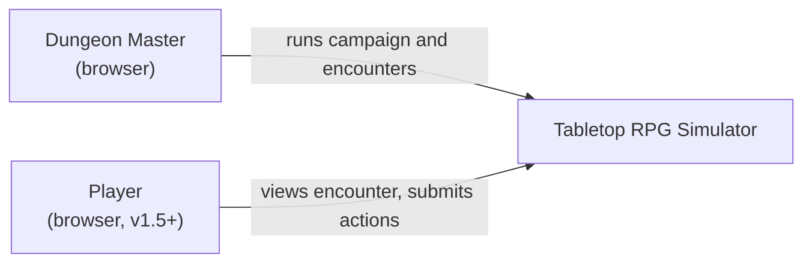
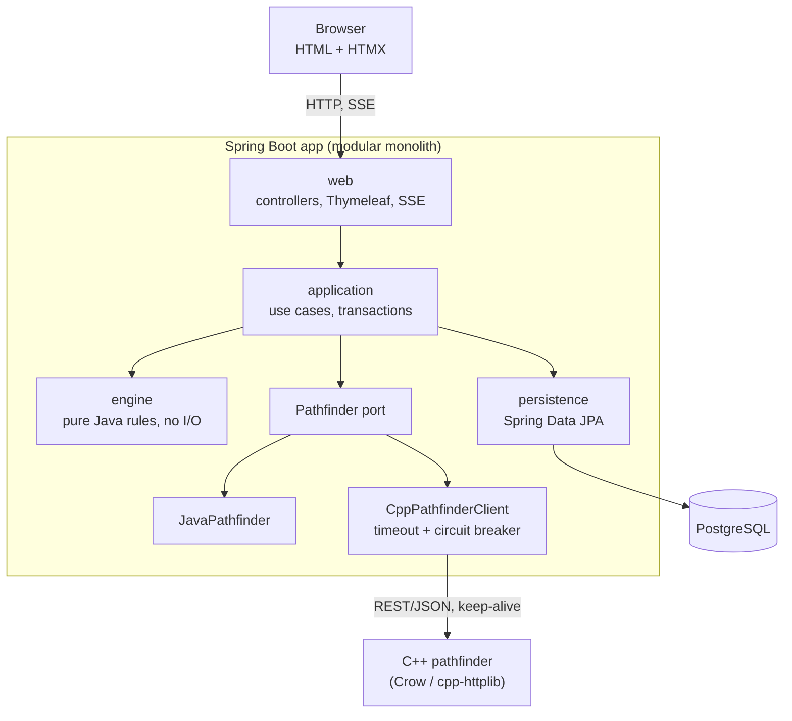
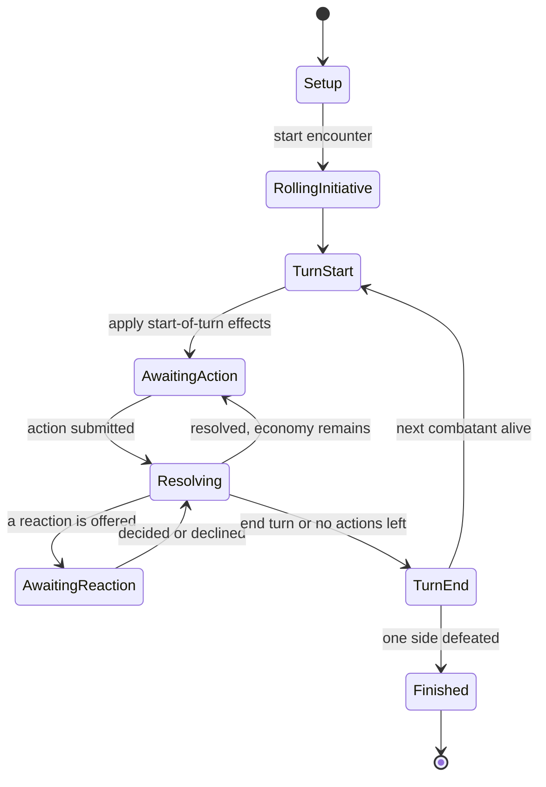
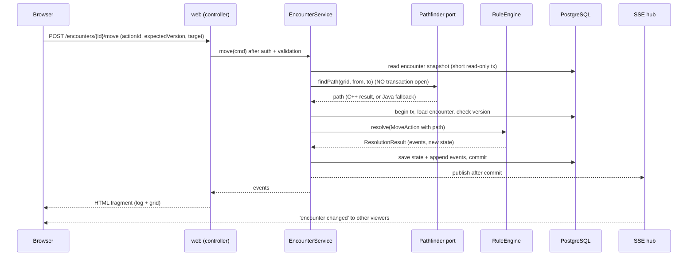
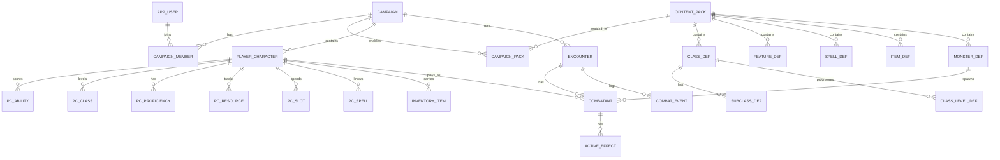
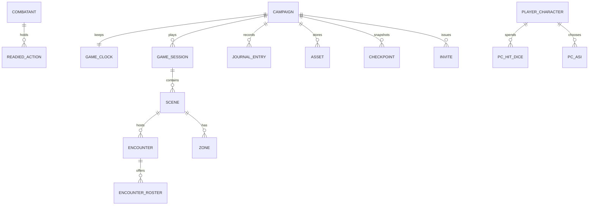
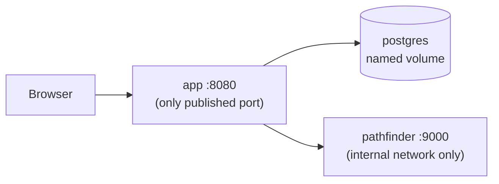

# Tabletop RPG Simulator: Architecture (v5.0)

Oct 16, 2026 · @Samarth

How the system is built and why. Current version **5.0**; the revision history is at the end. Companion documents: Requirements Specification (what it must do), Ruleset Specification (the D&D mechanics), Decision Log and Progress Tracker (decisions and status), AI Build Brief (setup, CI/CD, compose and Dockerfiles, full DDL and the build order), Project Design Guide (plain-language overview). This document holds the design and its reasons; code that the Build Brief already contains (CI workflows, compose file, schema DDL) is not repeated here, so there is one source of truth. Diagrams are written as Mermaid source.

## 0. What changed in v5

- Ability scores are modifiable stats: base plus improvements plus modifiers, clamped to a ceiling and a floor, with a per-ability maximum that caps improvements (DEC-074).
- Two modifier types (stat modifiers and roll bonuses), stacking by source, and a separate proficiency component that `multiply` targets (Ruleset Specification Part A).
- Dice rolls are lists of labeled, signed terms, with the natural d20, reroll once per die, a d20 floor and a crit-doubling flag.
- New section 4.13 consolidates the campaign settings: hit point method, advancement, natural 20 and 1 on checks and saves, clock advance per combat round, ability score generation method, feats, temporary hit points at 0 HP, mid-combat surprise, and join options.
- The game clock advances by a DM-set amount per combat round (default 6 seconds); the rules constant stays 6 seconds per round.
- Maximum HP is derived, so the database constraint on a character's HP only forbids negatives; the engine enforces the upper bound.
- Duplicated code (CI workflow, compose file, full DDL) moved to the AI Build Brief only.
- The document is now a Claude Doc with version numbering and a revision history.

## 1. Goals, constraints and drivers

**Purpose.** A self-hosted, browser-based tool for Dungeon Masters: a character manager plus an encounter runner built on a rules engine that automates the mathematics of tabletop play. It is not a virtual tabletop.

**Hard constraints**

- Runs in the browser. Java enterprise web application. Java + SQL, with C++ allowed only as a separate service.
- Ruleset: D&D SRD 5.1 (2014 rules) under CC-BY-4.0, with attribution. Editions are not mixed.
- Self-hosted, installable with a single `docker compose up`, used on a local network: the DM hosts and players connect to the DM's machine.
- Two-person team, about 2 months. No course rubric; the stack is free apart from Java.

**Design principle.** Keep the implementation simple, and keep a seam where each plausible upgrade would go (section 15).

**Quality attributes, in priority order**

| # | Attribute | Concrete target |
| --- | --- | --- |
| 1 | Correctness and testability | Same seed gives the same combat. Engine has no I/O. Every rule has a worked-example test. |
| 2 | Extensibility | New spell, monster or subclass = data. New feature behavior = one class. New ability set, grid geometry or vision model = a contained change behind a seam. |
| 3 | Buildability | Finishable in about 8 weeks by two students. |
| 4 | Resilience | Pathfinder down means combat still works. Duplicate submits are harmless. A paused game resumes exactly. |
| 5 | Latency | Action resolve p95 under 150 ms excluding pathfinder; under 300 ms including it (targets). |
| 6 | Security | Campaign data visible and mutable only to members; players never receive DM-only data; uploads and imports are untrusted input. |
| 7 | Operability | One command to install, no default secrets, data survives upgrades. |

### Release scope

| Release | Scope |
| --- | --- |
| **v1 (MVP, milestone A)** | DM-driven play for Fighter, Rogue, Paladin, Bard and Wizard at levels 1-5; characters with a multiclass-ready schema; dice; combat with reactions; curated tier-2 spells; an SRD monster subset with per-encounter rosters and artwork upload; square grid with the metric setting and movement; rests; sessions, scenes, game clock and audience in the schema with basic UI; LAN accounts with invites; single-step Docker. |
| **v1.5 (achievable goals)** | Live player view with audience filtering; journal and quests; checkpoints; campaign export and import; JSON content-pack import; custom monsters and homebrew spells; levels 6-12 as data increments. |
| **v2 (stretch goals)** | Vision phases (radius, then SRD light and senses); players submitting actions; homebrew editor UI; Sorcerer and Warlock; multiclass rules and UI; hex geometry. |

Proposed order inside v1.5, so unfinished items cut cleanly: live player view, journal, export/import, checkpoints, pack import, then levels 6-12.

## 2. System context



## 3. Containers and module structure



The engine does not point at the pathfinder port: the application layer fetches the path, then hands a plain value to the engine.

### Package structure (by feature, boundaries enforced)

```
com.yourteam.rpg
├── engine/           // PURE rules. Imports only the JDK. No Spring, JPA or HTTP.
│   ├── kernel/       // Ability, AbilityScores, Stat, Modifier, Resource, SlotPool, GameClock, Audience
│   ├── dice/         // DiceExpression, parser, RandomSource
│   ├── combat/       // Encounter, Combatant, turn state machine, reaction window, zones, readied actions
│   ├── action/       // sealed Action types and their resolvers
│   ├── feature/      // trigger points and built-in feature behaviors
│   ├── spell/        // spell resolution, slots, concentration
│   ├── grid/         // GridGeometry (square now), distance metrics, area shapes, cost maps
│   └── vision/       // VisionModel (full by default), senses, light
├── encounter/        // web / application / persistence for combat sessions
├── campaign/         // campaigns, membership, invites, sessions, scenes, clock (layered CRUD)
├── character/        // characters, creation, level-up, derived sheet
├── content/          // content packs, SRD seed, importer, validation, in-memory definitions
├── asset/            // image upload, validation, re-encoding, storage on the data volume
├── journal/          // journal and quests (v1.5), checkpoints and export/import (v1.5)
├── identity/         // users, login, password hashing
├── pathfinding/      // Pathfinder port, JavaPathfinder, CppPathfinderClient
└── platform/         // error handling, logging/trace filter, config, SSE hub
```

**Rules, enforced by ArchUnit tests in CI** (a failing build, not a code-review hope):

1. `engine` may not import `org.springframework..`, `jakarta.persistence..`, `java.net.http..`.
2. A feature's `web` package may not touch another feature's `persistence`. Cross-feature calls go through the other feature's `application` classes.
3. No cycles between feature packages.
4. Ability scores are read and written only through `AbilityScores` and `Ability`; no other code may touch ability columns or fields directly. This is the seam that keeps custom abilities a later, contained change.
5. Content definitions are immutable once loaded; only the `content` package may build them.

JPA entities live in `persistence` and are **mapped** to engine objects for encounters. For plain CRUD features (campaign, character, identity) entities are used directly in `application`. This keeps the mapper cost only where purity pays.

## 4. Rules engine

The engine is pure Java: no I/O, no framework. Everything it knows about the game is either **kernel** (a small fixed vocabulary) or **content** (data that references the kernel).

### 4.1 Kernel and content

```java
public enum Ability { STR, DEX, CON, INT, WIS, CHA }          // the only place abilities are enumerated

public final class AbilityScores {                             // the only accessor
    public int score(Ability a) { ... }      // base + improvements + ability stat modifiers, clamped to 0..ceiling (default 30)
    public int maxScore(Ability a) { ... }   // 20 by default; some effects raise it together with the score
    public int modifier(Ability a) { return Math.floorDiv(score(a) - 10, 2); }
}
```

| Kernel concept | Meaning |
| --- | --- |
| `Ability`, `AbilityScores` | six fixed abilities behind a single accessor |
| `Stat` | a named computed number: AC, initiative, speed, max HP, attack bonus, save bonus, skill bonus, spell DC |
| `Modifier` | target stat, operation (set, add, multiply, min, max, advantage, disadvantage), value, optional `activeWhen` condition, duration, source |
| `Resource` | key, current, max, recharge (turn, short rest, long rest, dawn, never) |
| `SlotPool` | spell slots by level (and later pact slots) |
| `DiceExpression` | value type, see 4.5 |
| Action economy | action, bonus action, reaction, movement remaining, object interaction |

**Content** (open, replaceable): classes, subclasses, features, spells, items, species, backgrounds, monsters, feats. Content refers to kernel keys such as `"stat:ac"` or `"resource:bardic_inspiration"` and never adds new kernel concepts.

### 4.2 Stats and modifiers

A stat value is computed from a base plus the active modifiers, never stored. Combination order is fixed and documented in the Ruleset Specification: `set` first, then `add`, then `multiply` (rounding fractions down, as the SRD does), then `min`/`max`; advantage and disadvantage are collected separately and cancel. Feats, magic items, spells, conditions and class features are all expressed as bundles of modifiers plus trigger points, which is why a small kernel can carry a large amount of flavor.

Two details from the Ruleset Specification:

1. Skill, save and attack totals have a separate proficiency component, `floor(bonus x multiplier)`, and `multiply` targets that multiplier, never the total.
2. There are two modifier types: stat modifiers (persistent) and roll bonuses (applied when a roll is made, fixed or dice, possibly consumed). The same source never stacks with itself (the most potent applies, then the most recent), while different sources add.

Ability scores are themselves modifiable stats (DEC-074): base plus improvements plus modifiers, clamped to a ceiling (default 30) and a floor of 0, with a per-ability maximum (default 20) that caps improvements.

### 4.3 Pipeline: action, validate, resolve, events (with reactions)

1. **Action** (Command, sealed type): immutable, with an `actionId`.
2. **Validation:** turn order, action economy, range, conditions.
3. **Resolution:** roll through the injected `RandomSource`, run the feature trigger points, apply effects, mutate the `Encounter`.
4. **Result:** either `Completed(events)` or `AwaitingReaction(pending, events)`.
5. **Events:** immutable `CombatEvent` records including every die rolled, so a session can be replayed.

```java
public sealed interface Action
    permits AttackAction, CastSpellAction, MoveAction, EndTurnAction, ReactionDecision {}

public sealed interface ResolutionResult permits Completed, AwaitingReaction {}

// Pure: no I/O. MoveAction carries a path computed earlier; the engine re-validates it.
public interface RuleEngine {
    ResolutionResult resolve(Encounter encounter, Action action, RandomSource rng);
}
```

`resolve` throws a `RuleViolation` (expected, carries a stable code) for anything illegal. A miss or a failed save is a normal result, not an error.

### 4.4 Feature trigger points

Class features and homebrew features do not live in per-class branches. The engine exposes trigger points and runs the active features registered for them.

| Trigger | Example use |
| --- | --- |
| `ON_ATTACK_ROLL` | advantage sources, attack bonuses |
| `ON_DAMAGE_ROLL` | Sneak Attack, smite dice |
| `ON_DAMAGE_TAKEN` | resistance, reaction triggers |
| `ON_SAVE` | save bonuses, advantage on saves |
| `ON_CAST` | spell-slot effects, Metamagic later |
| `ON_MOVE` | opportunity attack triggers |
| `ON_TURN_START`, `ON_TURN_END` | ongoing effects, resource recharge |
| `ON_SHORT_REST`, `ON_LONG_REST` | resource refresh |

A feature definition is data: a trigger, conditions, an effect type with parameters, an optional resource cost and a usage limit. Illustrative shape (not final):

```json
{ "key": "sneak_attack", "ruleset": "srd-5.1", "trigger": "ON_DAMAGE_ROLL",
  "conditions": [ { "weaponProperty": "finesse_or_ranged" }, { "hasAdvantageOrAllyAdjacent": true } ],
  "effect": { "type": "add_damage_dice", "dice": "{sneak_attack_dice}" },
  "limit": "once_per_turn" }
```

The engine ships a catalog of **effect types** implemented in Java (`add_damage_dice`, `grant_advantage`, `grant_resistance`, `add_modifier`, `spend_resource`, `apply_condition`, `heal`, `grant_reaction`, and so on). Data can only combine behaviors the engine already knows. A genuinely new mechanic means adding one effect type in code.

### 4.5 Dice engine

- **Grammar:** a sum of terms: dice groups (`NdX` with optional keep or drop `kh`, `kl`, `dh`, `dl`, reroll and floor modifiers) and fixed integers, each added or subtracted. Examples: `2d20kh1` (advantage), `4d6dl1` (ability scores), `3d8+4`, `d8+3d6+3` (weapon, Sneak Attack, modifier), `d20+3-d4` (Bane).
- **Any die:** X from 2 to 1000, N from 1 to 100, with caps on total dice and expression length. This prevents `999d999` abuse.
- **Fairness:** each die comes from a bounded uniform draw (`nextInt(bound)`), never `random() * X` or modulo, so there is no bias.
- **Injection:** `RandomSource` is an interface. Production uses `SecureRandom`; tests use `SeededRandom(42)`.
- **Result:** a list of labeled, signed terms, each with every face and whether it was kept or dropped, plus the natural d20, the mode and the total, so the log can show `[14, 7] -> 14` and where each number came from. A reroll replaces a die once, a d20 floor applies to each d20 before the kept die is chosen, and each dice term carries a crit-doubling flag.
- **Rule coupling:** only a few rules depend on a particular die. The critical-hit threshold on the d20 is a rule parameter, not a hard-coded 20.
- **Bonus:** exact outcome distributions can be computed for previews, because every die is a uniform integer.

### 4.6 Where the patterns show up

| Concern | Pattern |
| --- | --- |
| Actions | Command with sealed types and exhaustive `switch` |
| Features and spells | Strategy (effect types) plus trigger-point registry |
| Conditions | state plus modifiers |
| Stats | computed from base plus modifier stack |
| Monster and character creation | Factory from definitions |
| Dice | value object with a parser |

### 4.7 Combat state machine, with the reaction window



`AwaitingReaction` is persisted state (section 5.4), so a restart in the middle of a reaction loses nothing.

### 4.8 Content, packs and homebrew

- **Content packs.** Every definition belongs to a pack and carries `pack`, `ruleset`, `source`, `license` and `attribution`. The SRD 5.1 pack is seeded at first start. A campaign enables the packs it wants.
- **Loading.** Definitions load once at startup into immutable in-memory maps. They change only through migrations or pack imports, and a restart (or an explicit reload) is the invalidation.
- **Homebrew.** Declarative: users assemble features from the trigger and effect-type catalog. No user code ever runs. Guardrails: schema validation, numeric caps, campaign scope, DM approval, a visible 'user-created' label.
- **Importer.** Packs import as JSON validated against a published schema, with size and depth limits. Invalid input is rejected whole with `CONTENT_INVALID`.
- **Extensible lists.** Damage types and conditions are registries with SRD defaults. Engine-known conditions carry built-in mechanics; custom conditions are bundles of modifiers.
- **Upgrade path.** The SRD classes themselves are expressed through the same mechanism, so homebrew needs no special path. The homebrew editor UI is post-MVP; the data model and trigger points exist from day one.

### 4.9 Spell automation tiers

| Tier | Behavior | Scope |
| --- | --- | --- |
| 0 | Reference text only; DM adjudicates | all SRD spells of levels 0-6 |
| 1 | Verifies and spends the slot, rolls the dice, logs the result | most damage and healing spells |
| 2 | Full effect resolution: saves, area targeting, conditions, concentration | a curated set chosen in the Ruleset Specification |

New spells move up a tier as time allows; nothing in the engine changes when they do.

### 4.10 Sessions, scenes, game clock and audience

- **Hierarchy:** Campaign, then Session (one real-world play night), then Scene (a place and time, with a map, ambient light and participants), then Encounter (combat inside a scene). Exploration and social scenes need no encounter.
- **`GameClock`:** the campaign's in-game time, stored in seconds. It advances only when the DM advances it, a rest is taken, or travel is resolved, never with real time. In combat each completed round advances it by a DM-set amount (default 6 seconds). The rules constant of 6 seconds per round (10 rounds per minute) does not change; durations given in rounds count rounds, while time-based durations count on the clock. A scene's default light derives from the time of day, and the DM can override it.
- **`Audience`:** `DM_ONLY`, `ALL`, or a set of players. Every combat event, journal entry, note, handout and chat message carries one. A secret roll is a roll with `DM_ONLY`. Player-facing responses are built by filtering on audience on the server.
- **Duration kinds** on modifiers and effects: rounds (with start or end of a named turn), until end of turn, game time, until a short or long rest, or permanent.
- **`Zone`:** a persistent area effect on the map (shape, origin, source, duration, and the trigger points that fire when a creature enters or starts its turn inside).
- **`ReadiedAction`:** the trigger, the held action or spell (with concentration), and the owner.

### 4.11 Vision (the seam now, the feature in v2)

Kernel pieces, present from v1:

- **Sense stats** in feet: `sense:sight`, `sense:darkvision`, `sense:blindsight`, `sense:truesight`. A species trait or a blessing is a modifier on these.
- **Scene light:** ambient level (bright, dim, dark), with light sources (position, bright radius, dim radius) later.
- **Cell attributes:** `blocksSight` alongside blocks-movement, difficult terrain and cover.
- **Modifier extensions:** `multiply` and `activeWhen`, so 'night lowers sight' and 'a far-sight blessing doubles it' are data.

```java
public interface VisionModel {
    Visibility visibleCells(Viewer viewer, Scene scene, GridMap map);   // pure
}
// FullVision (default): everyone sees the whole map.
// RadiusVision: a per-viewer range with line of sight.     (v2)
// SrdVision: light levels plus darkvision and similar senses. (v2)
```

Server-side rule: the server computes each player's visible set and sends only that. Hiding cells in the browser would still leak them. Phases: DM-revealed areas, then radius vision with line of sight, then SRD light and senses with remembered cells.

### 4.12 Homebrew spells and monsters

Homebrew spells and monsters use the same schemas and validation as built-in ones. Numeric caps (for example maximum damage dice per spell level) are derived from the SRD's own spells at the same level, and the DM approves each item. New monsters are stat blocks expressed with the same feature and effect system, so a custom monster needs no new engine code unless it introduces a new effect type.

### 4.13 Campaign settings

Settings live on the campaign (a validated JSON document) and are part of the saved state, so a game resumes under the same rules.

| Setting | Default | Notes |
| --- | --- | --- |
| Distance metric | equal-cost diagonals | also true diagonal and alternating 5-10-5 |
| Diagonal moves past blocked corners | disallowed |  |
| Vision model | full | radius and SRD models in v2 |
| Group initiative for identical monsters | off |  |
| Hit point method | player chooses per level | or the DM forces fixed average or rolled |
| Advancement | milestone | XP option planned for v1.5; XP and thresholds stay in the data |
| Natural 20 and 1 on checks and saves | off | the DM can enable it for checks, saves or both |
| Game clock advance per combat round | 6 seconds | 0 for manual only; the rules constant of 6 seconds per round does not change |
| Ability score generation method | DM selects from the built-in list | DM-created methods in v2 |
| Feats enabled | on |  |
| Damage absorbed by temporary hit points at 0 HP | counts as damage taken (death save failure) | house rule available: no failure when fully absorbed |
| Mid-combat surprise | off | optional house rule: combatants caught off guard by an arrival |
| Join options for a combatant entering a running fight | normal roll, at its initiative | DM chooses roll mode, timing, starting conditions and first-turn restriction per join |

Hit point rule: when a maximum rises, current hit points rise by the same amount; when it falls below current hit points, current becomes the new maximum; when a temporary increase ends only the clamp applies; a creature at 0 hit points is not raised.

## 5. Request lifecycle, state and failure handling

### 5.1 One action, end to end (a move, the most complex case)



Rules of this lifecycle:

- **One action = one short write transaction.** No HTTP calls, no SSE pushes, no pathfinding inside it.
- **Never trust a path**, even our own. `resolve` re-validates it against the grid and remaining movement.
- **After-commit publishing** via `@TransactionalEventListener(phase = AFTER_COMMIT)`.

### 5.2 Idempotency and concurrency

- Every mutating request carries `actionId` (client-generated UUID, rendered into the form) and `expectedVersion`.
- `combat_event` has `UNIQUE (encounter_id, action_id)`. A replay of the same `actionId` returns the stored result instead of acting twice.
- A mismatched `expectedVersion` returns `ENCOUNTER_VERSION_CONFLICT`. The UI shows 'State changed, refreshed' and reloads the fragment.
- `Encounter` also has a JPA `@Version` column as the last line of defense against races.

### 5.3 Failure behavior

| Failure | Behavior |
| --- | --- |
| C++ service down or slow | Timeout/circuit opens, Java fallback computes the path, metric `pathfinder.fallback` increments. User sees nothing. |
| DB unavailable | Readiness goes down, requests return `SERVICE_UNAVAILABLE`, logged at ERROR. |
| Illegal action (not your turn, out of range) | `RuleViolation` becomes HTTP 422 with a stable code. Not logged at ERROR. |
| Stale tab or duplicate submit | 409 with `ENCOUNTER_VERSION_CONFLICT`. |
| SSE connection drops | Browser auto-reconnects and refetches the current fragment. No state is lost, because state is in the DB. |
| App restart mid-session | Nothing lost except live SSE connections and login sessions (use Spring Session JDBC if relogin is annoying). |

### 5.4 Reaction flow

1. An action (for example a move that leaves an enemy's reach) reaches a trigger point that offers a reaction.
2. The engine returns `AwaitingReaction(pending, events)`. The application layer persists the pending reaction on the encounter and bumps its version, inside the same short write transaction.
3. The response shows the prompt to whoever controls the reactor (the DM in v1; the player in v2).
4. The next request carries a `ReactionDecision` (use or decline). The engine resumes the original action, which then completes or is cancelled.
5. While a reaction is pending, other actions are rejected with `REACTION_PENDING`. A DM can cancel a pending reaction, which counts as declined and is logged.

Because the pending state is in the database, the flow survives restarts and works unchanged when players start deciding for themselves. Reactions triggered by reactions queue in order; the maximum depth is defined in the Ruleset Specification.

### 5.5 Save, pause and resume

The server is stateless and every action is one transaction, so state is **autosaved continuously**. Pausing a game is simply stopping. On top of that there are four layers:

| Layer | What it does | Release |
| --- | --- | --- |
| Autosave | Every resolved action is persisted before it is acknowledged. | v1 |
| Session pause and resume | A session is `ACTIVE`, `PAUSED` or `ENDED`. Resuming shows a recap: current scene, whose turn it is, party HP and resources, and the last events. | v1 (basic recap from the event log) |
| Checkpoints | Full serialized snapshots taken before each encounter, at session end, and on demand; the last N are kept. Restore replaces current state atomically and is logged. | v1.5 |
| Export and import | One file with the state, homebrew packs, assets and a manifest. It doubles as backup and as a way to move between instances. | v1.5 |

**What the state must contain to resume exactly**

| Group | Contents |
| --- | --- |
| Versions | state schema version; app and engine version; ruleset; enabled content packs with versions or hashes |
| World | game clock; current scene with map cells, light and ambient level; explored cells per player; trap and secret states; shared handouts; journal and quests |
| Settings | the campaign settings in section 4.13; without them the engine behaves differently on resume |
| Characters | everything stored on the character, including long-duration effects with remaining game time, and concentration |
| Mid-encounter | round number; initiative order and whose turn it is; per-combatant position, remaining action economy, reaction used, conditions with remaining duration and source; readied actions; zones; summoned creatures; the pending reaction |
| History | the append-only event log with dice results and audience |
| Access | members, roles, character ownership, invite status |

**Not saved:** derived values (AC, modifiers), UI state, login sessions, and the random seed (dice results are already in the log).

**Rules**

- **Pausing does not tick game time.** Only the DM, rests and travel advance the clock.
- **Pin content versions.** An active encounter keeps the definition versions it started with (or a snapshot of the definitions it uses), so a pack update cannot change a spell mid-fight.
- **Checkpoint format:** JSON with a `schemaVersion`, covering the campaign aggregate (not derived data). Restore runs in one transaction, bumps versions, and tells connected viewers to refetch.
- **Export layout:** `manifest.json` (app and schema version, ruleset, pack ids and hashes), `state.json`, `packs/` for homebrew, `assets/` for images. Import validates schema, sizes and versions, and regenerates IDs. Imports are untrusted input (section 10).
- **Journal (v1.5)** supplies the recap on resume: DM-written entries and quests, plus notable events captured automatically (deaths, level-ups, scene changes, session start and end).

## 6. Data model and constraints

Principle: **store choices and current state; derive numbers.** A character stores its base ability scores, class levels and chosen options. Modifiers, AC, proficiency bonus, save DCs and attack bonuses are computed. The full DDL lives in the AI Build Brief (section 7); this section holds the model and the reasons.



**Stored versus derived** (the official character sheet is used only as a field checklist, not for its layout)

| Sheet area | Stored | Derived |
| --- | --- | --- |
| Identity | name, owner, species, background, alignment, XP, class levels, subclass | proficiency bonus |
| Abilities | six base scores (`pc_ability`), ability-score choices by level | modifiers, save bonuses |
| Proficiencies | skills, saves, tools, weapons, armor, languages with a source; expertise flags | skill totals, passive Perception |
| Combat | HP gained per level, current and temp HP, hit dice spent, death saves, conditions, exhaustion | AC, initiative, speed, max HP, attack bonuses |
| Features | subclass choice, feats | the feature list (granted by class level and subclass data) |
| Resources | uses spent per feature (`pc_resource`) | maximum uses |
| Spellcasting | known and prepared spells, spellbook, slots spent (`pc_slot`) | save DC, spell attack, slots per level |
| Equipment | item, quantity, equipped, attunement, currency | weight, attack lines |

**Design notes**

- **Character state lives on the character.** HP, slots and resources are not copied into encounters. A combatant for a player character references the character and holds only encounter state (initiative, position, reaction used, concentration, active effects). Monster combatants hold their own HP. This removes a classic copy-in/copy-out bug source.
- **Abilities are rows, not columns** (`pc_ability(player_character_id, ability, score)`). The six values are enforced by a `CHECK`, and relaxing it later is one migration. This is the database half of the `Ability` seam.
- **Content definitions** are validated JSON documents (`definition` JSONB) with relational columns for the fields used in filtering: `pack_id`, `key`, `ruleset`, `name`, `license`. Content shapes vary too much for a table per feature type, and the importer validates against a schema anyway.
- Reserved words: use `app_user` and `player_character`, not `user` and `character`.
- The event log is append-only, cursor-paginated by `seq`, and stores dice results so replay is possible. Undo is a stretch goal that needs snapshots or replay.

**Invariants enforced by the schema** (DDL in the AI Build Brief, section 7)

| Table | Constraints |
| --- | --- |
| `player_character` | current and temporary HP are not negative; the upper bound is enforced by the engine because maximum HP is derived |
| `pc_ability` | one score per ability; score 1 to 30; ability is one of the six |
| `pc_class` | one row per class; level 1 to 20 |
| `pc_slot` | slot level 1 to 9; used is not negative |
| `pc_hit_dice` | one row per die size; die is 6, 8, 10 or 12; spent is not negative |
| `pc_asi` | one improvement record per class and class level |
| `combatant` | one initiative slot per encounter; monster HP within 0 and its maximum when set |
| `campaign_member` | one membership per user per campaign; role is DM or PLAYER |
| `combat_event` | one row per (encounter, action id); one per (encounter, seq); audience is DM, ALL or PLAYERS |
| `game_clock` | one clock per campaign; seconds not negative |
| `game_session` | status ACTIVE, PAUSED or ENDED; at most one open (active or paused) session per campaign |
| `scene` | ambient light is BRIGHT, DIM or DARK |
| `asset` | size at most 5 MB; kind is MONSTER, CHARACTER, SCENE or HANDOUT |

**Query discipline:** `spring.jpa.open-in-view=false`; one explicit fetch graph for an encounter with its combatants and effects; projections for list pages; indexes on every foreign key and on `combat_event (encounter_id, seq)`; a small connection pool (about 10).

**Migration rules:** Flyway owns the schema. Never edit an applied migration. Prefer additive changes (add, backfill, switch the code, drop later) so rolling back the app image never meets an unreadable schema.

### 6.1 World, session and support tables



- **Multiclass-ready, single-class today:** `pc_class` already has one row per class. Hit dice are tracked per die size (`pc_hit_dice`), ability score improvements are recorded by class and class level (`pc_asi`), the subclass lives on the class row, and spell slots remain derived (from the combined caster level) while only the used counts are stored.
- **Maps:** a scene stores its map as compact arrays (width, height, per-cell flags for blocks-movement, blocks-sight, difficult, cover), not one row per cell.
- **Audience:** every event, journal entry and message has an `audience` (`DM`, `ALL`, `PLAYERS`) plus a player set for the last case.
- **Assets:** images live on the data volume under their content hash; the table stores metadata only.
- **Encounter roster:** the DM's chosen set of monsters for an encounter, drawn from enabled packs and custom monsters.

## 7. Grid, geometry and pathfinding

### 7.1 Grid model

A **square grid with 5 ft cells and 8 neighbors** is the default (the SRD describes space in feet and implies eight creatures around another). Each cell has attributes: `blocksMove`, `blocksSight`, `difficult`, and a cover level. Creature footprints follow size (Medium 1x1, Large 2x2, and so on; Tiny occupies a whole cell in version 1).

### 7.2 Distance metric (a setting)

| Metric | Straight step | Diagonal step | Notes |
| --- | --- | --- | --- |
| `EQUAL_COST` (default) | 100 | 100 | familiar to most players |
| `TRUE_DIAGONAL` | 100 | 141 | the square's actual diagonal length |
| `ALTERNATING` | 100 | 100 then 200 alternately | the 5-10-5 variant; path cost depends on parity, so the search tracks it as part of its state |

- **Scaled integers:** costs are integers (100 units per 5 ft) so budgets are deterministic. A speed of 30 ft is 600 units; under `TRUE_DIAGONAL`, four diagonal steps (564) fit and five (705) do not. Fractions round down, as in the SRD.
- **Reach and adjacency are separate from distance.** A 5 ft melee reach covers all 8 neighbors under every metric. Reach 10 ft is two steps (Chebyshev). Movement cost, ranges and area radii use the chosen metric.
- **Corner cutting:** a diagonal step past a blocked corner is disallowed by default and is a setting.

### 7.3 The engine prepares a per-mover cost map

The SRD's movement rules depend on who is moving, so the engine (not the pathfinder) builds the cost map for each mover:

- difficult terrain costs double; another creature's space counts as difficult terrain;
- a hostile creature's space is blocked unless the size difference is at least two steps; non-hostile spaces can be passed through but not stopped in (`noStop`);
- walls and other obstacles are blocked; prone crawling, squeezing and standing up add engine-side adjustments before the map is built, and overlapping extra costs add (one extra foot each per foot).

The pathfinder then stays generic: it searches a weighted grid and knows nothing about D&D.

### 7.4 Pathfinder contract (v1 API)

Endpoints: `POST /v1/path` (A\*), `POST /v1/reach` (all cells within a budget), later `/v1/los` and, for the vision feature, `/v1/vision`. The service is stateless.

```json
{ "geometry": "square", "metric": "equal_cost", "corners": "forbid_if_blocked",
  "rows": ["....#...", "..~.#...", "........"],
  "noStop": [[3, 1]],
  "start": [0, 0], "goal": [7, 2], "budget": 600 }
```

```json
{ "found": true, "path": [[0,0],[1,1],[2,2]], "cost": 200 }
```

Cell characters: `#` blocked, `.` normal (100), `~` difficult (200). The `geometry` field is the extension point for other grids.

**Limits enforced in C++** (a bad request must not hang or crash it): body at most 1 MB, grid at most 200x200, node-expansion cap, per-request deadline of 200 ms, strict JSON validation with bounds checks.

### 7.5 Java client policy

| Setting | Value | Reason |
| --- | --- | --- |
| HTTP client | one shared `HttpClient`, keep-alive | avoids a TCP handshake per click |
| Connect timeout | 100 ms | local network, fail fast |
| Read timeout | 250 ms | interactive budget |
| Circuit breaker | Resilience4j, opens after repeated failures, half-opens after a cool-down | stops hammering a dead service |
| Retry | none | the Java fallback is the retry |
| Fallback | `JavaPathfinder` | always available |

`pathfinder.mode = java | cpp | auto` (default `auto`). A benchmark (Java in-process versus C++ over HTTP at 30x20, 100x100 and 500x500) goes in the report and runs nightly in CI. At tabletop sizes expect the round trip to dominate; report the numbers either way.

### 7.6 Geometry responsibilities and the `GridGeometry` seam

```java
public interface GridGeometry {
    List<Cell> neighbors(Cell c);
    int stepCost(Cell from, Cell to, DistanceMetric metric);
    int distance(Cell a, Cell b, DistanceMetric metric);
    Set<Cell> areaCells(AreaShape shape, Cell origin, Facing facing);
    boolean lineOfSight(Cell a, Cell b, GridMap map);
    Set<Cell> footprint(Cell anchor, Size size);
}
// SquareGeometry now. HexGeometry later, with its own area and footprint conventions.
```

- **Pure engine (`engine.grid`):** distance, adjacency, area shapes (sphere, cube, cone, line, cylinder) for spells and auras, and footprints. These are cheap and keep the engine testable.
- **Pathfinder (C++ with Java fallback):** path, reach and later line of sight and vision, the calls where a separate service might pay off on large grids.
- Aura-style features ask the engine for 'combatants within N feet of X', using the engine's own distance function with no network call.

## 8. Web layer

- **Thymeleaf + HTMX**, self-hosted `htmx.js` (no CDN, so a strict CSP is possible). Controllers return **fragments** (combat log, grid, HP bars), not full pages, for interactive actions.
- **Grid** is a CSS grid of cells or one inline SVG. Movement highlights come from `/v1/reach`.
- **Live updates (v1.5):** SSE. The server pushes 'encounter changed' with the new version; viewers refetch the fragment. The SSE hub lives in `platform` and is behind an `EncounterNotifier` interface so a different transport can replace it later.
- **Known limit:** the SSE hub is in-memory, so this works for one app instance. Scaling out would need Postgres `LISTEN/NOTIFY` or Redis pub/sub (section 15).

## 9. Error contract

Every failure is either the **caller's fault** (4xx, no ERROR log, no alert) or the **system's** (5xx, ERROR log with trace ID). One `@ControllerAdvice` maps them.

| Code | HTTP | Kind | Meaning |
| --- | --- | --- | --- |
| `NOT_YOUR_TURN` | 422 | caller | acting out of initiative order |
| `NO_ACTIONS_LEFT` | 422 | caller | action economy exhausted |
| `TARGET_OUT_OF_RANGE` | 422 | caller | invalid target |
| `INVALID_PATH` | 422 | caller | path blocked or too costly for remaining movement |
| `REACTION_PENDING` | 409 | caller | another action was submitted while a reaction decision is pending |
| `REACTION_NOT_AVAILABLE` | 422 | caller | the combatant cannot use that reaction now |
| `CONTENT_INVALID` | 422 | caller | an imported pack or homebrew feature failed schema or cap validation |
| `PACK_NOT_ENABLED` | 422 | caller | content from a pack that the campaign has not enabled |
| `SESSION_NOT_ACTIVE` | 409 | caller | an action was submitted while the session is paused or ended |
| `ASSET_INVALID` | 422 | caller | an uploaded image failed type, size or content validation |
| `INVITE_INVALID` | 403 | caller | an invite code is unknown, expired or used up |
| `ENCOUNTER_VERSION_CONFLICT` | 409 | caller | stale tab or duplicate submit |
| `VALIDATION_FAILED` | 400 | caller | malformed input, with field details |
| `NOT_FOUND` | 404 | caller | also returned for resources in other campaigns (no enumeration) |
| `SERVICE_UNAVAILABLE` | 503 | system | DB or critical dependency down |
| `INTERNAL_ERROR` | 500 | system | bug; generic message to the user, full detail in logs |

Rules: catch only what you have a plan for; every catch either logs structured context or rethrows with the cause preserved; validation happens at the boundary (bean validation on form DTOs), not scattered in business code. HTMX requests get an error fragment plus the correct status; JSON clients get `application/problem+json` with the stable `code`.

## 10. Security

**Core**

- **Deny by default:** all routes require authentication except login, register and static assets.
- **Roles are per campaign** (`campaign_member.role`), not global.
- **Authorization at the data layer.** Repository queries take the principal and filter by membership, so changing an ID in the URL cannot expose another campaign (IDOR). Foreign IDs return `NOT_FOUND`, not 403. Write negative tests for this.
- **Form DTOs, not entities,** for input (no mass assignment of `role`, `hp`, `campaign_id`).
- **SSE subscribe** re-checks campaign membership.
- **Passwords:** BCrypt (or Argon2). **CSRF** enabled; HTMX sends the token via header. **Cookies:** `HttpOnly`, `SameSite=Lax`, `Secure` controlled by a setting. **Headers:** CSP without inline scripts, `X-Content-Type-Options`, `Referrer-Policy`, HSTS when served over HTTPS.
- **Rate limits** on login and on pack import.
- **Secrets only via environment or secret store.** Never in the repo or logs; passwords and tokens redacted at the logger.
- The **pathfinder is on an internal network only** and has the input limits from section 7.
- Dependency and image scanning run in CI (section 13).

**Content, homebrew and player views**

- **Imported and homebrew content is data only.** Validate against the schema, cap file size (for example 5 MB), nesting depth and record counts, and never fetch URLs referenced inside a pack (no SSRF). No expression or script in a pack is ever executed; effects are chosen from the engine's effect-type catalog.
- **Escape on output.** Descriptions from packs are rendered escaped; if Markdown is allowed, sanitize the resulting HTML.
- **Separate view models for DMs and players.** Player-facing responses are built from dedicated DTOs that omit DM-only data (monster HP values, hidden stats, DM notes) and show health descriptors instead. Hiding fields in the template is not enough, because the data would still be sent.
- **Licence metadata is informational.** It never influences authorization.
- **Audience is enforced server-side.** Events, notes, handouts and rolls are filtered by audience before they leave the server, for both normal responses and SSE.

**LAN play, invites and uploads**

- **Local network, plain HTTP.** Players connect to the DM's host over the LAN. Cookies are not `Secure` by default, so the project documents that the stack must not be port-forwarded to the internet without a reverse proxy providing HTTPS.
- **Invite-only registration.** The first account becomes the instance administrator (typically the DM). Every later account needs a DM-issued invite code that is single-use or limited, expires, is stored hashed, and is rate-limited against guessing.
- **Join screen.** It shows the address players should open, derived from the DM's own browser URL, with a warning when that URL is `localhost` (players cannot use it), and the invite code.
- **Uploaded images are untrusted.** Check the declared and sniffed type (PNG, JPEG, WebP), cap the size (5 MB) and dimensions, decode and re-encode to strip metadata and any embedded payload, name files by content hash, store them outside the web root, and serve them through an authenticated endpoint with `X-Content-Type-Options: nosniff`.
- **Exports and checkpoints** are sensitive (they contain every campaign secret); only the DM can create, download or restore them.

## 11. Observability

- **Logs:** JSON to stdout, each line with `trace_id`, `campaign_id`, `encounter_id` where relevant, and an `event` name in past tense (`action.resolved`, `pathfinder.fallback`). No passwords, tokens or full emails.
- **Trace ID:** a servlet filter reads `X-Request-Id`/`traceparent` or generates one, puts it in the logging MDC, and **forwards it to the C++ service**, which logs it too. One ID follows a click everywhere.
- **Metrics (Micrometer):** request rate, errors and duration per route (RED); action-resolve duration histogram; `pathfinder.call.duration`, `pathfinder.fallback`, circuit-breaker state; DB pool usage.
- **Health:** liveness is trivial. **Readiness checks the DB.** The pathfinder is reported but **does not fail readiness**, because the fallback means the app is still healthy when it is down.
- **Alerts** (once deployed): readiness failing, 5xx rate up, circuit breaker open for a long time.

## 12. Testing strategy

| Layer | Approach | Runs in CI |
| --- | --- | --- |
| Engine rules | Plain JUnit 5, seeded RNG, no Spring. One assertion per rule branch (crit, miss, 0 HP, conditions, initiative ties). | every push |
| Architecture | ArchUnit rules from section 3 | every push |
| Persistence | `@DataJpaTest` against **real PostgreSQL via Testcontainers** (never H2), including constraint violations and the fetch graph query count | PR |
| Web and security | `MockMvc`: unauthenticated access, cross-campaign access denied, CSRF, duplicate `actionId`, version conflict | PR |
| Pathfinder contract | The same cases run against `JavaPathfinder` and the C++ container; both must agree on path cost and validity | PR |
| C++ | Unit tests built with AddressSanitizer + UBSan | every push |
| Smoke | After deploy: readiness check plus one scripted flow (create campaign, start encounter, one attack) | deploy |
| Bug fixes | A failing regression test first, then the fix | always |

Deliberately not tested: getters, framework plumbing, trivial delegation. Track 'bugs that escaped' rather than a coverage percentage.

**Ruleset and content**

- **Conformance tests from the Ruleset Specification.** Every rule has at least one worked example (inputs, forced dice, expected outcome). These are named assertions about outcomes, not raw snapshots of log output.
- **Pack validation test:** load the SRD pack in CI, validate every definition against the schema, and run each tier-2 spell through a scripted scenario.
- **Dice tests:** property tests (range, keep/drop correctness, limits and rejection of malformed expressions) plus a seeded statistical check on uniformity.
- **Architecture tests:** engine purity, and no ability access outside `AbilityScores`.
- **Reaction tests:** pending reactions survive a simulated restart; a decision resumes the original action exactly once.

**Geometry, save/resume, audience and uploads**

- **Metric tests:** each distance metric against worked examples (including the 30 ft, 4-versus-5 diagonal case under `TRUE_DIAGONAL`), reach under every metric, corner cutting, and the alternating-parity search.
- **Cost-map tests:** difficult terrain, occupied spaces, passing allies and hostile size differences produce the expected costs and `noStop` cells.
- **Save/resume round trip:** pause mid-encounter (including a pending reaction, readied action and active zone), restart the app, resume, and assert the state and next legal actions are identical. The same for checkpoint restore and export/import.
- **Content pinning:** a pack update does not change an active encounter.
- **Audience tests:** DM-only data never appears in player responses or SSE events, including secret rolls and the DM/player view models.
- **Upload tests:** wrong types, oversize files, polyglot files and metadata are rejected or stripped.
- **Clock tests:** pausing does not advance game time; durations measured in game time expire only when the clock advances.

## 13. CI/CD

**Principles:** the main branch is always deployable; branches live at most a few days; **build once, promote the same image** through environments; every change is verified automatically before a human looks at it; rollback is 'deploy the previous image tag'. The workflow files themselves (`ci.yml`, `release.yml`, `dependabot.yml`) are in the AI Build Brief, section 10.

### 13.1 Repository layout (monorepo)

```
/app                Spring Boot service (Maven wrapper checked in)
/pathfinder         C++ service (CMake) with its own tests and Dockerfile
/deploy             docker-compose.yml, compose overrides, .env.example, scripts
/docs               architecture, ADRs, benchmark results
/.github/workflows  ci.yml, release.yml
```

A monorepo keeps the contract tests and the compose file next to both services. Path filters let C++-only changes skip the Java jobs and vice versa.

### 13.2 Branching and review

- Short-lived feature branches off `main`, squash-merged by pull request. A teammate reviews each PR.
- **Branch protection:** required status checks must be green; no direct pushes to `main`.
- Conventional Commit messages (`feat:`, `fix:`) keep the history readable and allow an automatic changelog later.
- **Unfinished work merges behind a feature flag** (for example `features.player-live-view=false`), so v1.5 and v2 can land on `main` early without being released. This is the main mechanism for leaving room for future improvements.

### 13.3 Pipeline stages

| Stage | Trigger | Budget | Jobs |
| --- | --- | --- | --- |
| 1. Fast | every push | about 3 min | Java compile, unit tests (engine, ArchUnit), formatter/linter; C++ build and tests with sanitizers |
| 2. Verify | pull request | under 10 min | Testcontainers integration tests, MockMvc security tests, Flyway migrate on a fresh database, pathfinder contract tests, secret scan, dependency scan, Docker image build for both services, image vulnerability scan |
| 3. Publish | merge to `main` | few min | Tag images with the git SHA, push to the container registry, run the compose smoke test in CI (the staging equivalent) |
| 4. Release | version tag | few min | Build multi-architecture images, publish them with a GitHub Release carrying the compose bundle; rollback by starting the previous tag |
| 5. Nightly | schedule | any | Pathfinder benchmark (results stored as an artifact), full dependency audit |

Dependabot (or Renovate) opens weekly updates for Maven, Docker base images and GitHub Actions.

### 13.4 Containers and configuration

- **Multi-stage Dockerfiles.** Java: build with Maven, run on a slim JRE image as a non-root user. C++: build in a full toolchain image, copy only the binary into a minimal runtime image, non-root.
- **Twelve-factor config:** all settings come from environment variables (`SPRING_DATASOURCE_URL`, `PATHFINDER_URL`, `PATHFINDER_MODE`, feature flags). `deploy/.env.example` is committed; real `.env` files and secrets never are. Secrets live in the CI secret store.
- **Dev/prod parity:** developers run the same PostgreSQL via `docker compose up`; no H2 in dev or tests.
- **Logs to stdout** only; the platform collects them.
- **Disposability:** fast startup, `server.shutdown=graceful`, SSE connections closed on shutdown, so a deploy or restart is routine.

### 13.5 Distribution and environments

The product is a self-hosted stack, so 'production' is the user's own machine. The pipeline therefore publishes artifacts and proves they install, instead of deploying to servers.

- **Publish:** on merge to `main`, CI builds both images, tags them with the git SHA, and pushes them to a container registry. A version tag (`v1.0.0`) additionally produces a GitHub Release carrying `docker-compose.yml` and `.env.example`.
- **Install paths:** (a) prebuilt: `docker compose up` pulls the pinned images; (b) from source: a compose override builds the images locally.
- **Multi-architecture:** images are built for amd64 and arm64 with `buildx` (the C++ image included), so the stack runs on Apple Silicon and small ARM hosts.
- **Pinned tags:** the compose file references an explicit `RPG_VERSION`, never `latest`.
- **Staging is the CI runner:** the compose stack comes up inside CI and the smoke test runs (readiness check plus one scripted flow). This tests exactly what a user will do.
- **Upgrade:** pull the new tag and `docker compose up -d`; Flyway migrates on start. Documentation tells users to back up the volumes first.
- **Rollback:** start the previous tag. Additive migrations (13.6) make that safe.
- **Optional demo hosting:** a single cheap VM or a container platform can run the same compose file for the course demo.

### 13.6 Database migrations in CD

- Flyway runs at app startup and in CI against a fresh database.
- Migrations must be **backward compatible with the previous app version** (additive first), so a rollback of the app image never meets a schema it cannot read.
- A destructive change (drop column) ships one release after the code stops using it.

### 13.7 What to measure

Track informally, for the report: deployment frequency, lead time (commit to a passing compose smoke test), change failure rate, time to restore. First-build and start-up time are tracked in the Decision Log (performance notes). Moving from 'demo on the last day' to 'deployable every week' is a result worth showing.

## 14. Deployment view



Three services in Docker Compose. The same images run everywhere; only environment variables differ. The compose file, Dockerfiles and environment setup are in the AI Build Brief (section 9).

**What a single-step install requires**

- **Zero-config first run:** migrations and the SRD seed run automatically. There is no default admin account: the first registered user becomes the instance administrator.
- **No default secrets:** an init script generates a `.env` with a random database password; compose refuses to start without it.
- **Cookies and HTTPS:** `APP_COOKIE_SECURE` defaults to false so login works on `http://localhost`. People who expose the app publicly put a reverse proxy (for example Caddy) in front and set it to true; forwarded headers are honored.
- **Health checks:** the app waits for a healthy database. The pathfinder binary supports a `--healthcheck` flag so the image needs no `curl`.
- **Only port 8080 is published.** The database and pathfinder stay on the internal network.
- **Data:** the named volumes (`pgdata` and `assets`) survive restarts and upgrades; documentation covers backup and restore.
- **Single instance is the supported topology** (ADR-18). It is why the in-memory SSE hub and in-memory sessions are acceptable.
- **Without the C++ container:** set `PATHFINDER_MODE=java`; nothing else changes.

**LAN notes**

- Publishing `8080:8080` exposes the app on all interfaces so players on the local network can reach the host's address. Use `127.0.0.1:8080:8080` for single-machine use.
- The app derives the join address from the DM's browser URL, so no configuration is needed as long as the DM opens it by the host's LAN address, not `localhost`.
- The `assets` volume holds uploaded images and must be included in backups, alongside `pgdata`.

## 15. Seams and deferred decisions

Design principle: **keep the implementation simple and keep avenues for future upgrades open.** A seam is one narrow type, interface or accessor, plus a note of what it allows. Add one only if the upgrade is plausible, the seam is nearly free today, and retrofitting later would be expensive. Never build the upgrade itself early.

### 15.1 Seams register

| Seam | Simple today | Upgrade it allows | Trigger to revisit |
| --- | --- | --- | --- |
| `Ability`, `AbilityScores`, `pc_ability` rows | six fixed abilities | custom abilities per ruleset | a campaign needs a different attribute set |
| `GridGeometry` and `DistanceMetric` | square grid; equal-cost diagonals by default | hex grids, true-diagonal and alternating metrics (already a setting) | a table wants a hex map |
| `VisionModel` | `FullVision` | radius vision, then SRD light and senses | v2 vision work |
| `Pathfinder` port | Java A\*, optional C++ service | gRPC, other algorithms | benchmark shows transport overhead matters |
| `EncounterNotifier` | in-memory SSE hub | Postgres LISTEN/NOTIFY or Redis pub/sub | more than one app instance |
| `RandomSource`, `Clock` | `SecureRandom`, system clock | seeded replay, simulations | replay or simulator feature |
| `GameClock` | DM-advanced game time; DM-set advance per combat round | travel and calendar systems, scheduled events | calendar or weather features |
| Ability generation method registry | built-in list the DM selects from (standard array, point buy, 4d6 drop lowest, 3d6, manual) | DM-created methods | v2 |
| `Audience` on events | DM, all, or a player set | per-player secrets, handouts, whispers | secret-heavy storytelling |
| `AssetStore` | files on a Docker volume | object storage | multi-instance deployment |
| Snapshot serializer (`schemaVersion`) | JSON of the campaign aggregate | checkpoints, export/import, migration between versions | v1.5 |
| `ruleset` and `pack` fields on content | SRD 5.1 only | other 5e-family editions and packs | a second ruleset is wanted |
| Feature trigger points and effect-type catalog | hooks for the MVP classes | richer homebrew | the homebrew editor |
| Modifier targets, damage-type and condition registries | kernel stats and SRD defaults | custom stats, damage types and conditions | homebrew needs them |
| Feature flags | a few config switches | merge unfinished work safely | live view and player actions |
| Content pack importer and schema | JSON import with validation | community pack sharing | demand for sharing |

Where it is cheap, an ArchUnit test enforces the seam (for example no ability access outside `AbilityScores`). The rulesets seam covers 5e-family rulesets; it does not turn the engine into a generic game system, because the kernel assumes d20 tests, HP, AC and action economy.

### 15.2 Deferred on purpose

| Deferred | Revisit when |
| --- | --- |
| Job queue (Redis Streams) and the encounter-difficulty simulator | the core is done and a long-running feature would genuinely benefit |
| Vision phases, hex geometry, homebrew editor UI, Sorcerer and Warlock, multiclass rules and UI, player-submitted actions | v2, after v1.5 is stable |
| gRPC for the pathfinder | the benchmark shows JSON/HTTP overhead matters |
| Multi-instance deployment | more than one app instance is needed; the SSE hub, sessions and asset storage must move out of local state first |
| Response caching | a measured hot path exceeds its latency target |
| Kubernetes | essentially never for this project |

## 16. Architecture decisions

| ADR | Decision | Status | Main driver |
| --- | --- | --- | --- |
| 1 | Modular monolith, only the pathfinder separate | Accepted | buildability |
| 2 | Pure-Java engine, no framework or I/O dependencies | Accepted | testability |
| 3 | Stateless server; encounter state in PostgreSQL per action | Accepted | resilience |
| 4 | Thymeleaf + HTMX, no SPA | Accepted | team capacity |
| 5 | SSE for live updates | Accepted for v1.5 | players if only a little harder |
| 6 | C++ pathfinder behind a port, short timeouts, circuit breaker, Java fallback, benchmarked | Accepted | performance trade-off plus resilience |
| 7 | PostgreSQL + Flyway; relational stats; append-only event log | Accepted | correctness |
| 8 | Pathfinding happens outside the transaction; the engine re-validates paths | Accepted | failure isolation, purity |
| 9 | Idempotent actions via `actionId` + `expectedVersion` | Accepted | duplicate submits, stale tabs |
| 10 | Stable error codes, caller vs system split | Accepted | readability, operability |
| 11 | Feature-based packages with ArchUnit-enforced boundaries; hexagonal only for the engine | Accepted | readability, avoid boilerplate |
| 12 | Trunk-based flow, build once and promote, feature flags, backward-compatible migrations | Accepted | smooth delivery, future change |
| 13 | SRD 5.1 (2014) is the single supported ruleset; `ruleset` field on content | Accepted | data availability, stability |
| 14 | Kernel and content split with a Stat/Modifier model; abilities behind one accessor | Accepted | certainty on base variables |
| 15 | Reaction window as persisted engine state | Accepted | correctness of reactions |
| 16 | Content packs with licence and attribution; declarative, data-only homebrew | Accepted | licence safety, extensibility |
| 17 | Dice: arbitrary NdX within limits, injectable RNG | Accepted | homebrew, testability |
| 18 | Self-hosted single-step Docker; single-instance topology | Accepted | easy installation |
| 19 | Spell automation tiers | Accepted | scope versus schedule |
| 20 | Square grid with 8 neighbors; diagonal metric is a setting (equal-cost default); reach is always 8-neighbor | Accepted | SRD fit, familiarity, simplicity |
| 21 | Sessions, scenes, game clock and audience in the MVP schema | Accepted | resume, exploration, secrets |
| 22 | Four-layer save/pause/resume with pinned content versions | Accepted | exact resume |
| 23 | LAN play: invite-only registration, HTTP, authenticated and re-encoded asset uploads | Accepted | trust boundary |
| 24 | Vision as a kernel seam with a `VisionModel` strategy; feature in v2 | Accepted | storytelling depth, low cost now |
| 25 | Pathfinder stays generic; the engine builds a per-mover cost map | Accepted | SRD movement rules |
| 26 | Release split: v1 MVP, v1.5 achievable, v2 stretch | Accepted | scope control |
| 27 | Ability scores as modifiable stats with a per-ability maximum, a ceiling and a floor (DEC-074) | Accepted | feats, items and effects change scores |
| 28 | Two modifier types (stat modifiers, roll bonuses) with stacking by source (DEC-076) | Accepted | Bless, Bardic Inspiration, correct stacking |

### ADR-8 in full

- **Context:** the first design let the engine depend on the `Pathfinder` port, so an HTTP call could run inside the write transaction. A slow service would hold a DB connection and block the click.
- **Options:** (a) call from the engine; (b) call from the application service inside the transaction; (c) call from the application service before the transaction and pass the result in.
- **Decision:** (c). The engine receives a `MoveAction` carrying the path and **re-validates** it.
- **Consequences:** the engine stays pure and trivially testable; the transaction is short; the pathfinder is an optimization, not a trust boundary. Cost: the state can change between the pathfinding call and the write, which is caught by the version check and returns `ENCOUNTER_VERSION_CONFLICT`.

### ADR-12 in full

- **Context:** two people, 8 weeks, and a wish to leave room for later features.
- **Decision:** CI from the first day, short-lived branches with required checks, one immutable image per commit promoted across environments, config in environment variables, feature flags for unfinished features, additive migrations.
- **Consequences:** about a day of setup in week 1; in exchange every merge is verified, demos are always possible, and v1.5/v2 work does not block releases. Risk: a flaky or slow pipeline gets ignored, so the budgets in 13.3 are part of the design and a flaky test is fixed or deleted the same day.

### ADR-13 in full

- **Context:** the plan was SRD 5.2 (2024 rules), but most of the community content and datasets the project wants to use are built on the 2014 rules.
- **Decision:** SRD 5.1 only, under CC-BY-4.0 with attribution. Editions are not mixed. Content records carry a `ruleset` field so another edition could be added as a separate pack.
- **Consequences:** a larger body of compatible content and tooling, a very small feat list (Grappler) and a single background (Acolyte) in the SRD itself, and no 2024-only mechanics such as weapon mastery. Multi-edition support is a possibility, not a promise.

### ADR-15 in full

- **Context:** opportunity attacks, Shield, Counterspell and similar reactions interrupt another combatant's turn mid-action.
- **Options:** (a) ignore reactions; (b) handle them with a blocking prompt held in memory; (c) model the interruption as persisted engine state.
- **Decision:** (c). Resolution can return `AwaitingReaction`; the pending reaction is stored on the encounter and resolved by a later request.
- **Consequences:** a slightly more complex state machine and one more error code, in exchange for correctness, restart safety and an unchanged design when players start deciding for themselves.

### ADR-16 in full

- **Context:** users should be able to add and share subclasses and other content, but popular community material is copyrighted by its authors, and running user-supplied code is dangerous.
- **Decision:** content packs with per-record licence and attribution; the SRD pack ships; openly licensed packs may be added with their obligations checked; anything else is user-imported; homebrew is declarative and data-only, assembled from engine-provided effect types.
- **Consequences:** safe and testable extensibility, with a hard limit that genuinely new mechanics need code.

### ADR-20 in full

- **Context:** hex was first proposed because it removes the diagonal question, but the SRD describes space in feet and implies eight neighbors, published maps and creature sizes assume squares, and square grids are far simpler to render.
- **Decision:** square grid, 8 neighbors. The diagonal rule is a setting: equal-cost (default), true diagonal length, alternating 5-10-5. Reach and adjacency always count the 8 neighbors, so the true-diagonal metric never takes a diagonal neighbor out of melee reach. Hex is a future `GridGeometry`.
- **Consequences:** scaled-integer costs, parity-aware search for the alternating rule, and a documented corner-cutting setting.

### ADR-22 in full

- **Context:** a game paused for a week must resume exactly, including mid-encounter, and a content update between sessions must not change an active fight.
- **Decision:** autosave on every action, a session lifecycle with a recap, JSON checkpoints and a campaign export file, with content versions pinned for active encounters and campaign settings stored in the saved state.
- **Consequences:** the state boundary must be kept up to date as new entities (zones, readied actions) appear; round-trip tests in CI guard it.

### ADR-27 in full

- **Context:** feats, magic items and spells change ability scores, and some effects raise the maximum a score can reach (as the Manual of Bodily Health raises both the score and its maximum).
- **Decision:** an ability score is a stat computed from the stored base plus improvements plus modifiers, clamped to a ceiling (default 30) and floored at 0. A per-ability maximum (default 20) caps level-up and feat improvements at the moment they are chosen; a warning appears before an improvement that would be partly lost.
- **Consequences:** `AbilityScores.score()` runs the modifier pipeline; permanent effects are stored as modifiers with a source and are never undone retroactively; the stored base stays between 1 and 30.

### ADR-28 in full

- **Context:** Bless, Bane and Bardic Inspiration add dice to a particular roll, while armor class and speed are persistent computed stats.
- **Decision:** two modifier types: stat modifiers (persistent integers on a stat) and roll bonuses (applied when a roll is made, fixed or dice, possibly consumed). The same source never stacks with itself (the most potent applies, then the most recent); different sources add. A roll is a list of labeled, signed terms.
- **Consequences:** the dice engine returns term-level results, the log can show where every number came from, and the kernel needs a stack key and a comparable potency on every modifier.

## 17. Risks

| Risk | Mitigation |
| --- | --- |
| Rules scope explodes | Commit in writing to the Ruleset Specification: five MVP classes, a curated tier-2 spell set, SRD conditions, and milestone A (levels 1-5) before widening to 12 |
| Engine/entity mapping gets tedious | Map only the encounter aggregate; keep CRUD features on plain entities |
| Two languages slow the team | C++ service is small and built in week 6; Java fallback keeps demos working |
| CI becomes slow or flaky | Stage budgets, split fast/verify stages, fix or delete flaky tests immediately |
| First-build time grows | Tracked in the Decision Log performance notes; re-measure after the engine and rulesets exist |
| Authorization gaps | Principal-filtered repository queries plus negative tests for every per-ID route |
| Schema/app mismatch on rollback | Additive migrations, migration tested on a fresh DB in CI |
| Scope creep from nice extras | Section 15 lists deferred items with explicit triggers |
| Spell and feature volume at levels 6-12 | Tier spells by automation; treat levels 6-12 as data increments after milestone A; document what is deferred |
| Reaction windows complicate the state machine | Model them early (week 4), test restart safety, limit nesting depth |
| Licence mistakes with third-party packs | Per-record licence fields, SRD plus openly licensed packs only, user-import for the rest, check obligations of share-alike licences |
| Mixing 2014 and 2024 mechanics | One ruleset per pack; the importer rejects packs that declare another ruleset |
| Homebrew editor scope grows | JSON import and the data model first; the editor UI is post-MVP |
| Ruleset specification drifts from the code | Worked examples in the specification are executable tests in CI |
| Save/resume misses a new piece of state | A documented state boundary, round-trip tests for pause, checkpoint and export, and a checklist item for every new entity |
| Uploaded images or imported packs carry hostile content | Re-encode images, validate schemas and sizes, serve through authenticated endpoints, never execute pack content |
| LAN setup is confusing (players cannot connect) | A join screen with the right address, a localhost warning, and a short troubleshooting section in the README |
| Distance-metric variants multiply bugs | One `GridGeometry`, one set of metric tests, and equal-cost as the only metric needed for milestone A |
| v1.5 does not fit the 8 weeks | The proposed order lets unfinished items cut cleanly; v1 is the course deliverable and v1.5 may continue afterwards |

## 18. Plan

The 8-week window is sized for **v1 plus the first items of v1.5**. The rest of v1.5 continues after submission unless the scope is reduced; the proposed order inside v1.5 is live player view, journal, export/import, checkpoints, pack import, then levels 6-12. Progress against this plan is tracked in the Decision Log.

| Week | Deliverable |
| --- | --- |
| 1 | **Walking skeleton, installable:** repo, `docker compose up` working end to end, required CI checks, image build, first-run admin and invite flow. Dice engine and parser with property tests. ArchUnit rules (engine purity, ability accessor). Schema for sessions, scenes, game clock and audience. |
| 2 | Kernel: abilities, stats, modifiers (with `multiply` and `activeWhen`), resources. Content pack loader and the SRD seed pipeline (classes, level tables). Character creation and the derived sheet for the Fighter, with the multiclass-ready schema. Worked examples from the Ruleset Specification as tests. |
| 3 | Combat core: encounter, initiative, action economy, attack and damage, advantage, critical hits, death saves, conditions, event log with audience, idempotency and versioning, error contract. |
| 4 | Features and trigger points: Rogue, Paladin, Bard, level-3 subclass features. **Reaction window** and opportunity attacks. Rests. Session pause/resume with a basic recap, game clock, scene ambient light. |
| 5 | Spells (tiers 1 and 2 for the curated set), slots, concentration, Wizard preparation and Bard casting. Grid UI with the metric setting, movement with `JavaPathfinder`, reach highlighting, area shapes. Monster roster and artwork upload. |
| 6 | C++ pathfinder with limits, client adapter, circuit breaker, fallback, contract tests. Observability. **Milestone A (v1) complete.** |
| 7 | First v1.5 items: live player view (SSE, feature-flagged) with audience filtering, DM/player view models. Benchmark. |
| 8 | Polish, README quick start (including LAN setup), attribution, release tag and compose bundle. Buffer; start the journal if time remains. |

Stays out of the 8 weeks unless time remains: the rest of v1.5 (journal, checkpoints, export/import, pack import, levels 6-12 data, custom monsters and homebrew spells) and everything in v2. Week 8 is deliberately slack.

## 19. Version and revision history

Current version: **5.0**. Earlier versions were circulated as the file `architecture.md`; this Claude Doc replaces it, and 5.0 supersedes the file marked v4.

| Version | Date | Changes |
| --- | --- | --- |
| 1.0 | 2026-10-10 | Initial architecture: modular monolith, rules engine, schema, pathfinder, web layer, security, tests, plan |
| 2.0 | 2026-10-10 | Review: pathfinding outside the transaction, idempotent actions, error contract, constraints, observability, CI/CD, seams |
| 3.0 | 2026-10-11 | Requirements decisions: SRD 5.1, kernel and content split, reaction windows, content packs and homebrew, dice engine, self-hosted Docker, seams register |
| 4.0 | 2026-10-11 | Second review: square grid and distance metric, vision seam, sessions, scenes, game clock and audience, save/resume, multiclass-ready schema, LAN play, assets, release split |
| 5.0 | 2026-10-16 | Ruleset Specification Parts A and B applied: ability scores as modifiable stats, two modifier types and stacking, term-based dice rolls, feats as content, campaign settings section, clock advance setting, derived maximum HP constraint fix, join options and temporary hit point rules; CI, compose and DDL code moved to the AI Build Brief; converted to a Claude Doc; version numbering added |