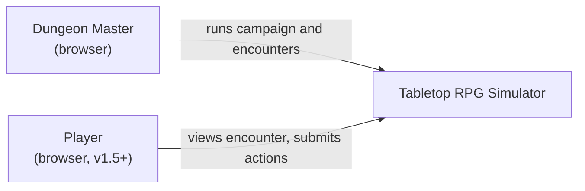
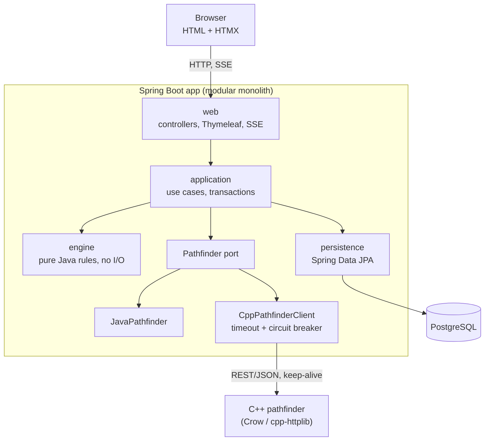
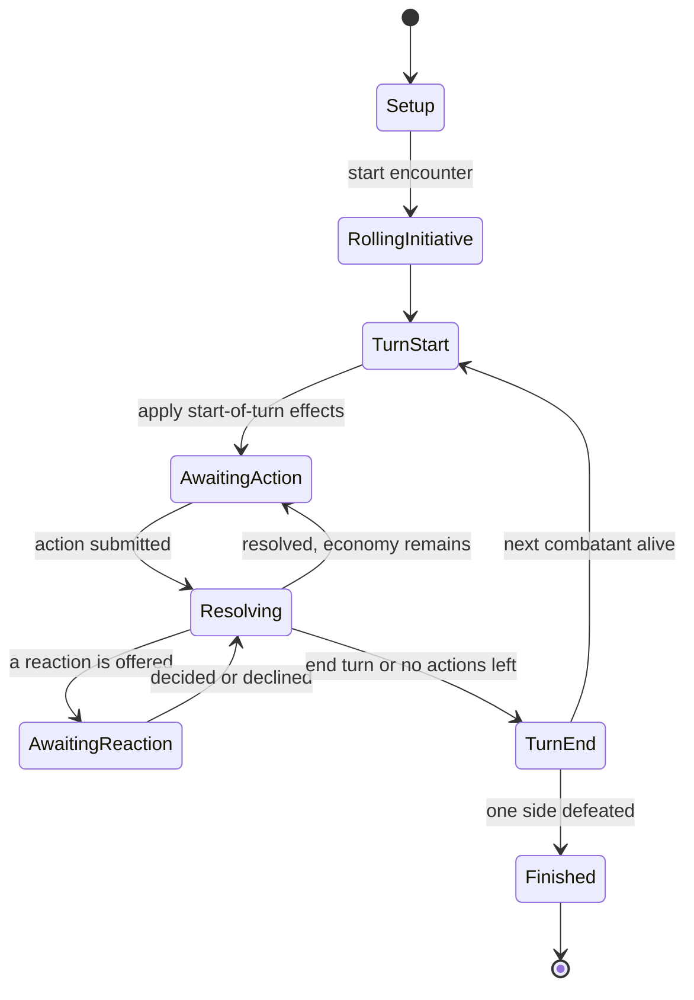
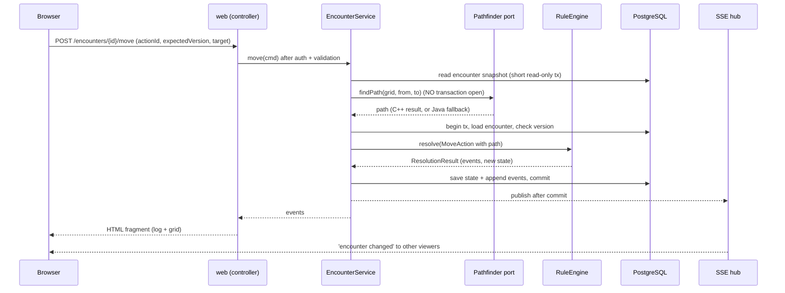
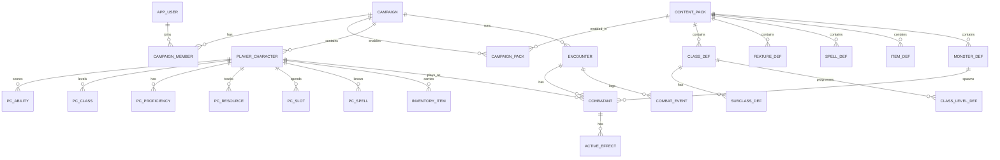
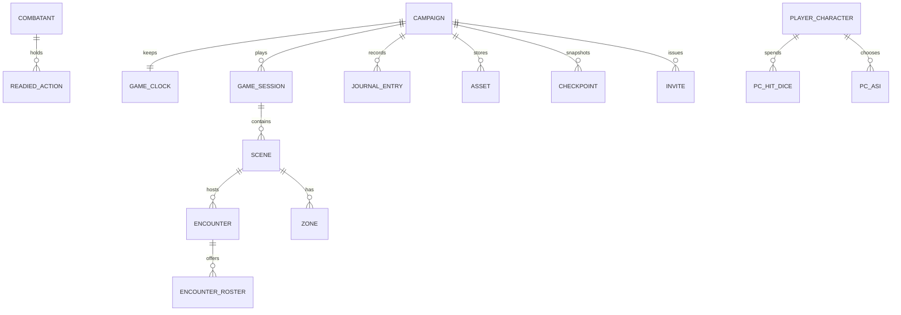
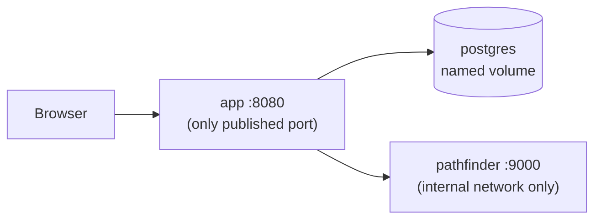

# Tabletop RPG Simulator: Architecture (v5.16)

Oct 16, 2026 · @Samarth

How the system is built and why. Current version **5.16**; the revision history is at the end. Companion documents: Requirements Specification (what it must do), Ruleset Specification (the D&D mechanics), Decision Log and Progress Tracker (decisions and status), AI Build Brief (setup, CI/CD, compose and Dockerfiles, full DDL and the build order), Grid and Pathfinder Specification (the pathfinder contract), Project Design Guide (plain-language overview). This document holds the design and its reasons; code that the Build Brief already contains (CI workflows, compose file, schema DDL) is not repeated here, so there is one source of truth. Diagrams are written as Mermaid source.

## 0. What changed in v5

- Ability scores are modifiable stats: base plus improvements plus modifiers, clamped to a ceiling and a floor, with a per-ability maximum that caps improvements (DEC-074).
- Two modifier types (stat modifiers and roll bonuses), stacking by source, and a separate proficiency component that `multiply` targets (Ruleset Specification Part A).
- Dice rolls are lists of labeled, signed terms, with the natural d20, reroll once per die, a d20 floor and a crit-doubling flag.
- New section 4.13 consolidates the campaign settings: hit point method, advancement, natural 20 and 1 on checks and saves, clock advance per combat round, ability score generation method, feats, temporary hit points at 0 HP, mid-combat surprise, and join options.
- The game clock advances by a DM-set amount per combat round (default 6 seconds); the rules constant stays 6 seconds per round.
- Maximum HP is derived, so the database constraint on a character's HP only forbids negatives; the engine enforces the upper bound.
- Duplicated code (CI workflow, compose file, full DDL) moved to the AI Build Brief only.
- The document is now a Claude Doc with version numbering and a revision history.

## 1. Goals, constraints and drivers

**Purpose.** A self-hosted, browser-based tool for Dungeon Masters: a character manager plus an encounter runner built on a rules engine that automates the mathematics of tabletop play. It is not a virtual tabletop.

**Hard constraints**

- Runs in the browser. Java enterprise web application. Java + SQL, with C++ allowed only as a separate service.
- Ruleset: D&D SRD 5.1 (2014 rules) under CC-BY-4.0, with attribution. Editions are not mixed.
- Self-hosted, installable with a single `docker compose up`, used on a local network: the DM hosts and players connect to the DM's machine.
- Two-person team, about 2 months. No course rubric; the stack is free apart from Java.

**Design principle.** Keep the implementation simple, and keep a seam where each plausible upgrade would go (section 15).

**Quality attributes, in priority order**

| # | Attribute | Concrete target |
| --- | --- | --- |
| 1 | Correctness and testability | Same seed gives the same combat. Engine has no I/O. Every rule has a worked-example test. |
| 2 | Extensibility | New spell, monster or subclass = data. New feature behavior = one class. New ability set, grid geometry or vision model = a contained change behind a seam. |
| 3 | Buildability | Finishable in about 8 weeks by two students. |
| 4 | Resilience | Pathfinder down means combat still works. Duplicate submits are harmless. A paused game resumes exactly. |
| 5 | Latency | Action resolve p95 under 150 ms excluding pathfinder; under 300 ms including it (targets). |
| 6 | Security | Campaign data visible and mutable only to members; players never receive DM-only data; uploads and imports are untrusted input. |
| 7 | Operability | One command to install, no default secrets, data survives upgrades. |

### Release scope

| Release | Scope |
| --- | --- |
| **v1 (MVP, milestone A)** | DM-driven play for Fighter, Rogue, Paladin, Bard and Wizard at levels 1-5; characters with a multiclass-ready schema; dice; combat with reactions; curated tier-2 spells; the SRD 5.1 monsters as seed data, 18 of them fully automated (Ruleset Specification 12.10), with per-encounter rosters and artwork upload; square grid with the metric setting and movement; rests; sessions, scenes, game clock and audience in the schema with basic UI; LAN accounts with invites; single-step Docker. |
| **v1.5 (achievable goals)** | Live player view with audience filtering; journal and quests; checkpoints; campaign export and import; JSON content-pack import; custom monsters and homebrew spells; levels 6-12 as data increments. |
| **v2 (stretch goals)** | Vision phases (radius, then SRD light and senses); players submitting actions; homebrew editor UI; Sorcerer and Warlock; multiclass rules and UI; hex geometry. |

Proposed order inside v1.5, so unfinished items cut cleanly: live player view, journal, export/import, checkpoints, pack import, then levels 6-12.

## 2. System context



## 3. Containers and module structure



The engine does not point at the pathfinder port: the application layer fetches the path, then hands a plain value to the engine.

### Package structure (by feature, boundaries enforced)

```
com.yourteam.rpg
├── engine/           // PURE rules. Imports only the JDK. No Spring, JPA or HTTP.
│   ├── kernel/       // Ability, AbilityScores, Stat, Modifier, Resource, SlotPool, GameClock, Audience
│   ├── dice/         // DiceExpression, parser, RandomSource
│   ├── combat/       // Encounter, Combatant, turn state machine, reaction window, zones, readied actions
│   ├── action/       // sealed Action types and their resolvers
│   ├── feature/      // trigger points and built-in feature behaviors
│   ├── spell/        // spell resolution, slots, concentration
│   ├── grid/         // GridGeometry (square now), distance metrics, area shapes, cost maps; geometry/ holds line of sight and cover
│   ├── light/        // LightModel, emitters, zone flags
│   ├── vision/       // VisionModel (full by default), SightResolver, senses
│   ├── fall/         // fall events, FallDistanceProvider
│   ├── hazard/       // hazard definitions and triggers
│   └── affliction/   // madness and disease instances, expiry
├── encounter/        // web / application / persistence for combat sessions
├── campaign/         // campaigns, membership, invites, sessions, scenes, clock (layered CRUD)
├── character/        // characters, creation, level-up, derived sheet
├── content/          // content packs, SRD seed, importer, validation, in-memory definitions
├── asset/            // image upload, validation, re-encoding, storage on the data volume
├── journal/          // journal and quests (v1.5), checkpoints and export/import (v1.5)
├── identity/         // users, login, password hashing
├── pathfinding/      // Pathfinder port, JavaPathfinder, CppPathfinderClient
└── platform/         // error handling, logging/trace filter, config, SSE hub
```

**Rules, enforced by ArchUnit tests in CI** (a failing build, not a code-review hope):

1. `engine` may not import `org.springframework..`, `jakarta.persistence..`, `java.net.http..`.
2. A feature's `web` package may not touch another feature's `persistence`. Cross-feature calls go through the other feature's `application` classes.
3. No cycles between feature packages.
4. Ability scores are read and written only through `AbilityScores` and `Ability`; no other code may touch ability columns or fields directly. This is the seam that keeps custom abilities a later, contained change.
5. Content definitions are immutable once loaded; only the `content` package may build them.

JPA entities live in `persistence` and are **mapped** to engine objects for encounters. For plain CRUD features (campaign, character, identity) entities are used directly in `application`. This keeps the mapper cost only where purity pays.

## 4. Rules engine

The engine is pure Java: no I/O, no framework. Everything it knows about the game is either **kernel** (a small fixed vocabulary) or **content** (data that references the kernel).

### 4.1 Kernel and content

```java
public enum Ability { STR, DEX, CON, INT, WIS, CHA }          // the only place abilities are enumerated

public final class AbilityScores {                             // the only accessor
    public int score(Ability a) { ... }      // base + improvements + ability stat modifiers, clamped to 0..ceiling (default 30)
    public int maxScore(Ability a) { ... }   // 20 by default; some effects raise it together with the score
    public int modifier(Ability a) { return Math.floorDiv(score(a) - 10, 2); }
}
```

| Kernel concept | Meaning |
| --- | --- |
| `Ability`, `AbilityScores` | six fixed abilities behind a single accessor |
| `Stat` | a named computed number: AC, initiative, speed, max HP, attack bonus, save bonus, skill bonus, spell DC |
| `Modifier` | target stat, operation (set, add, multiply, min, max, advantage, disadvantage), value, optional `activeWhen` condition, duration, source |
| `Resource` | key, current, max, recharge (turn, short rest, long rest, dawn, never) |
| `SlotPool` | spell slots by level (and later pact slots) |
| `DiceExpression` | value type, see 4.5 |
| Action economy | action, bonus action, reaction, movement remaining, object interaction |

**Content** (open, replaceable): classes, subclasses, features, spells, items, species, backgrounds, monsters, feats. Content refers to kernel keys such as `"stat:ac"` or `"resource:bardic_inspiration"` and never adds new kernel concepts.

### 4.2 Stats and modifiers

A stat value is computed from a base plus the active modifiers, never stored. Combination order is fixed and documented in the Ruleset Specification: `set` first, then `add`, then `multiply` (rounding fractions down, as the SRD does), then `min`/`max`; advantage and disadvantage are collected separately and cancel. Feats, magic items, spells, conditions and class features are all expressed as bundles of modifiers plus trigger points, which is why a small kernel can carry a large amount of flavor.

Two details from the Ruleset Specification:

1. Skill, save and attack totals have a separate proficiency component, `floor(bonus x multiplier)`, and `multiply` targets that multiplier, never the total.
2. There are two modifier types: stat modifiers (persistent) and roll bonuses (applied when a roll is made, fixed or dice, possibly consumed). The same source never stacks with itself (the most potent applies, then the most recent), while different sources add. Suppressed instances are kept and resume if the applying one ends first, and the rule covers every modifier source with the same name, including class features and items.

Ability scores are themselves modifiable stats (DEC-074): base plus improvements plus modifiers, clamped to a ceiling (default 30) and a floor of 0, with a per-ability maximum (default 20) that caps improvements.

### 4.3 Pipeline: action, validate, resolve, events (with reactions)

1. **Action** (Command, sealed type): immutable, with an `actionId`.
2. **Validation:** turn order, action economy, range, conditions.
3. **Resolution:** roll through the injected `RandomSource`, run the feature trigger points, apply effects, mutate the `Encounter`.
4. **Result:** either `Completed(events)` or `AwaitingReaction(pending, events)`.
5. **Events:** immutable `CombatEvent` records including every die rolled, so a session can be replayed.

```java
public sealed interface Action
    permits AttackAction, CastSpellAction, MoveAction, EndTurnAction, ReactionDecision {}

public sealed interface ResolutionResult permits Completed, AwaitingReaction {}

// Pure: no I/O. MoveAction carries a path computed earlier; the engine re-validates it.
public interface RuleEngine {
    ResolutionResult resolve(Encounter encounter, Action action, RandomSource rng);
}
```

`resolve` throws a `RuleViolation` (expected, carries a stable code) for anything illegal. A miss or a failed save is a normal result, not an error.

### 4.4 Feature trigger points

Class features and homebrew features do not live in per-class branches. The engine exposes trigger points and runs the active features registered for them.

| Trigger | Example use |
| --- | --- |
| `ON_ATTACK_ROLL` | advantage sources, attack bonuses |
| `ON_DAMAGE_ROLL` | Sneak Attack, smite dice |
| `ON_DAMAGE_TAKEN` | resistance, reaction triggers |
| `ON_SAVE` | save bonuses, advantage on saves |
| `ON_CAST` | spell-slot effects, Metamagic later |
| `ON_MOVE` | opportunity attack triggers |
| `START_OF_OWN_TURN`, `ON_TURN_END` | ongoing effects, resource recharge |
| `ON_DAWN` | dawn effects; rests refresh resources through recharge rules, not through a trigger |

A feature definition is data: a trigger, conditions, an effect type with parameters, an optional resource cost and a usage limit. Illustrative shape (not final):

```json
{ "key": "sneak_attack", "ruleset": "srd-5.1", "trigger": "ON_DAMAGE_ROLL",
  "conditions": [ { "weaponProperty": "finesse_or_ranged" }, { "hasAdvantageOrAllyAdjacent": true } ],
  "effect": { "type": "add_damage_dice", "dice": "{sneak_attack_dice}" },
  "limit": "once_per_turn" }
```

The engine ships a catalog of **effect types** implemented in Java (`add_damage_dice`, `grant_advantage`, `grant_resistance`, `modifier`, `spend_resource`, `condition`, `heal`, `reaction_option`, and so on). Data can only combine behaviors the engine already knows. A genuinely new mechanic means adding one effect type in code. Ruleset Specification Part G adds four: reduce\_hp\_max (a reduction of hit point maximum that lasts until a long rest), create\_creature (a spell or trait that spawns creatures), corrode\_item (a per-instance counter on a weapon or armor) and grant\_bonus\_action\_option (a bonus action that a trait offers after a condition). Each is defined only in Ruleset Specification section 12. Part H adds three more: start\_fall, ends\_affliction and suppress\_affliction, defined only in Ruleset Specification section 13. The names and the fields of every effect type are fixed in the Content Schema Specification, which is the authority for them; where this paragraph and that document differ, that document wins.

### 4.5 Dice engine

- **Grammar:** a sum of terms: dice groups (`NdX` with optional keep or drop `kh`, `kl`, `dh`, `dl`, reroll and floor modifiers) and fixed integers, each added or subtracted. Examples: `2d20kh1` (advantage), `4d6dl1` (ability scores), `3d8+4`, `d8+3d6+3` (weapon, Sneak Attack, modifier), `d20+3-d4` (Bane).
- **Any die:** X from 2 to 1000, N from 1 to 100, with caps on total dice and expression length. This prevents `999d999` abuse.
- **Fairness:** each die comes from a bounded uniform draw (`nextInt(bound)`), never `random() * X` or modulo, so there is no bias.
- **Injection:** `RandomSource` is an interface. Production uses `SecureRandom`; tests use `SeededRandom(42)`.
- **Result:** a list of labeled, signed terms, each with every face and whether it was kept or dropped, plus the natural d20, the mode and the total, so the log can show `[14, 7] -> 14` and where each number came from. A reroll replaces a die once, a d20 floor applies to each d20 before the kept die is chosen, and each dice term carries a crit-doubling flag.
- **Rule coupling:** only a few rules depend on a particular die. The critical-hit threshold on the d20 is a rule parameter, not a hard-coded 20.
- **Bonus:** exact outcome distributions can be computed for previews, because every die is a uniform integer.

### 4.6 Where the patterns show up

| Concern | Pattern |
| --- | --- |
| Actions | Command with sealed types and exhaustive `switch` |
| Features and spells | Strategy (effect types) plus trigger-point registry |
| Conditions | state plus modifiers |
| Stats | computed from base plus modifier stack |
| Monster and character creation | Factory from definitions |
| Dice | value object with a parser |

### 4.7 Combat state machine, with the reaction window



`AwaitingReaction` is persisted state (section 5.4), so a restart in the middle of a reaction loses nothing.

The reaction window is the engine's **only** pause mechanism. Since v5.6 it also carries the choices made after a roll, a hit or a failed save (Bardic Inspiration, Divine Smite, Uncanny Dodge, Indomitable), not only reactions in the narrow sense; there is no second kind of window (ADR-31, section 5.4). It opens in an encounter or in a scene. Part G adds a LAIR entry to the initiative order (RS-MON-034) and the START\_OF\_OWN\_TURN event, which the TurnStart state raises before a creature's options appear (E-123). Part H adds a TRAP entry for a complex trap (RS-ENV-049) and opens the ON\_FALL point when a fall begins (RS-ENV-040).

### 4.8 Content, packs and homebrew

- **Content packs.** Every definition belongs to a pack and carries `pack`, `ruleset`, `source`, `license` and `attribution`. The SRD 5.1 pack is seeded at first start. A campaign enables the packs it wants. A pack is a folder with a manifest, a NOTICE file and one JSON file per definition. Keys are namespaced as pack:local, a later pack replaces a definition only by naming its key explicitly, and an unknown vocabulary name rejects the whole pack (Content Schema Specification, CS-PKG, CS-KEY, CS-OVR and CS-VOC rules).
- **Loading.** Definitions load once at startup into immutable in-memory maps. They change only through migrations or pack imports, and a restart (or an explicit reload) is the invalidation.
- **Homebrew.** Declarative: users assemble features from the trigger and effect-type catalog. No user code ever runs. Guardrails: schema validation, numeric caps, campaign scope, DM approval, a visible 'user-created' label.
- **Importer.** Packs import as JSON validated against a published schema, with size and depth limits. Validation runs in nine stages (CS-VAL-001 to CS-VAL-011), against a hand-written JSON Schema 2020-12 file kept in the repository and a vocabulary file generated from the Java registries. The validator library is networknt json-schema-validator 3.x, which runs on Jackson 3 as Spring Boot 4.1 does (CS-VAL-011). Invalid input is rejected whole with `CONTENT_INVALID`.
- **Extensible lists.** Damage types and conditions are registries with SRD defaults. Engine-known conditions carry built-in mechanics; custom conditions are bundles of modifiers.
- **Upgrade path.** The SRD classes themselves are expressed through the same mechanism, so homebrew needs no special path. The homebrew editor UI is post-MVP; the data model and trigger points exist from day one.

### 4.9 Spell automation tiers

| Tier | Behavior | Scope |
| --- | --- | --- |
| 0 | Shared cast record only; the DM adjudicates the effect | all SRD spells of levels 0-6 |
| 1 | Shared cast record; rolls the dice and logs the result | most damage and healing spells |
| 2 | Shared cast record; full effect resolution through the effect primitives: saves, area targeting, conditions, zones | a curated set (Ruleset Specification 10.9) |

All three tiers share one cast record (Ruleset Specification 10.2, E-69); the tiers differ only in how the effect is resolved. Everything else about spells (the tier-2 list, the effect primitives, concentration, areas, reaction spells and the spell settings) is in Ruleset Specification Part E (section 10) and is not repeated here. New spells move up a tier as time allows; nothing in the engine changes when they do.

### 4.10 Sessions, scenes, game clock and audience

- **Hierarchy:** Campaign, then Session (one real-world play night), then Scene (a place and time, with a map, ambient light and participants), then Encounter (combat inside a scene). Exploration and social scenes need no encounter.
- **`GameClock`:** the campaign's in-game time, stored in seconds. It advances only when the DM advances it, a rest is taken, or travel is resolved, never with real time. In combat each completed round advances it by a DM-set amount (default 6 seconds). The rules constant of 6 seconds per round (10 rounds per minute) does not change; durations given in rounds count rounds, while time-based durations count on the clock. A scene's default light derives from the time of day, and the DM can override it. Time of day is derived (the campaign's start time of day plus the clock, modulo 86,400 seconds; a day is 24 hours) and the campaign has a dawn time. Advancing the clock (with a reason and a number of seconds) returns the effects that expired and the dawns crossed, in order. Rests (section 4.14) are the main source of clock advances.
- **`Audience`:** `DM_ONLY`, `ALL`, or a set of players. Every combat event, journal entry, note, handout and chat message carries one. A secret roll is a roll with `DM_ONLY`. Player-facing responses are built by filtering on audience on the server.
- **Duration kinds** on modifiers and effects: rounds (with start or end of a named turn), until end of turn, game time (stored as an absolute end time in seconds), until a short or long rest, until a long rest, or permanent. When an encounter ends, effects measured in rounds continue on the clock at 6 seconds per remaining round.
- **`Zone`:** a persistent area effect on the map (shape, origin, source, duration, and the trigger points that fire when a creature enters or starts its turn inside).
- **`ReadiedAction`:** the trigger, the held action or spell (with concentration), and the owner.

### 4.11 Vision (the seam now, the sight rules in v1.5, the feature in v2)

Kernel pieces, present from v1:

- **Sense stats** in feet: `sense:sight`, `sense:darkvision`, `sense:blindsight`, `sense:truesight`. A species trait or a blessing is a modifier on these.
- **Scene light:** ambient level (bright, dim, dark) and a sunlit flag, with light sources and zone flags from v1.5. Light is derived and never stored on a creature (Ruleset Specification 13.2).
- **Cell attributes:** `blocksSight` and cover as two independent values, alongside blocks-movement and difficult terrain (RS-ENV-025).
- **Modifier extensions:** `multiply` and `activeWhen`, so 'night lowers sight' and 'a far-sight blessing doubles it' are data.

```java
public interface VisionModel {
    Visibility visibleCells(Viewer viewer, Scene scene, GridMap map);   // pure
}
// FullVision (default): everyone sees the whole map.
// RadiusVision: a per-viewer range with line of sight.     (v2)
// SrdVision: built from the SightResolver of 4.18, with no rule of its own. (v2)
```

Server-side rule: the server computes each player's visible set and sends only that. Hiding cells in the browser would still leak them. Phases of fog of war: DM-revealed areas, then radius vision with line of sight, then SRD light and senses with remembered cells. From v1.5 the sight state that these phases read is the one function of 4.18 (E-137), and the projection that hides secret information is described there (E-150).

### 4.12 Homebrew spells and monsters

Homebrew spells and monsters use the same schemas and validation as built-in ones. Numeric caps (for example maximum damage dice per spell level) are derived from the SRD's own spells at the same level, and the DM approves each item. New monsters are stat blocks expressed with the same feature and effect system, so a custom monster needs no new engine code unless it introduces a new effect type. The stat block fields, the checks a definition must pass and the rules for spawning a monster are in Ruleset Specification Part G (section 12); the code that carries them is described in 4.17.

### 4.13 Campaign settings

Settings are defined in a registry (section 4.15) and stored as decided values per campaign, so a game resumes under the same rules; a setting nobody has decided uses its default. The table below does not repeat the spell settings or the equipment settings: their names, values, defaults, tiers and the moment each is asked are defined only in Ruleset Specification 10.11 and 11.9; the two monster settings (monsterHp and legendaryResistanceOverridesAutoFail) are defined only in 12.12.

| Setting | Default | Notes |
| --- | --- | --- |
| Distance metric | equal-cost diagonals | also true diagonal and alternating 5-10-5 |
| Diagonal moves past blocked corners | disallowed |  |
| Vision model | full | radius and SRD models in v2 |
| Group initiative for identical monsters | off |  |
| Hit point method | player chooses per level | or the DM forces fixed average or rolled |
| Advancement | milestone | XP option planned for v1.5; XP and thresholds stay in the data |
| Natural 20 and 1 on checks and saves | off | the DM can enable it for checks, saves or both |
| Game clock advance per combat round | 6 seconds | 0 for manual only; the rules constant of 6 seconds per round does not change |
| Ability score generation method | DM selects from the built-in list | DM-created methods in v2 |
| Feats enabled | on |  |
| Damage absorbed by temporary hit points at 0 HP | counts as damage taken (death save failure) | house rule available: no failure when fully absorbed |
| Mid-combat surprise | off | optional house rule: combatants caught off guard by an arrival |
| Join options for a combatant entering a running fight | normal roll, at its initiative | DM chooses roll mode, timing, starting conditions and first-turn restriction per join |
| Duplicate proficiency replacement | broad: skill and tool proficiencies from any two sources | the DM can narrow it to overlaps with the background, or turn it off |
| Rest variant | Standard | Epic Heroism, Gritty Realism or custom lengths; each preset sets the short rest, long rest and long rest interval |
| Short rest length | 1 hour | a minimum; the DM may let a rest run longer |
| Long rest length | 8 hours | a minimum; the DM may let a rest run longer |
| Long rest interval | 24 hours | measured from the end of one long rest to the end of the next; presets: 24 hours, 1 hour, 7 days |
| Interrupted long rest gives short-rest benefits | off | house rule: applies when at least 1 hour had passed |
| Hit Dice healing method | rolled | or the fixed average |
| Start time of day | 08:00 | the time of day when the clock is 0 |
| Dawn time | 06:00 | when dawn triggers fire for items that recharge at dawn |
| Critical dice mode | roll again and add | or extra die only, or reject keep-or-drop groups at definition time |
| Weapon dice scope | the weapon's damage dice only | or all damage dice of the attack; shared by Great Weapon Fighting and Savage Attacker |
| Savage Attacker critical dice | reroll the whole weapon roll | or the player chooses base or critical dice |
| Settings mode | defaults only (v1) | or configure now; from v1.5 also ask as needed (section 4.15) |
| Roll information for decisions | total shown | or natural die only, or outcome shown (after-roll options are then offered after the outcome and may flip it) |
| Divine Smite timing | after the hit, before damage | or declared before the attack (the slot is spent only on a hit that survives Shield) |
| Aura of Protection from several paladins | the highest bonus applies | or the bonuses stack |
| Archery with thrown weapons | excluded | or included |

Hit point rule: when a maximum rises, current hit points rise by the same amount; when it falls below current hit points, current becomes the new maximum; when a temporary increase ends only the clamp applies; a creature at 0 hit points is not raised.

### 4.14 Rests, the clock and recharge

The rules are in the Ruleset Specification, Part C (section 8). A rest is a **campaign-level command**, not an encounter action: it happens in a scene with no active encounter.

**Design summary**

| Question | Answer |
| --- | --- |
| What resolves a rest? | A pure `RestResolver` in `engine.rest` (JDK only, no wall clock, no I/O). Input: the participants' state (Hit Dice, resources, effects, exhaustion), the rest request (kind, participants, duration, the player's choices), the campaign settings and a `RandomSource`. Output: events and the new state. |
| What if it runs twice? | The first run is stored in `campaign_action` with a hash of the request and its result, dice included. The same `actionId` and hash returns the stored result without rolling or advancing the clock again; the same `actionId` with a different hash is `IDEMPOTENCY_KEY_CONFLICT`. The hash covers a canonical form of the request (stable key order, normalized numbers, participant order kept because it fixes the order of rolls). |
| What if it fails halfway? | One short write transaction contains the clock, every participant, the effects and the log rows, so a failure leaves nothing applied. |
| Who can change the same data at once? | In version 1 only the DM acts, but the command carries `expectedVersion`, checked against a version on `game_clock`; a mismatch is `CAMPAIGN_VERSION_CONFLICT`. Character rows keep their own `@Version`. |
| Side effects? | None inside the transaction. After commit the application publishes 'campaign changed' to the SSE hub, as for encounters. No external calls and no outbox are needed. |
| Order inside a rest | Fixed, so replays and tests are deterministic: check preconditions (a dead creature, or one at 0 hit points that is not stable, rejects the whole command; no duplicate participants and at most 30); advance the clock (at most 366 days; effects ending at or before the new time expire first, ordered by end time and then creation order; then one dawn trigger per dawn crossed); then for each participant in the listed order: exhaustion reduction (long rest), hit points restored to the maximum as it stands after that, Hit Dice spending by the participant's spend plan (a count, or until hit points reach a target, one die rolled at a time) or recovery, spell slot and resource recharge, temporary hit points end, concentration ends; then write the log. A second long rest inside the interval completes without benefit and logs long\_rest\_no\_benefit. |

**Data** (additive; tight types; the schema enforces the invariants)

| Table or column | Definition |
| --- | --- |
| `player_character.last_long_rest_end_seconds` | `bigint`, nullable (null means the character has never completed a long rest), `CHECK (>= 0)` |
| `active_effect.duration_kind` | `text NOT NULL` with a `CHECK` over the six kinds (`ROUNDS`, `UNTIL_END_OF_TURN`, `GAME_TIME`, `UNTIL_SHORT_OR_LONG_REST`, `UNTIL_LONG_REST`, `PERMANENT`) |
| `active_effect.ends_at_seconds` | `bigint`, nullable, with a `CHECK` that it is set exactly when the kind is `GAME_TIME` and is at least 0 |
| `game_clock.version` | `bigint NOT NULL DEFAULT 0`, the campaign-level optimistic lock |
| `campaign_action` | Primary key `(campaign_id, action_id)` with a foreign key to the campaign; `request_hash bytea NOT NULL`; `kind text` with a `CHECK`; `result jsonb NOT NULL`; `created_at timestamptz NOT NULL` |
| `campaign_event` | An append-only log of non-combat events: identity primary key; `campaign_id` foreign key with `ON DELETE CASCADE`; `seq bigint NOT NULL` with `UNIQUE (campaign_id, seq)`; `(campaign_id, action_id)` foreign key to `campaign_action`; `type text` with a `CHECK`; `game_time_seconds bigint NOT NULL CHECK (>= 0)`; `audience` with a `CHECK` plus the player set; `payload jsonb NOT NULL` (event payloads are the legitimate use of JSON); `created_at timestamptz NOT NULL`; an index on `(campaign_id, seq)` |

Migrations are additive (new tables, new nullable columns, constraints on new columns only), each is one concept, and each is tested on a fresh database and on an upgrade from the previous schema with sample data. The combat event log stays with encounters; `campaign_event` covers rests, clock changes and other scene-level events.

**Logging and metrics:** one `rest.resolved` line with the campaign, kind, participant count, clock before and after, and whether a long rest gave a benefit; the metrics `rest.duration`, `rest.long_rest_no_benefit` and `idempotency.replay`.

**Seams:** rest variants are data presets (short rest length, long rest length, interval), and the recharge rules live in content, so other variants and calendars need no engine change.

### 4.15 Campaign settings: registry, tiers and asking before use

A DM has many options, and deciding all of them before the first session is overwhelming. The design therefore gives every setting a good default, asks for a decision when it first matters (never in the middle of a roll), and records every decision.

**The registry.** Each setting is defined once, in code: a key, a type (enum, bounded integer, boolean or duration), the allowed values, a default, a tier, a plain-language explanation of what each option changes, and the actions that need it. The engine reads settings only through a `SettingsView`; unknown keys are rejected.

**Tiers**

| Tier | When it is asked | Examples (proposed placement) |
| --- | --- | --- |
| Structural | In the setup wizard, with presets | the ruleset and packs, the distance metric, the rest variant, advancement, the hit point method, the encumbrance rule, the monster hit point method (monsterHp) |
| Ask on first use | The first time an action needs it (v1.5); until then the default applies | natural 20 and 1 on checks and saves, critical dice mode, weapon dice scope and Savage Attacker critical handling, roll information, Divine Smite timing, aura stacking, Archery and thrown weapons, group initiative, join options, temporary hit points at 0 HP, duplicate proficiency, Hit Dice healing, interrupted long rest, ability score generation method, corner cutting, every spell setting that Ruleset Specification 10.11 marks ask on first use, and the Legendary Resistance option (legendaryResistanceOverridesAutoFail) |
| Silent | Never asked; the default is used and the panel shows it | start time of day, dawn time, limits, the spell settings that Ruleset Specification 10.11 marks silent, and the equipment settings that Ruleset Specification 11.9 marks silent |

**Modes** (per campaign): `CONFIGURE_NOW` (the wizard also offers the ask-on-first-use settings), `ASK_AS_NEEDED` and `DEFAULTS_ONLY`. Version 1 offers `CONFIGURE_NOW` and `DEFAULTS_ONLY` with the House rules panel; `ASK_AS_NEEDED` arrives in v1.5.

**Asking before rolling, without pending state.** Before an action is resolved, the application asks the engine which settings the action could need: `requiredSettings(state, action)`, a pure function that is deliberately conservative, listing every setting that could matter on any branch (an attack whose damage plan has a keep-or-drop dice group lists the critical dice mode even though no critical hit has happened yet). If a required setting is undecided and the mode is `ASK_AS_NEEDED`, the server answers `SETTING_DECISION_REQUIRED` (409) with the keys, the options, the default and the explanation, before any die is rolled and without changing any state. The DM decides (an idempotent campaign action) and the client sends the original action again. Nothing is stored in between, so there is nothing to recover after a restart. Inside a reaction chain: the action's required settings cover the action itself; an action spawned by a reaction (for example a paladin's opportunity attack) that needs an undecided setting after dice were rolled uses the default for that action, the setting stays undecided, and the question is asked before the next action that needs it. A spell cast follows the same rule: the settings a cast can need, and when each is asked, are listed in Ruleset Specification 10.11, and they are asked in the pre-flight, before any die is rolled. An open reaction window pins the settings it has read; a change made while it is open applies from the next action.

**Data** (additive; the registry types the values, so JSON is only the container)

| Table or column | Definition |
| --- | --- |
| `campaign_setting` | Primary key `(campaign_id, key)`; `campaign_id` foreign key `ON DELETE CASCADE`; `key text NOT NULL` (at most 64 characters); `value jsonb NOT NULL`, validated against the registry; `source text NOT NULL` with a `CHECK` over `WIZARD`, `PROMPT`, `PANEL`; `decided_by` foreign key to the user; `decided_at timestamptz NOT NULL`; `decided_game_time bigint NOT NULL CHECK (>= 0)`. A missing row means 'not decided: use the default'. |
| `campaign.settings_mode` | `text NOT NULL` with a `CHECK` over the three modes; the default in version 1 is `DEFAULTS_ONLY` |

Every decision is also a `campaign_event` of type `SettingDecided` with the old and the new value, so earlier values are kept. The stored result of each action lists the settings it read (key and value), so a replay or an export does not depend on later changes. Step 4 of the build creates `campaign_setting` instead of a settings column on the campaign.

**Authorization and validation.** Only the DM of the campaign can decide or change a setting; players may read them (v1.5). Values are checked against the registry at the boundary (type, range, allowed values); an unknown key or a bad value is `SETTING_INVALID` (422). Changing a setting never rewrites earlier events (decision E-37).

**Interface.** A setup wizard with presets, so a new campaign takes about a minute; a House rules panel listing every setting with its state (default or decided), who decided and when, and a one-click return to the default; and, from v1.5, the ask-before-use dialog showing the explanation with the default highlighted, 'use the default for now' (records nothing) and 'always use defaults' (switches the campaign to `DEFAULTS_ONLY`).

**Tests that belong to the design:** registry consistency (every referenced key exists and every default is valid); a completeness property test that instruments the settings view while resolving generated scenarios and asserts that every key read is in the action's required set; `DEFAULTS_ONLY` never asks; `ASK_AS_NEEDED` asks at most once per key; changes appear in the event log in order.

**Observability:** a `setting.decided` log line (key, source, user) and a `setting.prompt_shown` counter.

**Release:** the registry, defaults, wizard presets, House rules panel and event log are v1; ask-before-use, the modes and players seeing the house rules are v1.5; settings defined by content packs come later.

### 4.16 Equipment and items

The rules for items, armor class, hands, weapons, magic items, attunement, charges, currency and encumbrance are in Ruleset Specification Part F (section 11) and are not repeated here. The effect primitives that items use are effect types in the sense of 4.4 and are defined in the same part. This section holds what the design adds: where the code lives, what the schema holds, and how the player view stays safe.

**Engine components.** Ruleset Specification 11.12 lists ten components. They are pure Java with no database access, like the rest of the engine: the application layer loads the state, calls them and saves the result.

| Component | Job |
| --- | --- |
| `ItemCatalog` | Resolves item definitions and their tiers from the enabled content packs (11.2). |
| `Inventory` | Holds the item instances of an owner with their hand or slot position, and the equip and stow commands (11.4). |
| `ArmorClassCalculator` | `computeArmorClass`: returns armor class and its breakdown from the current state (11.3). |
| `HandsModel` | The two hands, grips and the free object interaction (11.4). |
| `AttackOptionBuilder` | Generates the attack options of a combatant (11.5). |
| `AttunementService` | Attunes an item and ends an attunement (11.6). |
| `ChargeService` | Spends and recharges the charges of an item (11.6). |
| `CurrencyLedger` | Coins per denomination, conversion and change (11.7). |
| `EncumbranceCalculator` | Carried weight and its limits by the chosen rule (11.7). |
| `PlayerViewFilter` | Removes what a player may not see, including the properties of an unidentified item (11.6). |

**Actions.** Every command that changes an inventory (equip, stow, attune, spend a charge, pay, move an item to the ground or pick it up) is an ordinary action: it goes through the path of 5.1, carries an idempotency key, and is logged in the same event log. A command the rules refuse (a third hand, a fourth attunement, a payment the purse cannot cover) is an expected `RuleViolation` and not a server error.

**Data** (additive; the DDL is in the AI Build Brief). `inventory_item` gains a hand or slot position, a charge count, an identified flag, a silvered flag and a ground location for an item that no character holds. The currency columns hold whole coins per denomination. The schema enforces what it can: quantity above zero, charges and coins never negative, a position from a fixed set, and an item held by a character or on the ground, never both. It does not enforce the equipment slot limits, because the DM can override them (E-111); the engine enforces those. Armor class is not stored (E-94); the breakdown is kept for display only.

**Hiding what a player may not see.** `PlayerViewFilter` is the single exit for item data to a player view. It builds the view from an allowlist of fields, so a field added later stays hidden until someone adds it to the list. No endpoint serializes an item definition or an item instance directly to a player. What an unidentified item shows is set in Ruleset Specification 11.6 (E-109).

**Settings.** The five equipment settings join the registry of 4.13 and the tiers of 4.15 through Ruleset Specification 11.9 and are not repeated here.

**Tests.** T-48 to T-61 are listed in 12.1 and defined in Ruleset Specification 11.11. T-61 is also run at the player endpoint: the response body must not contain the hidden properties, whatever the item.

**Release.** The release of each part follows the Requirements Specification, section 3.15.

### 4.17 Monsters and encounters

The rules for the monster definition, hit points, special traits, legendary actions, Legendary Resistance, lair actions, created creatures, experience points and the roster are in Ruleset Specification Part G (section 12) and are not repeated here. This section holds what the design adds: the components, the pause points, the schema and the release.

**Engine components.** They are pure Java with no database access, like the rest of the engine: the application layer loads the state, calls them and saves the result. The names are the design's; the mechanics they carry are named in the Ruleset.

| Component | Job |
| --- | --- |
| `MonsterCatalog` | Resolves monster definitions and their tiers from the enabled content packs (12.2, 12.10). |
| `StatBlockValidator` | The content validator: bonuses, hit point average and XP against the challenge rating table. It fails a pack build and warns on homebrew (12.2, 12.3). |
| `MonsterSpawner` | Turns a definition into a combatant: hit points by the monsterHp setting, starting resources and form (12.4). Creature-creating effects use it too (12.8). |
| `ZeroHitPointHook` | The ordered handlers between damage and the death step (12.4). |
| `TraitHandlers` | One handler per special trait, built from effect types (12.5). |
| `LegendaryActions` | The points pool, the ON\_TURN\_END windows, Legendary Resistance and the LAIR entry (12.6). |
| `EncounterXp` | Per-monster XP and the encounter total (12.9). |

**Pause points.** Part G adds one window point and one cost kind to the reaction window of 5.4, and no new kind of pause. ON\_TURN\_END opens a window for each eligible creature with legendary actions, and an option can cost points from a pool on the combatant (the cost kind LEGENDARY\_ACTION). Legendary Resistance uses the existing AFTER\_SAVE\_FAIL point. Lair actions are not a window: they are an entry in the initiative order at count 20. The zero-hit-point hook is not a pause either; it runs inside the damage step, and the saving throw of Undead Fortitude opens the usual save windows.

**Turn events.** START\_OF\_OWN\_TURN is an engine event raised in the TurnStart state of 4.7. Regeneration, legendary action points and recharge rolls run from it in a fixed order (E-123), before the creature's options appear.

**Adjacency.** "Within 5 feet of an ally" is computed by the pure-Java `engine.grid` package (7.6) and never by the C++ pathfinder, so Pack Tactics, Martial Advantage and auras work when the pathfinder is not installed (E-122). With no grid the DM confirms, and the answer is recorded.

**Data** (additive; the DDL is in the AI Build Brief). `combatant` gains a form key, a legendary action point count, a controller (a user, or empty for the DM), a created flag and the trait flags of 12.5 (regeneration suppressed, dying by trait, in sunlight). `encounter` gains an in-lair flag. `inventory_item` gains a corrosion counter that starts at 0 and never rises, and weapon and armor definitions gain a material field in content. A reduction of hit point maximum is an active effect of type `reduce_hp_max`, not a column. The schema enforces what it can: the point count is never negative and corrosion is never positive. The engine enforces the destruction limits of 12.5, because they differ by item.

**Hiding what a player may not see.** Part G adds fields to the monster combatant. The player view is built from an allowlist (section 10), so none of them reaches a player until someone adds it to the list.

**Settings.** The two monster settings join the registry of 4.13 and the tiers of 4.15 through Ruleset Specification 12.12 and are not repeated here.

**Tests.** T-62 to T-79 are listed in 12.1 and defined in Ruleset Specification 12.14. T-62 runs in the content build, because a shipped stat block that fails it fails the build.

**Release.** The spawn step, the zero-hit-point hook and the traits of the 18 tier 2 monsters are version 1, with every other SRD stat block as seed data at tier 0. The encounter difficulty readout waits for the simulator (v1.5). Mounts and Polymorph are version 2 (Ruleset Specification 12.15).

### 4.18 Environment: light, sight, cover, falling, hazards and afflictions

The rules for light, vision, line of sight and cover, reach and opportunity attacks, falling, hazards, breath, poisons, madness and diseases are in Ruleset Specification Part H (section 13) and are not repeated here. This section holds what the design adds: the packages and ports, the pause points, the schema, the hidden information, the tests and the release.

**Packages.** Six packages hold the environment rules: `engine.light`, `engine.vision`, `engine.fall`, `engine.hazard`, `engine.affliction` and `engine.grid.geometry`. They are pure Java like the rest of the engine. They depend on the engine core (dice, clock, ids) and on `engine.grid`, and never on Spring, the web layer or persistence. The application layer loads the state, calls them and saves the result. A test checks the imports (T-100). The names are the design's; the mechanics they carry are named in the Ruleset.

| Port or component | Job |
| --- | --- |
| `LightModel` | The light level and the sunlit flag of a cell. `SceneAmbientLight` reads the scene and the DM's override in version 1, and `SourcesAndZonesLight` adds emitters and zone flags in version 1.5 (13.2). |
| `SightResolver` | The one function that answers what a viewer can see of a target, over the light model, the senses and line of sight. It replaces the can-see default of E-21 from version 1.5, and with the DM-only lighting mode it returns the DM's flags (13.3). |
| `LineOfSight`, `CoverCalculator`, `lineOfEffect` | Pure integer functions on the lattice. The Java code is the reference. A native version could be added later and has to pass the differential test T-83 (13.4). |
| `FallDistanceProvider` | The distance of a fall in feet. `DmEnteredFallDistance` in versions 1 and 1.5, `ElevationFallDistance` in version 2 (13.6). |
| `HazardTrigger` | A listener on ON\_MOVE\_STEP, START\_OF\_OWN\_TURN and the DM's action that finds the hazards a creature triggers. In version 1 the DM triggers (13.7). |
| `AfflictionTracker` | Instances of madness and disease: start, expiry on the game clock, effects, suppression and cure (13.8). |
| `VisionModel` (4.11) | `SrdVision` of version 2 is built from the sight resolver and adds no rule of its own. |

**Pause points.** Part H adds no new kind of pause and no window point beyond ON\_FALL, which E-84 already placed in the list. ON\_FALL opens when a fall begins, before any damage (version 1.5). Opportunity attacks use ON\_MOVE\_STEP, which exists: the step check finds the creatures that can attack and offers each of them the attack as an option (RS-ENV-031, RS-ENV-033). A complex trap is not a window. It is a TRAP entry in the initiative order that is not a combatant, like the LAIR entry of 4.17 (RS-ENV-049). A long fall continues at the end of the creature's turn, and the window is offered again then (RS-ENV-041).

**Idempotency and replay.** Every function takes its inputs as arguments and returns a value, and none reads the clock, a random source or a hash order. Dice are recorded, so a replay gives the same fall damage, the same madness result and the same duration. A fall is resolved once, keyed by its id and state. A trap fires once for each trigger event, by a unique key on `hazard_trigger_log`, so a double submit or a replayed request cannot fire it twice. An affliction ends once, keyed by its id and state, and its creation carries the action id of 5.1, so the same click cannot add two. A repeated action id with a different body is rejected as 5.2 says.

**Data** (additive; the sketch with its constraints is in Ruleset Specification 13.9, and the AI Build Brief points to it). `scene` gains the ambient light, a sunlit flag and two version counters. `combatant` gains a light override and a breath state with its columns. `hazard_instance`, `hazard_trigger_log` and `affliction` are new tables in version 1. `map_cell` gains sight blocking, cover, a door state and a hidden flag, and `zone_flag` and `fall_event` are new tables, all in version 1.5. The version 2 migration adds `map_cell.floor_ft` and `combatant.altitude_ft`; a column with a constant default does not rewrite the table, so waiting costs nothing. The schema enforces what it can: the enumerations are CHECK constraints, an affliction with a timer must have an end time, and the trigger key is unique.

**Derived values.** Light and sight are never stored. The engine may keep a derived value in a memo in the process, keyed by the light version and the map version of the scene, and a value from an older version is never returned (T-80). Nothing here needs a cache server, a queue or a second process.

**Hiding what a player may not see.** The browser receives only what the viewer may see. The page and the realtime updates are built from a server-side projection that is a function of the player's visible set and role, made in the query and in the view model and not by styling afterwards (E-150). Hidden hazards, secret doors, unseen creatures and the DM-only fields are left out. In version 1 the visible set is what the DM allows. Every DM-only action, such as inflicting madness, triggering a hazard or overriding a sight state, checks the DM role in the service and is denied by default.

**Settings.** The four environment settings join the registry of 4.13 through Ruleset Specification 13.12.1 and are not repeated here.

**Performance.** The load is the lowest class (Ruleset Specification 13.9), so the design goal is clarity and exactness. The levers are used in this order: an exact algorithm with early exit, then a memo by version, then pruning by radius. The budgets are in Ruleset Specification 13.9 and are measured by the benchmark T-99, which runs as its own job and reports a missed target as a defect.

**Tests.** T-80 to T-100 are listed in 12.1 and defined in Ruleset Specification 13.14. T-99 is the benchmark job and T-100 runs with the engine suite.

**Release.** Version 1: scene light with the DM's overrides, senses as data, cover chosen by the DM, the fall calculator, hazards and the seed traps triggered by the DM, breath and underwater rules, poisons, and the affliction tracker. Version 1.5: emitters and zones, the cell values of the map, computed sight, line of sight and cover, reach checked on every step, the fall event with its window, hazards triggered by movement and the optional flanking rule. Version 2: elevation, the fall distance calculated from it, and fog of war through `SrdVision` (Ruleset Specification 13.9).

## 5. Request lifecycle, state and failure handling

### 5.1 One action, end to end (a move, the most complex case)



Rules of this lifecycle:

- **One action = one short write transaction.** No HTTP calls, no SSE pushes, no pathfinding inside it.
- **Never trust a path**, even our own. `resolve` re-validates it against the grid and remaining movement.
- **After-commit publishing** via `@TransactionalEventListener(phase = AFTER_COMMIT)`.

### 5.2 Idempotency and concurrency

- Every mutating request carries `actionId` (a UUID the server mints when it renders the form) and `expectedVersion`.
- `combat_event` has `UNIQUE (encounter_id, action_id)`. A replay of the same `actionId` returns the stored result instead of acting twice; the stored result includes every die rolled, so a replay never rolls again. A replay with the same actionId but a different request body is rejected with IDEMPOTENCY\_KEY\_CONFLICT (409). Campaign-level actions such as rests keep this record in the campaign\_action table (section 4.14).
- A mismatched `expectedVersion` returns `ENCOUNTER_VERSION_CONFLICT`. The UI shows 'State changed, refreshed' and reloads the fragment.
- `Encounter` also has a JPA `@Version` column as the last line of defense against races.

### 5.3 Failure behavior

| Failure | Behavior |
| --- | --- |
| C++ service down or slow | Timeout/circuit opens, Java fallback computes the path, metric `pathfinder.fallback` increments. User sees nothing. |
| DB unavailable | Readiness goes down, requests return `SERVICE_UNAVAILABLE`, logged at ERROR. |
| Illegal action (not your turn, out of range) | `RuleViolation` becomes HTTP 422 with a stable code. Not logged at ERROR. |
| Stale tab or duplicate submit | 409 with `ENCOUNTER_VERSION_CONFLICT`. |
| SSE connection drops | Browser auto-reconnects and refetches the current fragment. No state is lost, because state is in the DB. |
| App restart mid-session | Nothing lost except live SSE connections and login sessions (use Spring Session JDBC if relogin is annoying). |

### 5.4 Reaction flow (the reaction window)

The reaction window is the engine's one mechanism for pausing an action so that someone can choose (ADR-31). Its rules are in the Ruleset Specification, Part B (RS-REA-001 to RS-REA-010 and 18 edge cases) and Part D section 9.4.

**Design walk** (the six steps of the design workflow)

| Step | Answer |
| --- | --- |
| 1. Context | A resumable command flow inside the encounter and scene services: a request either completes an action or leaves it waiting for decisions. It is not a queue and not a background job. |
| 2. Data | One `pending_reaction` row holds the open window of an encounter or a scene (below). The combatant keeps 'reaction used'; the event log keeps the history. The row exists only while a window is open and is deleted when the action completes. |
| 3. Failure modes | A restart in the middle (the continuation is persisted); a stale or duplicate answer (version and action id); two answers at once (version check); a decider who never answers (the DM can pass or cancel); a runaway chain (depth cap 6, one open row per owner); a player answering for someone else (authorization); an option that is no longer valid (re-evaluated at each answer); state changed under an open window (rejected while it is open); settings or content changed under it (pinned). |
| 4. Authorization | The DM can answer for any decider. A player can answer only for creatures they control. The service checks this on every answer, and the prompt is filtered the same way: a player sees only their own options and only what the roll information setting allows. A denied answer is `REACTION_NOT_PERMITTED` (403) and is logged. |
| 5. Idempotence and concurrency | Each answer is an action with `actionId` and `expectedVersion`. A replay returns the stored result; the same action id with a different body is `IDEMPOTENCY_KEY_CONFLICT`. The row's version and the owner's version are checked in the same short write transaction. |
| 6. Observability | Log lines `reaction.opened`, `reaction.answered` (decider, option, principal), `reaction.cancelled` and `reaction.depth_limit`; metrics `reaction.opened`, `reaction.open_seconds`, `reaction.depth_limit` and `reaction.denied`. |

**Flow**

1. An action reaches a point where at least one decider has an eligible option. A decider is eligible when it can act, has the reaction or resource, and the rules offer the option; eligibility never depends on information the decider does not have (RS-REA-006).
2. The engine returns `AwaitingReaction(pending, events)`. In one short write transaction the application persists the continuation in `pending_reaction` and bumps the version.
3. The prompt goes to whoever decides: the DM in version 1, each player for their own creatures from v1.5. Each decider chooses an option or passes; the window closes when all have.
4. Each answer is a `ReactionDecision` request. The engine **resumes by replay**: it re-runs the original action from the owner's pre-action state, feeding it the recorded dice and the decisions so far, until the action finishes or reaches the next window. Nothing is rolled twice, and nested or repeated windows need no hand-written state machine. This works because the engine is pure and deterministic (no wall clock, no hidden randomness, section 12.1).
5. An option that starts a new action (an opportunity attack, a reaction spell) is resolved completely, including its own windows, before the original continues. Windows nest to depth 6. At the cap no further reactions are offered, the action resolves without them, and the log and a metric record it; it is never silent.
6. While a window is open, other actions in that encounter or scene are rejected with `REACTION_PENDING`; reads still work. The DM can cancel: the action's effects are not applied, and the dice already rolled stay in the log (an `ActionCancelled` event), so a cancel cannot be used to reroll.
7. When the action completes, the new state and the events are saved in one transaction and the `pending_reaction` row is deleted.

```java
public sealed interface Action
    permits AttackAction, CastSpellAction, MoveAction, EndTurnAction,
            CheckAction, SaveAction,           // scene-level rolls
            ReactionDecision, CancelReaction {}

public record ReactionDecision(UUID reactionId, long expectedVersion,
                               Map<CombatantId, OptionChoice> choices) implements Action {}
// OptionChoice is Use(optionId) or Pass.

public sealed interface ResolutionResult permits Completed, AwaitingReaction {}

public interface RuleEngine {   // pure: no I/O
    ResolutionResult resolve(Snapshot before, Action action, Continuation so_far, RandomSource rng);
}
// A ReplayingRandomSource returns the recorded draws first, then draws fresh ones and records them.
```

**Steps and follow-up choices.** At a point a window proceeds in four ordered steps: options of the acting side that raise its result; options of the defending side that lower the result or change the outcome; damage changes by the acting side; damage changes by the defending side. A decider is asked at every step where it has an eligible option, and passing at one step does not forfeit a later one (so a defender who passes Shield is still offered Uncanny Dodge). An option can carry a mandatory follow-up choice by the same decider, such as which total to keep after Savage Attacker's reroll; it is part of the same step and is recorded in the continuation (RS-REA-004, RS-REA-011). Within the defending side's step the order of options is set by E-83 (Ruleset Specification 10.11). Part G adds one point and one cost to this flow: at ON\_TURN\_END the window opens once for each creature with legendary actions that can use one, in initiative order starting after the creature whose turn ended (RS-MON-031), and an option can cost points from a pool on the combatant (the cost kind LEGENDARY\_ACTION, RS-MON-030). A creature with Legendary Resistance is offered it at AFTER\_SAVE\_FAIL, and an automatic failure opens a window that offers only that option when the setting allows it (RS-MON-033).

**Frozen state and pins.** Resume by replay assumes the state it replays against is the state the action started from. While a window is open, a command that would change a creature in it is rejected with `REACTION_PENDING`: a level-up, a rest, a clock advance, a DM edit of hit points or the sheet, or any other action; answers and cancel are allowed. The continuation also pins the settings the action has read and the content definition versions it started with, so a setting or pack change made meanwhile applies from the next action. Checkpoints (v1.5) include the open window and restore it atomically (RS-REA-012, RS-REA-R27).

**Settings during a chain.** Settings are asked before any die is rolled (section 4.15). An action spawned by an option, such as an opportunity attack by a paladin, can need a setting that is still undecided after dice were rolled. It then uses the default for that action, the setting stays undecided, and the question is asked before the next action that needs it (RS-REA-014).

**Orders.** The order of a saving throw and of an ability check, including the Indomitable reroll and Evasion, is RS-REA-013; the order of an attack is Ruleset section 9.4.

**Data** (additive; tight types; the schema enforces the invariants)

| Table or column | Definition |
| --- | --- |
| `pending_reaction` | `id uuid` (v7) primary key; `campaign_id` foreign key `ON DELETE CASCADE`; `encounter_id` and `scene_id`, both nullable foreign keys `ON DELETE CASCADE`, with `CHECK ((encounter_id IS NULL) <> (scene_id IS NULL))` (exactly one owner, no polymorphic id); `UNIQUE (encounter_id)` and `UNIQUE (scene_id)` (at most one open window per owner); `opened_by_action_id uuid NOT NULL`; `point text NOT NULL` with a `CHECK` over the canonical points (ON\_MOVE\_STEP, BEFORE\_ATTACK\_ROLL, AFTER\_ATTACK\_ROLL, AFTER\_HIT, AFTER\_DAMAGE\_ROLL, AFTER\_SAVE\_ROLL, AFTER\_SAVE\_FAIL, AFTER\_CHECK\_ROLL, ON\_CAST, AFTER\_DAMAGE\_TAKEN, ON\_READIED\_TRIGGER; the list belongs to the Ruleset Specification (E-68), ON\_TURN\_END joins it under E-119, and ON\_FALL joins it in version 1.5 under E-84 and E-142, by a migration of this check); `depth smallint NOT NULL CHECK (depth BETWEEN 1 AND 6)`; `offers jsonb NOT NULL` (what each decider may choose, for the prompt and for validating answers); `continuation jsonb NOT NULL` (the original action, the recorded draws, the decisions so far and the stack of frames: engine state that is never queried by field); `version bigint NOT NULL DEFAULT 0`; `created_at timestamptz NOT NULL`. Indexes on the foreign keys (the two unique indexes cover the owners). |
| `encounter.pending_reaction` | Removed from the encounter; the open window lives in `pending_reaction` |

The window history is not kept in this table: answers, cancels and depth limits are events in `combat_event` (encounters) or `campaign_event` (scenes), with the dice. Migrations are additive and tested on a fresh database and on an upgrade (T-19, T-33).

**Errors** (stable codes; the caller's fault is never logged at ERROR)

| Code | HTTP | Meaning |
| --- | --- | --- |
| `REACTION_PENDING` | 409 | another action, or a change to a creature in the window (a level-up, a rest, a DM edit), was sent while a window is open |
| `REACTION_OPTION_INVALID` | 422 | the chosen option is not offered (stale, already used, no longer eligible) |
| `REACTION_NOT_PERMITTED` | 403 | the principal does not control that decider |
| `ENCOUNTER_VERSION_CONFLICT` | 409 | the window or the encounter changed since the page loaded |

**Tests** are Architecture section 12.1, T-22 to T-36; each is written to fail if the feature is removed.

### 5.5 Save, pause and resume

The server is stateless and every action is one transaction, so state is **autosaved continuously**. Pausing a game is simply stopping. On top of that there are four layers:

| Layer | What it does | Release |
| --- | --- | --- |
| Autosave | Every resolved action is persisted before it is acknowledged. | v1 |
| Session pause and resume | A session is `ACTIVE`, `PAUSED` or `ENDED`. Resuming shows a recap: current scene, whose turn it is, party HP and resources, and the last events. | v1 (basic recap from the event log) |
| Checkpoints | Full serialized snapshots taken before each encounter, at session end, and on demand; the last N are kept. Restore first saves a checkpoint of the current state, so it can be undone, then replaces the current state atomically and is logged. | v1.5 |
| Export and import | One file with the state, homebrew packs, assets and a manifest. It doubles as backup and as a way to move between instances. | v1.5 |

**What the state must contain to resume exactly**

| Group | Contents |
| --- | --- |
| Versions | state schema version; app and engine version; ruleset; enabled content packs with versions or hashes |
| World | game clock; current scene with its map (the grid, the obstacle and difficult squares and the image by content hash), light and ambient level; explored cells per player; trap and secret states; shared handouts; journal and quests |
| Settings | the campaign settings in section 4.13; without them the engine behaves differently on resume |
| Characters | everything stored on the character, including long-duration effects with remaining game time, and concentration |
| Mid-encounter | round number; initiative order and whose turn it is; per-combatant position, remaining action economy, reaction used, conditions with remaining duration and source; readied actions; zones; summoned creatures; the pending reaction (the open window with its action, recorded dice and decisions; a scene's open window belongs to the World group) |
| History | the append-only event log with dice results and audience |
| Access | members by username with their roles, character ownership by username, and invite state (never a password hash, a session, an account id or an invite code) |

**Not saved:** derived values (AC, modifiers), UI state, login sessions, and the random seed (dice results are already in the log).

**Rules**

- **Pausing does not tick game time.** Only the DM, rests and travel advance the clock.
- **Pin content versions.** An active encounter keeps the definition versions it started with (or a snapshot of the definitions it uses), so a pack update cannot change a spell mid-fight. The content set is cached under the ordered list of enabled pack hashes, so a change to the list gives a new set and nothing needs invalidating (CS-STO-009, CS-LIF-010).
- **Checkpoint format:** JSON with a `schemaVersion`, covering the campaign aggregate (not derived data). Restore runs in one transaction, bumps versions, and tells connected viewers to refetch.
- **Export layout:** `manifest.json` (app and schema version, ruleset, pack ids and hashes), `state.json`, `packs/` for homebrew, `assets/` for images. Import validates schema, sizes and versions, and regenerates IDs. Imports are untrusted input (section 10). The Access group is exported by username and leaves out invite codes. An import is owned by the importing DM and matches each username to an account on the instance; a matched member takes their role and characters. A member with no account is held as an intended owner name on the character, which the DM can keep until that person joins with the username or discard.
- **Journal (v1.5)** supplies the recap on resume: DM-written entries and quests, plus notable events captured automatically (deaths, level-ups, scene changes, session start and end).

## 6. Data model and constraints

Principle: **store choices and current state; derive numbers.** A character stores its base ability scores, class levels and chosen options. Modifiers, AC, proficiency bonus, save DCs and attack bonuses are computed. The full DDL lives in the AI Build Brief (section 7); this section holds the model and the reasons.



**Stored versus derived** (the official character sheet is used only as a field checklist, not for its layout)

| Sheet area | Stored | Derived |
| --- | --- | --- |
| Identity | name, owner, species, background, alignment, XP, class levels, subclass | proficiency bonus |
| Abilities | six base scores (`pc_ability`), ability-score choices by level | modifiers, save bonuses |
| Proficiencies | skills, saves, tools, weapons, armor, languages with a source; expertise flags | skill totals, passive Perception |
| Combat | HP gained per level, current and temp HP, hit dice spent, death saves, conditions, exhaustion | AC, initiative, speed, max HP, attack bonuses |
| Features | subclass choice, feats | the feature list (granted by class level and subclass data) |
| Resources | uses spent per feature (`pc_resource`) | maximum uses |
| Spellcasting | known and prepared spells, spellbook, slots spent (`pc_slot`) | save DC, spell attack, slots per level |
| Equipment | item, quantity, hand or slot position, identified flag, silvered flag, attunement, charges, ground location, currency by denomination | carried weight, attack options |
| Monsters (the combatant) | definition key, current and maximum hit points, form, conditions, resources spent, recharge state, legendary action points, controller, created flag, the trait flags of Ruleset Specification 12.5, corrosion on carried items | proficiency bonus from the challenge rating, XP, the encounter XP total |

**Design notes**

- **Character state lives on the character.** HP, slots and resources are not copied into encounters. A combatant for a player character references the character and holds only encounter state (initiative, position, reaction used, concentration, active effects). Monster combatants hold their own HP. This removes a classic copy-in/copy-out bug source.
- **Abilities are rows, not columns** (`pc_ability(player_character_id, ability, score)`). The six values are enforced by a `CHECK`, and relaxing it later is one migration. This is the database half of the `Ability` seam.
- **Content definitions** are validated JSON documents (`body` JSONB in `content_definition`) with relational columns for the fields used in filtering and for the loader-set fields copied from the manifest: `pack_id`, `kind`, `key`, `name`, `license`. Content shapes vary too much for a table per feature type, and the importer validates against a schema anyway. The storage rules (insert-only rows, and one version of a pack per campaign enforced by the database) are in the Content Schema Specification, CS-STO-001 to CS-STO-011.
- Reserved words: use `app_user` and `player_character`, not `user` and `character`.
- The event log is append-only, cursor-paginated by `seq`, and stores dice results so replay is possible. Undo is a stretch goal that needs snapshots or replay.

**Invariants enforced by the schema** (DDL in the AI Build Brief, section 7)

| Table | Constraints |
| --- | --- |
| `player_character` | current and temporary HP are not negative; the upper bound is enforced by the engine because maximum HP is derived |
| `pc_ability` | one score per ability; score 1 to 30; ability is one of the six |
| `pc_class` | one row per class; level 1 to 20 |
| `pc_slot` | slot level 1 to 9; used is not negative |
| `pc_hit_dice` | one row per die size; die is 6, 8, 10 or 12; spent is not negative |
| `pc_asi` | one improvement record per class and class level |
| `combatant` | one initiative slot per encounter; monster HP within 0 and its maximum when set; legendary action points never negative |
| `campaign_member` | one membership per user per campaign; role is DM or PLAYER |
| `combat_event` | one row per (encounter, action id); one per (encounter, seq); audience is DM, ALL or PLAYERS |
| `game_clock` | one clock per campaign; seconds not negative |
| `game_session` | status ACTIVE, PAUSED or ENDED; at most one open (active or paused) session per campaign |
| `scene` | ambient light is BRIGHT, DIM or DARK |
| `asset` | size at most 5 MB, or 20 MB for a map image; kind is MONSTER, CHARACTER, SCENE, HANDOUT or MAP |
| pending\_reaction | exactly one of encounter and scene is set; at most one open window per encounter and per scene; depth 1 to 6; the point is one of the defined points |

**Query discipline:** `spring.jpa.open-in-view=false`; one explicit fetch graph for an encounter with its combatants and effects; projections for list pages; indexes on every foreign key and on `combat_event (encounter_id, seq)`; a small connection pool (about 10).

**Migration rules:** Flyway owns the schema. Never edit an applied migration. Prefer additive changes (add, backfill, switch the code, drop later) so rolling back the app image never meets an unreadable schema.

### 6.1 World, session and support tables



- **Multiclass-ready, single-class today:** `pc_class` already has one row per class. Hit dice are tracked per die size (`pc_hit_dice`), ability score improvements are recorded by class and class level (`pc_asi`), the subclass lives on the class row, and spell slots remain derived (from the combined caster level) while only the used counts are stored.
- **Maps:** a map stores its squares as compact arrays (width, height, per-square flags for blocks-movement, blocks-sight, difficult, cover), not one row per square. The record that holds them is described below.
- **Audience:** every event, journal entry and message has an `audience` (`DM`, `ALL`, `PLAYERS`) plus a player set for the last case. An override event takes its audience from the value it changes, computed by the server and never taken from the request. Its stream signal goes to that audience only, and a quiet override sends no signal to players (UX and API Specification, UXD-11, API-ENC-010 and API-ENC-015).
- **Assets:** images live on the data volume under their content hash; the table stores metadata only.
- **Encounter roster:** the DM's chosen set of monsters for an encounter, drawn from enabled packs and custom monsters.

  Maps: a map is a record owned by the campaign, not by a scene. It holds a name, a state (draft or ready), the image as an asset of kind MAP, the square size and offset in pixels, the width and height in squares, and the per-square flags. Each obstacle or difficult square records whether it was detected or confirmed by the DM, and only confirmed squares count in play. A version rises with every save of the squares, and derived values (cost maps, eligible squares) are keyed on it. An encounter holds a map assignment, and a map in use cannot be deleted (MAP\_IN\_USE).

  Placement: a roster group is the set of creatures one request adds for one monster. It holds its placement choice (by hand, anywhere eligible, or inside an area), the area, the start area for the player characters and the preview layout. Preview positions bind nothing until the encounter starts.

  Rolled set: for a player in a campaign, the ability score method, the six values, who rolled and when. It is kept until a character is created from it and then removed, so leaving the creation steps gives no re-roll.

  Held characters: a character has a held state and an intended owner (a username), used when an import names a member with no account on the instance. A held character is not playable. It passes to that person when they join with the username, or the DM discards it.

  Form tokens: a record for a single-use token (key T), which stops a double submit of a creation that is not in the action log (a campaign, an invite, a registration, a pack, an import).

  Monster images: an asset of kind MONSTER, mapped by the monster's content key. One image serves every copy of that monster.

## 7. Grid, geometry and pathfinding

### 7.1 Grid model

A **square grid with 5 ft cells and 8 neighbors** is the default (the SRD describes space in feet and implies eight creatures around another). Each cell has attributes: `blocksMove`, `blocksSight`, `difficult`, and a cover level. Creature footprints follow size (Medium 1x1, Large 2x2, and so on; Tiny occupies a whole cell in version 1).

Saved maps. A map is a grid plus a background image. Rules, movement and pathfinding read only the grid. Obstacle detection is a server-side step, written in Java, that only suggests squares: a suggested square blocks nothing until the DM saves. It runs inside the request that asks for it, with no job queue or background task, under the deadline of that request, and at most three detections run at once. It does not depend on the pathfinder, so NFR-REL-001 still holds. The method and its accuracy target are in the Grid and Pathfinder Specification.

### 7.2 Distance metric (a setting)

| Metric | Straight step | Diagonal step | Notes |
| --- | --- | --- | --- |
| `EQUAL_COST` (default) | 100 | 100 | familiar to most players |
| `TRUE_DIAGONAL` | 100 | 141 | the square's actual diagonal length |
| `ALTERNATING` | 100 | 100 then 200 alternately | the 5-10-5 variant; path cost depends on parity, so the search tracks it as part of its state |

- **Scaled integers:** costs are integers (100 units per 5 ft) so budgets are deterministic. A speed of 30 ft is 600 units; under `TRUE_DIAGONAL`, four diagonal steps (564) fit and five (705) do not. Fractions round down, as in the SRD.
- **Reach and adjacency are separate from distance.** A 5 ft melee reach covers all 8 neighbors under every metric. Reach 10 ft is two steps (Chebyshev). Movement cost, ranges and area radii use the chosen metric.
- **Corner cutting:** a diagonal step past a blocked corner is disallowed by default and is a setting.

### 7.3 The engine prepares a per-mover cost map

The SRD's movement rules depend on who is moving, so the engine (not the pathfinder) builds the cost map for each mover:

- difficult terrain costs double; another creature's space counts as difficult terrain;
- a hostile creature's space is blocked unless the size difference is at least two steps; non-hostile spaces can be passed through but not stopped in (`noStop`);
- walls and other obstacles are blocked; prone crawling, squeezing and standing up add engine-side adjustments before the map is built, and overlapping extra costs add (one extra foot each per foot).

The pathfinder then stays generic: it searches a weighted grid and knows nothing about D&D. For creatures larger than Medium the engine sends an anchor-cell map (a cell is blocked if any footprint cell is blocked, with the highest multiplier), so the service stays size-blind.

### 7.4 Pathfinder contract (v1 API)

The Grid and Pathfinder Specification is the authoritative contract; this section is a summary. Endpoints: `POST /v1/path` (A\*) and `POST /v1/reach` (the cheapest cost to every cell within a budget), later `/v1/los` and, for the vision feature, `/v1/vision`. There is no `/v1/area`: area shapes are computed in the engine. The service is stateless. The grid is sent as one string of digits per row, `0` for blocked and `1` to `9` for the cost multiplier.

```json
{ "geometry": "square", "metric": "equal_cost", "corners": "forbid_if_blocked",
  "width": 5, "height": 2, "cells": ["12111", "11111"], "noStop": [],
  "start": [0, 0], "goal": [4, 0], "budget": 600 }
```

```json
{ "found": true, "path": [[0,0],[1,1],[2,0],[3,0],[4,0]], "cost": 400, "expansions": 5 }
```

Cell digits: `0` blocked, `1` to `9` the cost multiplier for entering the cell (a step costs the metric's base cost times the multiplier). The `geometry` field is the extension point for other grids.

**Limits enforced in C++** (a bad request must not hang or crash it): body at most 1 MB, grid at most 200x200, node-expansion cap, per-request deadline of 200 ms, strict JSON validation with bounds checks.

### 7.5 Java client policy

| Setting | Value | Reason |
| --- | --- | --- |
| HTTP client | one shared `HttpClient`, keep-alive | avoids a TCP handshake per click |
| Connect timeout | 100 ms | local network, fail fast |
| Read timeout | 250 ms | interactive budget |
| Circuit breaker | Resilience4j, opens after repeated failures, half-opens after a cool-down | stops hammering a dead service |
| Retry | none | the Java fallback is the retry |
| Fallback | `JavaPathfinder` | always available |

`pathfinder.mode = java | cpp | auto` (default `auto`). A benchmark (Java in-process versus C++ over HTTP at 30x20, 100x100 and 200x200 (the grid cap)) goes in the report and runs nightly in CI. At tabletop sizes expect the round trip to dominate; report the numbers either way.

### 7.6 Geometry responsibilities and the `GridGeometry` seam

```java
public interface GridGeometry {
    List<Cell> neighbors(Cell c);
    int stepCost(Cell from, Cell to, DistanceMetric metric);
    int distance(Cell a, Cell b, DistanceMetric metric);
    Set<Cell> areaCells(AreaShape shape, Cell origin, Facing facing);
    boolean lineOfSight(Cell a, Cell b, GridMap map);
    Set<Cell> footprint(Cell anchor, Size size);
}
// SquareGeometry now. HexGeometry later, with its own area and footprint conventions.
```

- **Pure engine (`engine.grid`):** distance, adjacency, area shapes (sphere, cube, cone, line, cylinder) for spells and auras, footprints, the eligible squares for a creature's footprint (a square that is not an obstacle and not occupied, with every square of the footprint eligible; the move preview and placement use it), and from v1.5 line of sight and cover (4.18). The pathfinder stays size-blind, so this function lives in the engine. These are cheap and keep the engine testable.
- **Pathfinder (C++ with Java fallback):** path and reach, and later a native accelerator for line of sight and vision, the calls where a separate service might pay off on large grids. The Java geometry of 4.18 stays the reference, and the pathfinder holds no D&D rule.
- Aura-style features ask the engine for 'combatants within N feet of X', using the engine's own distance function with no network call.

## 8. Web layer

- **Thymeleaf + HTMX**, self-hosted `htmx.js` (no CDN, so a strict CSP is possible). Controllers return **fragments** (combat log, grid, HP bars), not full pages, for interactive actions.
- **Grid** is a CSS grid of cells or one inline SVG. Movement highlights come from `/v1/reach`.
- **Live updates (v1.5):** SSE. The server pushes 'encounter changed' and viewers refetch the fragment. The event sent to the DM carries the new version. An event sent to a player names the scope and nothing else, because a version counter would show a player that the DM changed something hidden. The SSE hub lives in `platform` and is behind an `EncounterNotifier` interface so a different transport can replace it later.
- **Known limit:** the SSE hub is in-memory, so this works for one app instance. Scaling out would need Postgres `LISTEN/NOTIFY` or Redis pub/sub (section 15).

  Random placement is chosen on the server from the obstacle map, using the engine's random source, so every screen shows one layout. The layout is written to the log when the encounter starts, so a replay places the same squares.

  Material 3 under the strict content security policy: the colour roles and type scale are CSS custom properties in a stylesheet the application serves, and the components are our own CSS written to the Material 3 specification, with no component library, no inline styles and no script from another origin. The tokens follow the UX and API Specification, section 4.11.

  The administrator status page reads the space used and the health of the instance, and shows developer details only behind a technical details control.

## 9. Error contract

Every failure is either the **caller's fault** (4xx, no ERROR log, no alert) or the **system's** (5xx, ERROR log with trace ID). One `@ControllerAdvice` maps them.

| Code | HTTP | Kind | Meaning |
| --- | --- | --- | --- |
| `NOT_YOUR_TURN` | 422 | caller | acting out of initiative order |
| `NO_ACTIONS_LEFT` | 422 | caller | action economy exhausted |
| `TARGET_OUT_OF_RANGE` | 422 | caller | invalid target |
| `INVALID_PATH` | 422 | caller | path blocked or too costly for remaining movement |
| `REACTION_PENDING` | 409 | caller | another action was submitted while a reaction decision is pending |
| `REACTION_NOT_AVAILABLE` | 422 | caller | the combatant cannot use that reaction now |
| `CONTENT_INVALID` | 422 | caller | an imported pack or homebrew feature failed schema or cap validation |
| `PACK_NOT_ENABLED` | 422 | caller | content from a pack that the campaign has not enabled |
| `SESSION_NOT_ACTIVE` | 409 | caller | an action was submitted while the session is paused or ended |
| `ASSET_INVALID` | 422 | caller | an uploaded image failed type, size or content validation |
| `INVITE_INVALID` | 403 | caller | an invite code is unknown, expired or used up |
| `ENCOUNTER_VERSION_CONFLICT` | 409 | caller | stale tab or duplicate submit |
| `VALIDATION_FAILED` | 400 | caller | malformed input, with field details |
| `NOT_FOUND` | 404 | caller | also returned for resources in other campaigns (no enumeration) |
| `SERVICE_UNAVAILABLE` | 503 | system | DB or critical dependency down |
| `INTERNAL_ERROR` | 500 | system | bug; generic message to the user, full detail in logs |
| ENCOUNTER\_ACTIVE | 409 | caller | a rest was requested while an encounter is active |
| REST\_NOT\_ALLOWED | 422 | caller | a rest rule is not met (for example no hit points at the start of a long rest) |
| REST\_TOO\_SHORT | 422 | caller | the rest is shorter than the campaign's minimum |
| HIT\_DICE\_UNAVAILABLE | 422 | caller | more Hit Dice were spent than the character has unspent |
| CAMPAIGN\_VERSION\_CONFLICT | 409 | caller | the campaign changed since the page loaded (stale tab or duplicate submit) |
| IDEMPOTENCY\_KEY\_CONFLICT | 409 | caller | an action id was reused with a different request body |
| SETTING\_DECISION\_REQUIRED | 409 | caller | an action needs a setting the DM has not decided (ask-as-needed mode); nothing was rolled or changed |
| SETTING\_INVALID | 422 | caller | an unknown setting key or a value outside the registry's type, range or allowed values |
| REACTION\_OPTION\_INVALID | 422 | caller | the chosen option is not offered in the open reaction window (stale, already used, or no longer eligible) |
| REACTION\_NOT\_PERMITTED | 403 | caller | the principal does not control the decider it tried to answer for |
| UNAUTHENTICATED | 401 | caller | no valid session; sign in and repeat. The return address travels in HX-Redirect or Location |
| FORBIDDEN | 403 | caller | the role does not allow the route; details carry requiredRole (dm, owner or administrator) |
| CSRF\_INVALID | 403 | caller | the form token is missing or wrong; reload and repeat |
| RATE\_LIMITED | 429 | caller | too many requests; details carry retryAfterSeconds |
| PACK\_REVIEW\_STALE | 409 | caller | the warnings of a pack changed after the DM saw the review; details carry the reviewHash now shown, and nothing was applied |
| ENCOUNTER\_STARTED | 409 | caller | a roster or placement change was sent after the encounter started |
| MAP\_IN\_USE | 409 | caller | a map that an encounter uses cannot be deleted; details carry encounterCount |
| PLACEMENT\_INVALID | 422 | caller | a creature cannot go there; details carry the reason (no-map, outside-map, outside-area, obstacle, occupied, too-few-squares or no-start-area) and the combatantId |
| LAST\_ADMINISTRATOR | 409 | caller | deactivating or demoting the only administrator is refused |

Rules: catch only what you have a plan for; every catch either logs structured context or rethrows with the cause preserved; validation happens at the boundary (bean validation on form DTOs), not scattered in business code. HTMX requests get an error fragment plus the correct status; JSON clients get `application/problem+json` with the stable `code`.

## 10. Security

**Core**

- **Deny by default:** all routes require authentication except login, register, static assets and /health, which shows no version and no detail.
- **Roles are per campaign** (`campaign_member.role`), not global.
- **Authorization at the data layer.** Repository queries take the principal and filter by membership, so changing an ID in the URL cannot expose another campaign (IDOR). Foreign IDs return `NOT_FOUND`, not 403. Write negative tests for this.
- **Form DTOs, not entities,** for input (no mass assignment of `role`, `hp`, `campaign_id`).
- **SSE subscribe** re-checks campaign membership. Sessions are stored with Spring Session JDBC, so a restart signs nobody out, and a filter ends every session at an absolute timeout however active it is (SEC-004). A form that creates something carries a single-use form token, and the sign-in and registration forms, which have no session yet, carry a signed double-submit cookie.
- **Passwords:** BCrypt (or Argon2). **CSRF** enabled; HTMX sends the token via header. **Cookies:** `HttpOnly`, `SameSite=Lax`, `Secure` controlled by a setting. **Headers:** CSP without inline scripts, `X-Content-Type-Options`, `Referrer-Policy`, HSTS when served over HTTPS.
- **Rate limits** on login, invite redemption, pack import, image upload and obstacle detection; uploads share one counter per user.
- **Secrets only via environment or secret store.** Never in the repo or logs; passwords and tokens redacted at the logger.
- The **pathfinder is on an internal network only** and has the input limits from section 7.
- Dependency and image scanning run in CI (section 13).

**Content, homebrew and player views**

- **Imported and homebrew content is data only.** Validate against the schema, cap file size (for example 5 MB), nesting depth and record counts, and never fetch URLs referenced inside a pack (no SSRF). No expression or script in a pack is ever executed; effects are chosen from the engine's effect-type catalog.
- **Escape on output.** Descriptions from packs are rendered escaped; if Markdown is allowed, sanitize the resulting HTML.
- **Separate view models for DMs and players.** Player-facing responses are built from dedicated DTOs that omit DM-only data (monster HP values, hidden stats, DM notes) and show health descriptors instead. Hiding fields in the template is not enough, because the data would still be sent.
- **Licence metadata is informational.** It never influences authorization.
- **Audience is enforced server-side.** Events, notes, handouts and rolls are filtered by audience before they leave the server, for both normal responses and SSE.

**LAN play, invites and uploads**

- **Local network, plain HTTP.** Players connect to the DM's host over the LAN. Cookies are not `Secure` by default, so the project documents that the stack must not be port-forwarded to the internet without a reverse proxy providing HTTPS.
- **Invite-only registration.** The first account becomes the instance administrator (typically the DM). Every later account needs a DM-issued invite code that is single-use or limited, expires, is stored hashed, and is rate-limited against guessing.
- **Join screen.** It shows the address players should open, derived from the DM's own browser URL, with a warning when that URL is `localhost` (players cannot use it), and the invite code.
- **Uploaded images are untrusted.** Check the declared and sniffed type (PNG, JPEG, WebP), cap the size (5 MB for a monster image, 20 MB for a map) and the dimensions (4096 pixels for a monster image; 8192 pixels and 40 million pixels for a map), reading the header dimensions before any decode, decode and re-encode to strip metadata and any embedded payload, name files by content hash, store them outside the web root, and serve them through an authenticated endpoint with `X-Content-Type-Options: nosniff`.
- **Exports and checkpoints** are sensitive (they contain every campaign secret); only the DM can create, download or restore them.

## 11. Observability

- **Logs:** JSON to stdout, each line with `trace_id`, `campaign_id`, `encounter_id` where relevant, and an `event` name in past tense (`action.resolved`, `pathfinder.fallback`). No passwords, tokens or full emails.
- **Trace ID:** a servlet filter reads `X-Request-Id`/`traceparent` or generates one, puts it in the logging MDC, and **forwards it to the C++ service**, which logs it too. One ID follows a click everywhere.
- **Metrics (Micrometer):** request rate, errors and duration per route (RED); action-resolve duration histogram; `pathfinder.call.duration`, `pathfinder.fallback`, circuit-breaker state; DB pool usage.
- **Health:** liveness is trivial. **Readiness checks the DB.** The pathfinder is reported but **does not fail readiness**, because the fallback means the app is still healthy when it is down.
- **Alerts** (once deployed): readiness failing, 5xx rate up, circuit breaker open for a long time.

## 12. Testing strategy

| Layer | Approach | Runs in CI |
| --- | --- | --- |
| Engine rules | Plain JUnit 5, seeded RNG, no Spring. One assertion per rule branch (crit, miss, 0 HP, conditions, initiative ties). | every push |
| Architecture | ArchUnit rules from section 3 | every push |
| Persistence | `@DataJpaTest` against **real PostgreSQL via Testcontainers** (never H2), including constraint violations and the fetch graph query count | PR |
| Web and security | `MockMvc`: unauthenticated access, cross-campaign access denied, CSRF, duplicate `actionId`, version conflict | PR |
| Pathfinder contract | The same cases run against `JavaPathfinder` and the C++ container; both must agree on path cost and validity | PR |
| C++ | Unit tests built with AddressSanitizer + UBSan | every push |
| Smoke | After deploy: readiness check plus one scripted flow (create campaign, start encounter, one attack) | deploy |
| Bug fixes | A failing regression test first, then the fix | always |

Deliberately not tested: getters, framework plumbing, trivial delegation. Track 'bugs that escaped' rather than a coverage percentage.

**Ruleset and content**

- **Conformance tests from the Ruleset Specification.** Every rule has at least one worked example (inputs, forced dice, expected outcome). These are named assertions about outcomes, not raw snapshots of log output.
- **Pack validation test:** load the SRD pack in CI, validate every definition against the schema, and run each tier-2 spell through a scripted scenario.
- **Dice tests:** property tests (range, keep/drop correctness, limits and rejection of malformed expressions) plus a seeded statistical check on uniformity.
- **Architecture tests:** engine purity, and no ability access outside `AbilityScores`.
- **Reaction tests:** pending reactions survive a simulated restart; a decision resumes the original action exactly once.

**Geometry, save/resume, audience and uploads**

- **Metric tests:** each distance metric against worked examples (including the 30 ft, 4-versus-5 diagonal case under `TRUE_DIAGONAL`), reach under every metric, corner cutting, and the alternating-parity search.
- **Cost-map tests:** difficult terrain, occupied spaces, passing allies and hostile size differences produce the expected costs and `noStop` cells.
- **Save/resume round trip:** pause mid-encounter (including a pending reaction, readied action and active zone), restart the app, resume, and assert the state and next legal actions are identical. The same for checkpoint restore and export/import.
- **Content pinning:** a pack update does not change an active encounter.
- **Audience tests:** DM-only data never appears in player responses or SSE events, including secret rolls and the DM/player view models.
- **Upload tests:** wrong types, oversize files, polyglot files and metadata are rejected or stripped.
- **Clock tests:** pausing does not advance game time; durations measured in game time expire only when the clock advances.

### 12.1 Additional tests and checks (the dice engine and Part C)

Added after a risk review: time handling, retries, migrations and randomness are where this project can fail in interesting ways. All of them are fast or belong to the stage shown. T-40 to T-47 are defined, with where each runs, in Ruleset Specification 10.13, and T-48 to T-61 in Ruleset Specification 11.11, and T-62 to T-79 in Ruleset Specification 12.14, and T-80 to T-100 in Ruleset Specification 13.14; they are listed here so that the test numbering stays in one sequence.

| ID | Test or check | Where it runs |
| --- | --- | --- |
| T-1 | `SeededRandom` uses an explicitly specified algorithm written in the project (not a JDK class whose sequence could change), with golden-vector tests for several seeds and bounds, so 'same seed, same combat' survives JDK updates | every push |
| T-2 | The dice test cases of the Ruleset Specification 3.10 as data (JSON in the engine's test resources), run by parameterized tests; one test asserts that every `DiceErrorCode` is produced by at least one case | every push |
| T-3 | An exhaustive differential test: every outcome of small dice groups (up to 3d4, with each modifier) is enumerated with `ForcedDice` and compared with a naive reference implementation of keep, drop, reroll, floor and ties | every push |
| T-4 | Parser property and fuzz tests: only `DiceParseException` is ever thrown, within a time bound, and every valid expression round-trips through its canonical form; a short run on every push and a long run nightly | every push, nightly |
| T-5 | Locale and platform independence: ASCII-only parsing with `Locale.ROOT`; the engine tests run a second time under the Turkish locale (where `"MIN".toLowerCase()` corrupts the letter I) and an unusual time zone | every push |
| T-6 | Forbidden APIs in engine and application game logic: `Math.random`, `java.util.Random`, `ThreadLocalRandom`, `UUID.randomUUID`, `System.currentTimeMillis`, `Instant.now`, `LocalDateTime.now`, `new Date()`, and `toLowerCase` or `toUpperCase` without a locale. All randomness comes from `RandomSource` and all time from the injected clock. Area code (Ruleset Specification 10.6, test T-43) also may not use floating-point types or Math.sqrt, Math.sin, Math.cos, Math.atan2 or Math.hypot | every push (architecture-tests) |
| T-7 | Exact distribution tests (for example advantage on a d20 against the enumerated probabilities) and bias tests of `nextInt` at awkward bounds | every push |
| T-8 | Immutability tests (returned collections cannot be changed) and a concurrent-evaluation test (one plan evaluated from several threads with separate sources gives the sequential results) | every push |
| T-9 | Test hygiene: random test order, no `Thread.sleep`, no `@Disabled` without an issue link | every push |
| T-10 | PIT mutation testing of the dice package with a minimum score (starting at 80%), to find tests that pass without the code they claim to test | nightly |
| T-11 | Strict compiler warnings for the engine module (`-Xlint:all -Werror`), and a non-blocking build on the newest JDK | every push, nightly |
| T-12 | A spec-drift test: the limit constants and the error code names equal the specification's | every push |
| T-13 | A non-blocking timing guard at the dice limits, to catch accidental quadratic behavior | nightly |
| T-14 | Clock tests: time of day and dawn boundaries (exact dawn, several days, zero seconds), and the property that advancing by a and then b gives the same state and events as advancing by a + b; the expiry sweep is ordered and repeat-safe | every push |
| T-15 | Rest conformance: each worked example of Part C as a named test, and a data-driven check that every resource of the five MVP classes matches the verified recharge table | every push |
| T-16 | Rest transaction tests on real PostgreSQL: a failure injected after the clock advance leaves nothing applied; a replay returns the stored result without rolling again; the same action id with a different body is a 409; two simultaneous rests give one success and one `CAMPAIGN_VERSION_CONFLICT` | pull request |
| T-17 | Rest state (the last long rest, effect end times, the clock, the settings) in the save/resume round trip, and a rest scenario in the seeded determinism replay (two runs give identical event logs), and a checkpoint taken while a reaction window is open (the pending window is part of the state and restores atomically) | pull request |
| T-18 | Audience tests for `campaign_event`: DM-only data never reaches player responses or SSE | pull request |
| T-19 | Migration checks: an upgrade test from the previous release's schema with sample data, JPA schema validation (`ddl-auto=validate`) in the integration tests, and a SQL migration lint (for example squawk) on changed migrations | pull request |
| T-20 | The compose smoke test includes a short rest and a long rest, then checks the clock | after merge, release |
| T-21 | Settings tests (section 4.15): registry consistency, the completeness property test, the modes, and the order of setting changes in the event log; the completeness test instruments reads on every replay pass; a setting changed while a reaction window is open does not affect the open action; a spawned reaction action that needs an undecided setting uses the default and leaves it undecided | pull request, when the feature lands |
| T-22 | Reaction window scenarios (engine only, forced dice, scripted decisions), each asserting exact totals and events: an opportunity attack and the Disengage case; Protection before an attack roll; Shield, then Smite, then Uncanny Dodge on one hit; Shield and Uncanny Dodge by one defender (one reaction); Bardic Inspiration then Cutting Words on one roll; two Cutting Words; Indomitable after a failed save; Savage Attacker then Cutting Words on damage; Counterspell chains; Savage Attacker's follow-up choice; Indomitable then Evasion on the final outcome; an automatic failure (no window); a turned creature; an aura source knocked unconscious before a reroll; a death save with Bardic Inspiration. Every scenario also runs with the options withheld and must differ where it should, so a test that passes regardless is caught | every push (the named job reaction-conformance, under a minute) |
| T-23 | Resume equivalence property: for generated actions and decision scripts, resolving in one pass equals resolving with a pause and a resume at every window (the continuation serialized and read back between them); final state and events are identical; resources and once-per-turn tokens are spent exactly once | every push |
| T-24 | Pass-all equivalence: every decider passing gives exactly the result of resolving with no options defined, and a case with no eligible option never creates a window record | every push |
| T-25 | Information-leak metamorphic test: vary only what is hidden from a decider (a DM-only AC, an unrevealed total, a natural 20) while its visible information stays the same; the set of offered options must not change; run in all three roll-information modes (total shown, natural die only, outcome shown) | every push |
| T-26 | Reaction budget property: across generated scripts no creature takes more than one reaction per round; a creature that used its reaction, or is incapacitated, unconscious, surprised or turned, is never offered a reaction-cost option; free options are unaffected; two options on one resource are re-evaluated | every push |
| T-27 | Nesting and depth: chains of depth 1 to 6 resolve and unwind in order; the seventh reaction is not offered, the log has reaction\_depth\_limit, the metric increments, and no state is corrupted | every push |
| T-28 | Cancel: cancelling after the attack roll applies no effects, the log holds the dice rolled and an ActionCancelled event, and the same cancel replayed returns the same result | every push |
| T-29 | Persistence on a real database: open a window, restart the application context, and resume; the offers are the same, the decision completes the action exactly once, and a stale answer after a cancel is refused | pull request |
| T-30 | Concurrency on a real database: two deciders answer at once (an attacker's Smite and a defender's Uncanny Dodge) and both are recorded once; two answers for one decider give one winner and one REACTION\_OPTION\_INVALID or ENCOUNTER\_VERSION\_CONFLICT; the DM's cancel racing a player's answer has one winner; a replayed answer with the same action id returns the stored result | pull request |
| T-31 | Authorization (MockMvc against the real stack): a player cannot answer for another player's creature (REACTION\_NOT\_PERMITTED, logged); the DM can answer for anyone and for an offline player; a player's prompt lists only their own options and only what the roll information setting allows | pull request |
| T-32 | Blocked actions: while a window is open any other action in the same encounter or scene returns REACTION\_PENDING and reads still work; so does a level-up, a rest, a clock advance or a DM edit that touches a creature in it | pull request |
| T-33 | Schema negative tests: the database itself refuses a pending\_reaction row with both or neither owner, a second open window for the same owner, a depth of 0 or 7, and an unknown point | pull request |
| T-34 | Scene scope: an ability check outside an encounter with Bardic Inspiration goes through the same window; the reaction is available outside combat; the scene's open window blocks other scene actions | pull request |
| T-35 | PIT mutation testing of the reaction package with a minimum score (starting at 80%); the scenarios of T-22 are the killing tests | nightly |
| T-36 | Determinism self-check: the same seed and the same decisions give identical event logs in two runs of one build (no committed golden files, so there is no snapshot to regenerate) | every push |
| T-37 | Pins: a setting changed, and a content pack updated, while a reaction window is open; the open action finishes under the settings and definitions it read, and the next action uses the new ones (a replay pass reads the pinned values, never the live ones) | pull request |
| T-38 | Frozen state on a real database: a level-up, a rest, a clock advance, a DM hit point edit and a sheet edit on a creature in an open window are each rejected with REACTION\_PENDING and change nothing; after the window closes each succeeds; answers and cancel work throughout | pull request |
| T-39 | Settings during a chain: a paladin's opportunity attack, spawned after dice were rolled, needs an undecided Divine Smite timing; it uses the default for that action, the setting stays undecided, no question is asked mid-chain, and the next action that needs it asks first | every push (engine) and pull request (with the settings service) |
| T-40 | Spell pack validation and the tier-2 scenarios | as listed in Ruleset Specification 10.13 |
| T-41 | Casting preconditions as a truth table, including the bonus action rule | as listed in Ruleset Specification 10.13 |
| T-42 | Concentration, including the settings that decide countered casts and Magic Missile damage sources | as listed in Ruleset Specification 10.13 |
| T-43 | Area geometry: the golden counts, the shape cases under both coverage values, the properties, and the ban on floating point in area code | as listed in Ruleset Specification 10.13 |
| T-44 | Reaction spells and Counterspell scenarios, including what the information setting reveals | as listed in Ruleset Specification 10.13 |
| T-45 | Preparation and rituals | as listed in Ruleset Specification 10.13 |
| T-46 | Scaling by slot and character level for every tier-2 spell | as listed in Ruleset Specification 10.13 |
| T-47 | The spell settings: each changes exactly its outcomes, the pre-flight lists them, and a chain uses the default | as listed in Ruleset Specification 10.13 |
| T-48 | Armor class for every armor and a range of Dexterity values | as listed in Ruleset Specification 11.11 |
| T-49 | Alternative armor class bases in every combination | as listed in Ruleset Specification 11.11 |
| T-50 | Armor class modifiers and floors, recomputed after each trigger | as listed in Ruleset Specification 11.11 |
| T-51 | Armor proficiency and the Strength requirement | as listed in Ruleset Specification 11.11 |
| T-52 | Hands, grips, the off-hand option and somatic components | as listed in Ruleset Specification 11.11 |
| T-53 | Object interaction under both settings | as listed in Ruleset Specification 11.11 |
| T-54 | Generated attack options | as listed in Ruleset Specification 11.11 |
| T-55 | Armor change in and out of an encounter | as listed in Ruleset Specification 11.11 |
| T-56 | Attunement: the limit and each ending condition | as listed in Ruleset Specification 11.11 |
| T-57 | Charges: spending, recharge at dawn and destruction | as listed in Ruleset Specification 11.11 |
| T-58 | Currency: conversion, change and refusal | as listed in Ruleset Specification 11.11 |
| T-59 | Encumbrance under all three rules | as listed in Ruleset Specification 11.11 |
| T-60 | Ammunition and its recovery | as listed in Ruleset Specification 11.11 |
| T-61 | Identification: the player view hides an unidentified item and the DM view shows it; also run at the player endpoint on a real database, where the response body must not contain the hidden properties | as listed in Ruleset Specification 11.11; the endpoint test is an integration test |
| T-62 | Stat block validation: every shipped definition passes the bonus, hit point average and XP checks, and a wrong bonus is flagged | as listed in Ruleset Specification 12.14; runs in the content build, with no database |
| T-63 | Monster hit points: the average, the rolled value recorded and replayed, and the minimum of 1 | as listed in Ruleset Specification 12.14 |
| T-64 | The zero-hit-point hook: handler order, the first handler that applies stops the chain, and instant death is never replaced | as listed in Ruleset Specification 12.14 |
| T-65 | Undead Fortitude, with its exclusions and the temporary hit point case | as listed in Ruleset Specification 12.14 |
| T-66 | Troll regeneration, its suppression and the death that follows | as listed in Ruleset Specification 12.14 |
| T-67 | Giant spider: the poison rider at 0 hit points and the web | as listed in Ruleset Specification 12.14 |
| T-68 | Recharge: the roll at the start of the monster's own turn, replayed unchanged, and recharge on a rest | as listed in Ruleset Specification 12.14 |
| T-69 | Legendary actions at the ON\_TURN\_END window: points, refill, eligibility; also run as a restart-in-the-middle test on a real database, like T-22 to T-36 | as listed in Ruleset Specification 12.14; the restart test is an integration test |
| T-70 | Lair actions: the LAIR entry at count 20, ties, removal on death, surprise; run with a test definition | as listed in Ruleset Specification 12.14 |
| T-71 | Legendary Resistance, including an automatic failure with the setting on and off | as listed in Ruleset Specification 12.14 |
| T-72 | Swarm: shared space, movement, no healing, the damage change at half hit points | as listed in Ruleset Specification 12.14 |
| T-73 | Adjacency from engine.grid, and the DM's recorded answer when there is no grid; also run with the pathfinder service absent | as listed in Ruleset Specification 12.14 |
| T-74 | Surprise Attack and Rampage conditions | as listed in Ruleset Specification 12.14 |
| T-75 | Forms and Adhesive | as listed in Ruleset Specification 12.14 |
| T-76 | Rust monster: corrosion on weapons and armor, the destruction limits and magic items | as listed in Ruleset Specification 12.14 |
| T-77 | Creature creation: spawn, initiative, removal without death effects, no XP | as listed in Ruleset Specification 12.14 |
| T-78 | Encounter XP: per-monster XP and the total | as listed in Ruleset Specification 12.14 |
| T-79 | Life Drain, and a monster's opportunity attack | as listed in Ruleset Specification 12.14 |
| T-80 | Light model: levels, magical darkness, the sunlight flag, the DM override and the light version | as listed in Ruleset Specification 13.14 |
| T-81 | Sight resolver, one case for each step of the fixed order, and the pair override | as listed in Ruleset Specification 13.14 |
| T-82 | Sight-based Perception | as listed in Ruleset Specification 13.14 |
| T-83 | Line of sight properties on seeded random maps, and the differential test against a slow reference | as listed in Ruleset Specification 13.14 |
| T-84 | Exact integer segment test, including the largest coordinates of the grid cap | as listed in Ruleset Specification 13.14 |
| T-85 | Cover, including area effects, both cover methods and the DM override | as listed in Ruleset Specification 13.14 |
| T-86 | Cell values and doors: sight blocking and cover are independent, and a secret door acts as a wall | as listed in Ruleset Specification 13.14 |
| T-87 | Reach and opportunity attacks, step by step | as listed in Ruleset Specification 13.14 |
| T-88 | Flanking, off and on | as listed in Ruleset Specification 13.14 |
| T-89 | Fall damage, with a persistence test of the fall table and a contract test that every FallDistanceProvider must pass | as listed in Ruleset Specification 13.14 |
| T-90 | The ON\_FALL window and long falls, with a restart and a replay of the remaining distance | as listed in Ruleset Specification 13.14 |
| T-91 | Hazards and traps, with the unique trigger key, and replay of a recorded encounter | as listed in Ruleset Specification 13.14 |
| T-92 | Detection, disabling, water and poison | as listed in Ruleset Specification 13.14 |
| T-93 | Seed content of traps, poisons, diseases and the madness tables, checked in the content build | as listed in Ruleset Specification 13.14 |
| T-94 | Starting an affliction, with the recorded d100 result and the stored duration | as listed in Ruleset Specification 13.14 |
| T-95 | Breath, choking and the suffocation marker | as listed in Ruleset Specification 13.14 |
| T-96 | Expiry on the clock: each instance ends once, at its own end time, including a retry and a replay | as listed in Ruleset Specification 13.14 |
| T-97 | Effects, cure, suppression and disease | as listed in Ruleset Specification 13.14 |
| T-98 | Hidden information and roles: the player page, the realtime update and the export leave out hidden facts, and a DM-only action is refused for a player | as listed in Ruleset Specification 13.14 |
| T-99 | Benchmark of the budgets of Ruleset Specification 13.9, run as its own job | as listed in Ruleset Specification 13.14 |
| T-100 | Module boundaries: the imports of the six environment packages contain no Spring, web or persistence | as listed in Ruleset Specification 13.14 |

The required status checks gain `architecture-tests` (ArchUnit and the forbidden-API rules), `migration-lint` and the contract corpus job.

## 13. CI/CD

**Principles:** the main branch is always deployable; branches live at most a few days; **build once, promote the same image** through environments; every change is verified automatically before a human looks at it; rollback is 'deploy the previous image tag'. The workflow files themselves (`ci.yml`, `release.yml`, `dependabot.yml`) are in the AI Build Brief, section 10.

### 13.1 Repository layout (monorepo)

```
/app                Spring Boot service (Maven wrapper checked in)
/pathfinder         C++ service (CMake) with its own tests and Dockerfile
/deploy             docker-compose.yml, compose overrides, .env.example, scripts
/docs               architecture, ADRs, benchmark results
/.github/workflows  ci.yml, release.yml
```

A monorepo keeps the contract tests and the compose file next to both services. Path filters let C++-only changes skip the Java jobs and vice versa.

### 13.2 Branching and review

- Short-lived feature branches off `main`, squash-merged by pull request. A teammate reviews each PR.
- **Branch protection:** required status checks must be green; no direct pushes to `main`. The required checks include architecture-tests (ArchUnit and the forbidden-API rules), migration-lint and the contract corpus job.
- Conventional Commit messages (`feat:`, `fix:`) keep the history readable and allow an automatic changelog later.
- **Unfinished work merges behind a feature flag** (for example `features.player-live-view=false`), so v1.5 and v2 can land on `main` early without being released. This is the main mechanism for leaving room for future improvements.

### 13.3 Pipeline stages

| Stage | Trigger | Budget | Jobs |
| --- | --- | --- | --- |
| 1. Fast | every push | about 3 min | Java compile, unit tests (engine, ArchUnit), forbidden-API checks, the engine tests a second time under the Turkish locale and an unusual time zone, random test order, formatter/linter; C++ build and tests with sanitizers |
| 2. Verify | pull request | under 10 min | Testcontainers integration tests, MockMvc security tests, Flyway migrate on a fresh database, a migration upgrade test from the previous schema, JPA schema validation, a SQL migration lint, rest transaction tests, pathfinder contract tests, secret scan, dependency scan, Docker image build for both services, image vulnerability scan |
| 3. Publish | merge to `main` | few min | Tag images with the git SHA, push to the container registry, run the compose smoke test in CI (the staging equivalent), including a short rest and a long rest |
| 4. Release | version tag | few min | Build multi-architecture images, publish them with a GitHub Release carrying the compose bundle; rollback by starting the previous tag |
| 5. Nightly | schedule | any | Pathfinder benchmark (results stored as an artifact), full dependency audit, mutation tests of the dice package, a longer parser fuzz run, a non-blocking build on the newest JDK |

Dependabot (or Renovate) opens weekly updates for Maven, Docker base images and GitHub Actions.

### 13.4 Containers and configuration

- **Multi-stage Dockerfiles.** Java: build with Maven, run on a slim JRE image as a non-root user. C++: build in a full toolchain image, copy only the binary into a minimal runtime image, non-root.
- **Twelve-factor config:** all settings come from environment variables (`SPRING_DATASOURCE_URL`, `PATHFINDER_URL`, `PATHFINDER_MODE`, feature flags). `deploy/.env.example` is committed; real `.env` files and secrets never are. Secrets live in the CI secret store.
- **Dev/prod parity:** developers run the same PostgreSQL via `docker compose up`; no H2 in dev or tests.
- **Logs to stdout** only; the platform collects them.
- **Disposability:** fast startup, `server.shutdown=graceful`, SSE connections closed on shutdown, so a deploy or restart is routine.

### 13.5 Distribution and environments

The product is a self-hosted stack, so 'production' is the user's own machine. The pipeline therefore publishes artifacts and proves they install, instead of deploying to servers.

- **Publish:** on merge to `main`, CI builds both images, tags them with the git SHA, and pushes them to a container registry. A version tag (`v1.0.0`) additionally produces a GitHub Release carrying `docker-compose.yml` and `.env.example`.
- **Install paths:** (a) prebuilt: `docker compose up` pulls the pinned images; (b) from source: a compose override builds the images locally.
- **Multi-architecture:** images are built for amd64 and arm64 with `buildx` (the C++ image included), so the stack runs on Apple Silicon and small ARM hosts.
- **Pinned tags:** the compose file references an explicit `RPG_VERSION`, never `latest`.
- **Staging is the CI runner:** the compose stack comes up inside CI and the smoke test runs (readiness check plus one scripted flow). This tests exactly what a user will do.
- **Upgrade:** pull the new tag and `docker compose up -d`; Flyway migrates on start. Documentation tells users to back up the volumes first.
- **Rollback:** start the previous tag. Additive migrations (13.6) make that safe.
- **Optional demo hosting:** a single cheap VM or a container platform can run the same compose file for the course demo.

### 13.6 Database migrations in CD

- Flyway runs at app startup and in CI against a fresh database.
- Migrations must be **backward compatible with the previous app version** (additive first), so a rollback of the app image never meets a schema it cannot read.
- A destructive change (drop column) ships one release after the code stops using it.

### 13.7 What to measure

Track informally, for the report: deployment frequency, lead time (commit to a passing compose smoke test), change failure rate, time to restore. First-build and start-up time are tracked in the Decision Log (performance notes). Moving from 'demo on the last day' to 'deployable every week' is a result worth showing.

## 14. Deployment view



Three services in Docker Compose. The same images run everywhere; only environment variables differ. The compose file, Dockerfiles and environment setup are in the AI Build Brief (section 9).

**What a single-step install requires**

- **Zero-config first run:** migrations and the SRD seed run automatically. There is no default admin account: the first registered user becomes the instance administrator.
- **No default secrets:** an init script generates a `.env` with a random database password; compose refuses to start without it.
- **Cookies and HTTPS:** `APP_COOKIE_SECURE` defaults to false so login works on `http://localhost`. People who expose the app publicly put a reverse proxy (for example Caddy) in front and set it to true; forwarded headers are honored.
- **Health checks:** the app waits for a healthy database. The pathfinder binary supports a `--healthcheck` flag so the image needs no `curl`.
- **Only port 8080 is published.** The database and pathfinder stay on the internal network.
- **Data:** the named volumes (`pgdata` and `assets`) survive restarts and upgrades; documentation covers backup and restore.
- **Single instance is the supported topology** (ADR-18). It is why the in-memory SSE hub and in-memory sessions are acceptable.
- **Without the C++ container:** set `PATHFINDER_MODE=java`; nothing else changes.

**LAN notes**

- Publishing `8080:8080` exposes the app on all interfaces so players on the local network can reach the host's address. Use `127.0.0.1:8080:8080` for single-machine use.
- The app derives the join address from the DM's browser URL, so no configuration is needed as long as the DM opens it by the host's LAN address, not `localhost`.
- The `assets` volume holds uploaded images and must be included in backups, alongside `pgdata`.

## 15. Seams and deferred decisions

Design principle: **keep the implementation simple and keep avenues for future upgrades open.** A seam is one narrow type, interface or accessor, plus a note of what it allows. Add one only if the upgrade is plausible, the seam is nearly free today, and retrofitting later would be expensive. Never build the upgrade itself early.

### 15.1 Seams register

| Seam | Simple today | Upgrade it allows | Trigger to revisit |
| --- | --- | --- | --- |
| `Ability`, `AbilityScores`, `pc_ability` rows | six fixed abilities | custom abilities per ruleset | a campaign needs a different attribute set |
| `GridGeometry` and `DistanceMetric` | square grid; equal-cost diagonals by default | hex grids, true-diagonal and alternating metrics (already a setting) | a table wants a hex map |
| `VisionModel` | `FullVision` | radius vision, then SRD light and senses | v2 vision work |
| `Pathfinder` port | Java A\*, optional C++ service | gRPC, other algorithms | benchmark shows transport overhead matters |
| `EncounterNotifier` | in-memory SSE hub | Postgres LISTEN/NOTIFY or Redis pub/sub | more than one app instance |
| `RandomSource`, `Clock` | `SecureRandom`, system clock | seeded replay, simulations | replay or simulator feature |
| `GameClock` | DM-advanced game time; DM-set advance per combat round | travel and calendar systems, scheduled events | calendar or weather features |
| Ability generation method registry | built-in list the DM selects from (standard array, point buy, 4d6 drop lowest, 3d6, manual) | DM-created methods | v2 |
| `Audience` on events | DM, all, or a player set | per-player secrets, handouts, whispers | secret-heavy storytelling |
| `AssetStore` | files on a Docker volume | object storage | multi-instance deployment |
| Snapshot serializer (`schemaVersion`) | JSON of the campaign aggregate | checkpoints, export/import, migration between versions | v1.5 |
| `ruleset` and `pack` fields on content | SRD 5.1 only | other 5e-family editions and packs | a second ruleset is wanted |
| Feature trigger points and effect-type catalog | hooks for the MVP classes, with names fixed in the registry of the Content Schema Specification | richer homebrew | the homebrew editor |
| Modifier targets, damage-type and condition registries | kernel stats and SRD defaults | custom stats, damage types and conditions | homebrew needs them |
| Feature flags | a few config switches | merge unfinished work safely | live view and player actions |
| Content pack importer and schema | pack folder import with a manifest, JSON Schema validation and a generated vocabulary file (Content Schema Specification) | community pack sharing | demand for sharing |

Where it is cheap, an ArchUnit test enforces the seam (for example no ability access outside `AbilityScores`). The rulesets seam covers 5e-family rulesets; it does not turn the engine into a generic game system, because the kernel assumes d20 tests, HP, AC and action economy.

### 15.2 Deferred on purpose

| Deferred | Revisit when |
| --- | --- |
| Job queue (Redis Streams) and the encounter-difficulty simulator | the core is done and a long-running feature would genuinely benefit |
| Vision phases, hex geometry, homebrew editor UI, Sorcerer and Warlock, multiclass rules and UI, player-submitted actions | v2, after v1.5 is stable |
| gRPC for the pathfinder | the benchmark shows JSON/HTTP overhead matters |
| Multi-instance deployment | more than one app instance is needed; the SSE hub, sessions and asset storage must move out of local state first |
| Response caching | a measured hot path exceeds its latency target |
| Kubernetes | essentially never for this project |

## 16. Architecture decisions

| ADR | Decision | Status | Main driver |
| --- | --- | --- | --- |
| 1 | Modular monolith, only the pathfinder separate | Accepted | buildability |
| 2 | Pure-Java engine, no framework or I/O dependencies | Accepted | testability |
| 3 | Stateless server; encounter state in PostgreSQL per action | Accepted | resilience |
| 4 | Thymeleaf + HTMX, no SPA | Accepted | team capacity |
| 5 | SSE for live updates | Accepted for v1.5 | players if only a little harder |
| 6 | C++ pathfinder behind a port, short timeouts, circuit breaker, Java fallback, benchmarked | Accepted | performance trade-off plus resilience |
| 7 | PostgreSQL + Flyway; relational stats; append-only event log | Accepted | correctness |
| 8 | Pathfinding happens outside the transaction; the engine re-validates paths | Accepted | failure isolation, purity |
| 9 | Idempotent actions via `actionId` + `expectedVersion` | Accepted | duplicate submits, stale tabs |
| 10 | Stable error codes, caller vs system split | Accepted | readability, operability |
| 11 | Feature-based packages with ArchUnit-enforced boundaries; hexagonal only for the engine | Accepted | readability, avoid boilerplate |
| 12 | Trunk-based flow, build once and promote, feature flags, backward-compatible migrations | Accepted | smooth delivery, future change |
| 13 | SRD 5.1 (2014) is the single supported ruleset; `ruleset` field on content | Accepted | data availability, stability |
| 14 | Kernel and content split with a Stat/Modifier model; abilities behind one accessor | Accepted | certainty on base variables |
| 15 | Reaction window as persisted engine state | Accepted | correctness of reactions |
| 16 | Content packs with licence and attribution; declarative, data-only homebrew | Accepted | licence safety, extensibility |
| 17 | Dice: arbitrary NdX within limits, injectable RNG | Accepted | homebrew, testability |
| 18 | Self-hosted single-step Docker; single-instance topology | Accepted | easy installation |
| 19 | Spell automation tiers | Accepted | scope versus schedule |
| 20 | Square grid with 8 neighbors; diagonal metric is a setting (equal-cost default); reach is always 8-neighbor | Accepted | SRD fit, familiarity, simplicity |
| 21 | Sessions, scenes, game clock and audience in the MVP schema | Accepted | resume, exploration, secrets |
| 22 | Four-layer save/pause/resume with pinned content versions | Accepted | exact resume |
| 23 | LAN play: invite-only registration, HTTP, authenticated and re-encoded asset uploads | Accepted | trust boundary |
| 24 | Vision as a kernel seam with a `VisionModel` strategy; feature in v2 | Accepted | storytelling depth, low cost now |
| 25 | Pathfinder stays generic; the engine builds a per-mover cost map | Accepted | SRD movement rules |
| 26 | Release split: v1 MVP, v1.5 achievable, v2 stretch | Accepted | scope control |
| 27 | Ability scores as modifiable stats with a per-ability maximum, a ceiling and a floor (DEC-074) | Accepted | feats, items and effects change scores |
| 28 | Two modifier types (stat modifiers, roll bonuses) with stacking by source (DEC-076) | Accepted | Bless, Bardic Inspiration, correct stacking |
| 29 | Rests are campaign-level commands resolved by a pure RestResolver in one idempotent transaction; effect durations are stored as absolute clock end times; campaign actions record a request hash (Part C) | Accepted | correct time handling, safe retries |
| 30 | Campaign settings are defined in a registry with defaults and tiers, stored as decided values, and asked for before the action that needs them (no pending state) | Accepted | a DM cannot decide dozens of options up front; never interrupt a roll |
| 31 | One reaction window is the engine's only pause mechanism: it opens at defined points, offers options with a cost and an effect to several deciders, nests to depth 6, resumes by replay, and works in encounters and scenes | Accepted | one reaction budget and one ordering; no duplicated machinery |

### ADR-8 in full

- **Context:** the first design let the engine depend on the `Pathfinder` port, so an HTTP call could run inside the write transaction. A slow service would hold a DB connection and block the click.
- **Options:** (a) call from the engine; (b) call from the application service inside the transaction; (c) call from the application service before the transaction and pass the result in.
- **Decision:** (c). The engine receives a `MoveAction` carrying the path and **re-validates** it.
- **Consequences:** the engine stays pure and trivially testable; the transaction is short; the pathfinder is an optimization, not a trust boundary. Cost: the state can change between the pathfinding call and the write, which is caught by the version check and returns `ENCOUNTER_VERSION_CONFLICT`.

### ADR-12 in full

- **Context:** two people, 8 weeks, and a wish to leave room for later features.
- **Decision:** CI from the first day, short-lived branches with required checks, one immutable image per commit promoted across environments, config in environment variables, feature flags for unfinished features, additive migrations.
- **Consequences:** about a day of setup in week 1; in exchange every merge is verified, demos are always possible, and v1.5/v2 work does not block releases. Risk: a flaky or slow pipeline gets ignored, so the budgets in 13.3 are part of the design and a flaky test is fixed or deleted the same day.

### ADR-13 in full

- **Context:** the plan was SRD 5.2 (2024 rules), but most of the community content and datasets the project wants to use are built on the 2014 rules.
- **Decision:** SRD 5.1 only, under CC-BY-4.0 with attribution. Editions are not mixed. Content records carry a `ruleset` field so another edition could be added as a separate pack.
- **Consequences:** a larger body of compatible content and tooling, a very small feat list (Grappler) and a single background (Acolyte) in the SRD itself, and no 2024-only mechanics such as weapon mastery. Multi-edition support is a possibility, not a promise.

### ADR-15 in full

- **Context:** opportunity attacks, Shield, Counterspell and similar reactions interrupt another combatant's turn mid-action.
- **Options:** (a) ignore reactions; (b) handle them with a blocking prompt held in memory; (c) model the interruption as persisted engine state.
- **Decision:** (c). Resolution can return `AwaitingReaction`; the pending reaction is stored on the encounter and resolved by a later request.
- **Consequences:** a slightly more complex state machine and one more error code, in exchange for correctness, restart safety and an unchanged design when players start deciding for themselves.

### ADR-16 in full

- **Context:** users should be able to add and share subclasses and other content, but popular community material is copyrighted by its authors, and running user-supplied code is dangerous.
- **Decision:** content packs with per-record licence and attribution; the SRD pack ships; openly licensed packs may be added with their obligations checked; anything else is user-imported; homebrew is declarative and data-only, assembled from engine-provided effect types.
- **Consequences:** safe and testable extensibility, with a hard limit that genuinely new mechanics need code.

### ADR-20 in full

- **Context:** hex was first proposed because it removes the diagonal question, but the SRD describes space in feet and implies eight neighbors, published maps and creature sizes assume squares, and square grids are far simpler to render.
- **Decision:** square grid, 8 neighbors. The diagonal rule is a setting: equal-cost (default), true diagonal length, alternating 5-10-5. Reach and adjacency always count the 8 neighbors, so the true-diagonal metric never takes a diagonal neighbor out of melee reach. Hex is a future `GridGeometry`.
- **Consequences:** scaled-integer costs, parity-aware search for the alternating rule, and a documented corner-cutting setting.

### ADR-22 in full

- **Context:** a game paused for a week must resume exactly, including mid-encounter, and a content update between sessions must not change an active fight.
- **Decision:** autosave on every action, a session lifecycle with a recap, JSON checkpoints and a campaign export file, with content versions pinned for active encounters and campaign settings stored in the saved state.
- **Consequences:** the state boundary must be kept up to date as new entities (zones, readied actions) appear; round-trip tests in CI guard it.

### ADR-27 in full

- **Context:** feats, magic items and spells change ability scores, and some effects raise the maximum a score can reach (as the Manual of Bodily Health raises both the score and its maximum).
- **Decision:** an ability score is a stat computed from the stored base plus improvements plus modifiers, clamped to a ceiling (default 30) and floored at 0. A per-ability maximum (default 20) caps level-up and feat improvements at the moment they are chosen; a warning appears before an improvement that would be partly lost.
- **Consequences:** `AbilityScores.score()` runs the modifier pipeline; permanent effects are stored as modifiers with a source and are never undone retroactively; the stored base stays between 1 and 30.

### ADR-28 in full

- **Context:** Bless, Bane and Bardic Inspiration add dice to a particular roll, while armor class and speed are persistent computed stats.
- **Decision:** two modifier types: stat modifiers (persistent integers on a stat) and roll bonuses (applied when a roll is made, fixed or dice, possibly consumed). The same source never stacks with itself (the most potent applies, then the most recent); different sources add. A roll is a list of labeled, signed terms.
- **Consequences:** the dice engine returns term-level results, the log can show where every number came from, and the kernel needs a stack key and a comparable potency on every modifier.

### ADR-29 in full

- **Context:** a rest changes the clock, several characters, their resources and their effects at once. It must not apply twice on a retry or half-apply on a failure, and time-based effects must expire correctly however the clock moves.
- **Options:** (a) change each character through separate calls; (b) one command in one transaction with a pure resolver; (c) event-source the whole campaign.
- **Decision:** (b). The resolver is pure (JDK only, an injected `RandomSource`, no wall clock). The application layer wraps it in one write transaction with an idempotency record that holds a hash of the request. Effects with clock durations store an absolute end time, so expiry is a sweep, not a countdown.
- **Consequences:** rests are all-or-nothing; a replay returns the stored result without rolling again; nothing depends on real time, and a forbidden-API check can enforce that. The cost is one more table (`campaign_action`) and a campaign-level version for concurrency.

### ADR-30 in full

- **Context:** the project has dozens of campaign settings (house rules, variants, presets). Forcing every decision before the first session is overwhelming, and prompting in the middle of an action is disruptive.
- **Options:** (a) decide everything up front; (b) use defaults only and offer a panel; (c) ask for a decision when an action first needs it, before it is resolved; (d) pause an action midway and ask.
- **Decision:** (b) and (c) together: a registry with defaults and tiers, a House rules panel, and, from v1.5, asking before use through a pure pre-flight check (`requiredSettings`) that answers before any die is rolled. (d) is rejected because it needs stored pending state and interrupts the moment.
- **Consequences:** every setting needs a default that is fine to skip; the pre-flight set must cover every branch an action can take, which a property test checks; each decision is logged and each action records the settings it read, so replays and exports are exact.

### ADR-31 in full

- **Context:** the class features of Ruleset Part D are chosen after a roll, a hit or a failed save (Bardic Inspiration, Cutting Words, Divine Smite, Uncanny Dodge, Indomitable, Savage Attacker). The reaction window of v5.5 paused an action for one reactor, inside an encounter only.
- **Options:** (a) add a separate decision window beside the reaction window; (b) generalize the reaction window; (c) take every optional choice up front in the action's input, with no pause.
- **Decision:** (b). Options carry a cost (the reaction, a resource, nothing) and an effect (change the roll or damage, start an action, cancel); a window has several deciders and opens in an encounter or a scene; the engine resumes by replaying the action from its recorded dice and decisions. (a) is rejected because the one-reaction-per-round budget is shared between the two kinds of option (Shield and Uncanny Dodge are both reactions; Smite and Inspiration are not), so two windows cannot compute eligibility, cannot order options that happen at the same moment, cannot nest, and would duplicate persistence, restart recovery, blocking, cancel, audience filtering and the prompt. (c) is rejected because the SRD rules that these choices follow the result they depend on; only choices that do not depend on a result (for example the Smite-before-attack setting) go in the action's input.
- **Consequences:** one mechanism to build, test and operate. Resume by replay requires a pure deterministic engine and recorded dice, which the no-wall-clock and no-hidden-randomness rules already give. A new table `pending_reaction` replaces the encounter's pending-reaction column. Eligibility must never leak information. The cost is re-running the action on each answer (cheap) and nested replay logic, which the property tests of section 12.1 cover. Because the replay assumes the state the action started from, an open window freezes the creatures in it and pins the settings and content versions the action has read.
- **Requirements addressed:** FR-RXN-001 to FR-RXN-008 (Requirements 1.11); Ruleset RS-REA-001 to RS-REA-010.

## 17. Risks

| Risk | Mitigation |
| --- | --- |
| Rules scope explodes | Commit in writing to the Ruleset Specification: five MVP classes, a curated tier-2 spell set, SRD conditions, and milestone A (levels 1-5) before widening to 12 |
| Engine/entity mapping gets tedious | Map only the encounter aggregate; keep CRUD features on plain entities |
| Two languages slow the team | C++ service is small and built in week 6; Java fallback keeps demos working |
| CI becomes slow or flaky | Stage budgets, split fast/verify stages, fix or delete flaky tests immediately |
| First-build time grows | Tracked in the Decision Log performance notes; re-measure after the engine and rulesets exist |
| Authorization gaps | Principal-filtered repository queries plus negative tests for every per-ID route |
| Schema/app mismatch on rollback | Additive migrations, migration tested on a fresh DB in CI |
| Scope creep from nice extras | Section 15 lists deferred items with explicit triggers |
| Spell and feature volume at levels 6-12 | Tier spells by automation; treat levels 6-12 as data increments after milestone A; document what is deferred |
| Reaction windows complicate the state machine | Model them early (week 4), test restart safety, limit nesting depth |
| Licence mistakes with third-party packs | Per-record licence fields, SRD plus openly licensed packs only, user-import for the rest, check obligations of share-alike licences |
| Mixing 2014 and 2024 mechanics | One ruleset per pack; the importer rejects packs that declare another ruleset |
| Homebrew editor scope grows | JSON import and the data model first; the editor UI is post-MVP |
| Ruleset specification drifts from the code | Worked examples in the specification are executable tests in CI |
| Save/resume misses a new piece of state | A documented state boundary, round-trip tests for pause, checkpoint and export, and a checklist item for every new entity |
| Uploaded images or imported packs carry hostile content | Re-encode images, validate schemas and sizes, serve through authenticated endpoints, never execute pack content |
| LAN setup is confusing (players cannot connect) | A join screen with the right address, a localhost warning, and a short troubleshooting section in the README |
| Distance-metric variants multiply bugs | One `GridGeometry`, one set of metric tests, and equal-cost as the only metric needed for milestone A |
| v1.5 does not fit the 8 weeks | The proposed order lets unfinished items cut cleanly; v1 is the course deliverable and v1.5 may continue afterwards |

## 18. Plan

The 8-week window is sized for **v1 plus the first items of v1.5**. The rest of v1.5 continues after submission unless the scope is reduced; the proposed order inside v1.5 is live player view, journal, export/import, checkpoints, pack import, then levels 6-12. Progress against this plan is tracked in the Decision Log.

| Week | Deliverable |
| --- | --- |
| 1 | **Walking skeleton, installable:** repo, `docker compose up` working end to end, required CI checks, image build, first-run admin and invite flow. Dice engine and parser with property tests. ArchUnit rules (engine purity, ability accessor). Schema for sessions, scenes, game clock and audience. |
| 2 | Kernel: abilities, stats, modifiers (with `multiply` and `activeWhen`), resources. Content pack loader and the SRD seed pipeline (classes, level tables). Character creation and the derived sheet for the Fighter, with the multiclass-ready schema. Worked examples from the Ruleset Specification as tests. |
| 3 | Combat core: encounter, initiative, action economy, attack and damage, advantage, critical hits, death saves, conditions, event log with audience, idempotency and versioning, error contract. |
| 4 | Features and trigger points: Rogue, Paladin, Bard, level-3 subclass features. **Reaction window** and opportunity attacks. Rests. Session pause/resume with a basic recap, game clock, scene ambient light. |
| 5 | Spells (tiers 1 and 2 for the curated set), slots, concentration, Wizard preparation and Bard casting. Grid UI with the metric setting, movement with `JavaPathfinder`, reach highlighting, area shapes. Monster roster and artwork upload. Scene light, cover chosen by the DM, fall damage, hazards, breath, poisons and the affliction tracker (4.18). |
| 6 | C++ pathfinder with limits, client adapter, circuit breaker, fallback, contract tests. Observability. **Milestone A (v1) complete.** |
| 7 | First v1.5 items: live player view (SSE, feature-flagged) with audience filtering, DM/player view models. Benchmark. |
| 8 | Polish, README quick start (including LAN setup), attribution, release tag and compose bundle. Buffer; start the journal if time remains. |

Stays out of the 8 weeks unless time remains: the rest of v1.5 (journal, checkpoints, export/import, pack import, levels 6-12 data, custom monsters and homebrew spells) and everything in v2. Week 8 is deliberately slack.

## 19. Version and revision history

Current version: **5.16**. Earlier versions were circulated as the file `architecture.md`; this Claude Doc replaces it, and 5.0 supersedes the file marked v4.

| Version | Date | Changes |
| --- | --- | --- |
| 1.0 | 2026-10-10 | Initial architecture: modular monolith, rules engine, schema, pathfinder, web layer, security, tests, plan |
| 2.0 | 2026-10-10 | Review: pathfinding outside the transaction, idempotent actions, error contract, constraints, observability, CI/CD, seams |
| 3.0 | 2026-10-11 | Requirements decisions: SRD 5.1, kernel and content split, reaction windows, content packs and homebrew, dice engine, self-hosted Docker, seams register |
| 4.0 | 2026-10-11 | Second review: square grid and distance metric, vision seam, sessions, scenes, game clock and audience, save/resume, multiclass-ready schema, LAN play, assets, release split |
| 5.0 | 2026-10-16 | Ruleset Specification Parts A and B applied: ability scores as modifiable stats, two modifier types and stacking, term-based dice rolls, feats as content, campaign settings section, clock advance setting, derived maximum HP constraint fix, join options and temporary hit point rules; CI, compose and DDL code moved to the AI Build Brief; converted to a Claude Doc; version numbering added |
| 5.1 | 2026-11-14 | New campaign setting for duplicate proficiency replacement (E-22); the stacking rule now keeps suppressed instances and covers same-named class features and items (verified in the Ruleset Specification, 0.11) |
| 5.2 | 2026-11-15 | Pathfinder contract moved to the Grid and Pathfinder Specification: cells are digits (0 blocked, 1 to 9 the multiplier), no /v1/area, an anchor-cell map for larger creatures, benchmark sizes corrected to 200x200 at most (decisions G-1 to G-15, decided) |
| 5.3 | 2026-11-16 | Ruleset Specification Part C applied: section 4.14 (rests, clock and recharge: the resolver, idempotent transaction, data and migrations, logging), time of day and dawn on the clock, absolute effect end times and two new duration kinds, rest settings, new error codes, campaign\_action request hashes for idempotency, ADR-29 |
| 5.4 | 2026-11-16 | Settings design (section 4.15, ADR-30): registry with defaults and tiers, the campaign\_setting table, ask-before-use through a pure pre-flight check (v1.5), settings modes and the House rules panel; new settings (critical dice mode, Savage Attacker scope and critical dice, settings mode) and error codes SETTING\_DECISION\_REQUIRED and SETTING\_INVALID |
| 5.5 | 2026-11-16 | Tests and CI: section 12.1 adds 21 tests and checks (T-1 to T-21) for the dice engine and Part C, the pipeline stages and required checks are extended; the rest section 4.14 now follows the accepted edge cases (fixed step order, spend plan, dying and dead participants, limits, canonical request hash) |
| 5.6 | 2026-11-16 | One reaction window (ADR-31): section 5.4 rewritten (design walk, flow, resume by replay, nesting to depth 6, scene scope, authorization, cancel keeps the dice), the pending\_reaction table, new errors REACTION\_OPTION\_INVALID and REACTION\_NOT\_PERMITTED, 15 conformance and edge-case tests T-22 to T-36, section 4.7 and the save-state table updated |
| 5.7 | 2026-11-16 | Reaction window rectifications: canonical point names in the pending\_reaction check, ordered steps and follow-up choices, frozen state and pins, settings during a chain, the order of saves and checks; section 4.15 and the settings table updated (roll information, Divine Smite timing, aura stacking, Archery and thrown weapons, a shared weapon dice scope); tests T-17, T-21, T-22, T-23, T-25, T-26 and T-32 extended and T-37 to T-39 added |
| 5.8 | 2026-11-18 | Ruleset Specification Part E (0.23) applied by reference: section 4.9 now says all tiers share one cast record (E-69); the spell settings join the registry of 4.13 and the pre-flight of 4.15 through Ruleset Specification 10.11 instead of being repeated; the point list names its owner and ON\_FALL (E-84); the order of options inside the defending step follows E-83; tests T-40 to T-47 added to 12.1 and the forbidden-API rule of T-6 extended to area code |
| 5.9 | 2026-11-19 | Ruleset Specification Part F applied by reference: new section 4.16 lists the ten equipment components and the design additions (inventory commands as ordinary actions, additive columns on inventory\_item with the invariants the schema enforces, the allowlist player view filter); the five equipment settings join the registry of 4.13 and the tiers of 4.15 through Ruleset Specification 11.9; the equipment row of the data table in section 6 updated (armor class stays derived); tests T-48 to T-61 added to 12.1, with an endpoint test for T-61. |
| 5.10 | 2026-11-19 | Ruleset Specification Part G applied by reference: new section 4.17 lists the seven monster components and the design additions (the ON\_TURN\_END window point and the LEGENDARY\_ACTION cost kind, the START\_OF\_OWN\_TURN event, adjacency from engine.grid, additive columns on combatant, encounter and inventory\_item, the allowlist for the new monster fields); section 4.4 names the four new effect types; sections 4.7 and 5.4 and the check on pending\_reaction.point updated; the two monster settings join the registry of 4.13 and the tiers of 4.15 through Ruleset Specification 12.12; the release scope names the roster; a monsters row added to the data table in section 6; tests T-62 to T-79 added to 12.1, with a restart test for T-69. |
| 5.11 | 2026-11-19 | Ruleset Specification Part H applied by reference: new section 4.18 lists the environment packages and their ports (the light model, the sight resolver, the geometry functions, the fall distance provider, the hazard trigger and the affliction tracker), the pause points, the idempotency keys, the additive tables of 13.9 and the server-side projection; section 4.11 now says that the engine computes light and sight from version 1.5 and that fog of war reads the same sight resolver; the package tree, the grid and pathfinder summary, the effect types of 4.4, the check on pending\_reaction.point, the reaction window paragraph and the release scope updated; tests T-80 to T-100 added to 12.1, with the import boundary test T-100. |
| 5.12 | 2026-11-21 | Content Schema Specification, accepted by the owner on 2026-11-21, applied by reference. The effect type names of section 4.4 are now the registry names (modifier, condition and reaction\_option replace add\_modifier, apply\_condition and grant\_reaction), and the paragraph says that the specification is the authority for names and fields. The content decisions are extended with the pack folder and manifest, namespaced keys, explicit overrides, nine-stage validation, the JSON Schema library (networknt json-schema-validator 3.x on Jackson 3), the definition storage columns and the cached content set. The trigger table of section 4.4 lists START\_OF\_OWN\_TURN and ON\_DAWN in place of ON\_TURN\_START, ON\_SHORT\_REST and ON\_LONG\_REST, and the hazard listener names START\_OF\_OWN\_TURN. The seams rows for the importer and schema and for the trigger points and effect catalog are updated. No change to the engine boundary. |
| 5.13 | 2026-11-21 | UX and API Specification, accepted by the owner on 2026-11-21, applied by reference. Section 9 gains UNAUTHENTICATED, FORBIDDEN, CSRF\_INVALID, RATE\_LIMITED, PACK\_REVIEW\_STALE, ENCOUNTER\_STARTED, MAP\_IN\_USE, PLACEMENT\_INVALID and LAST\_ADMINISTRATOR with their details. Session store (absolute timeout, form token, double-submit cookie); records for maps, placement, rolled sets, held characters and form tokens (6.1); saved maps and obstacle detection inside the request with no job queue (7.1); eligible squares in engine.grid (7.6); live update versions go to the DM only; random placement on the server, Material 3 under the content security policy and the status page (8); image limits for maps and the health route (10); saved state and export by username, restore saves a checkpoint first (5.5). |
| 5.14 | 2026-11-21 | Saved maps (7.1): at most three obstacle detections run at once, matching the UX and API Specification. Two wording fixes from the 5.13 pass are recorded here: the action id is minted by the server, and a map belongs to the campaign. |
| 5.15 | 2026-11-22 | Section 19 stated the current version as 5.12 although the table lists 5.13 and 5.14; the line now matches the title. No design content changed. |
| 5.16 | 2026-11-22 | The audience rule for events now states that an override event takes its audience from the value it changes, computed by the server, and that its stream signal goes to that audience only, so a quiet override sends no signal to players. Applies UXD-11 and UXQ-24, accepted by the owner. No other design content changed. |
